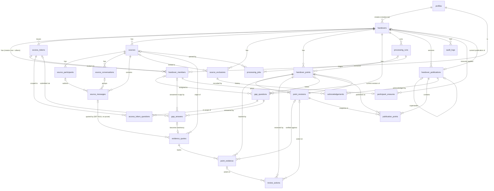
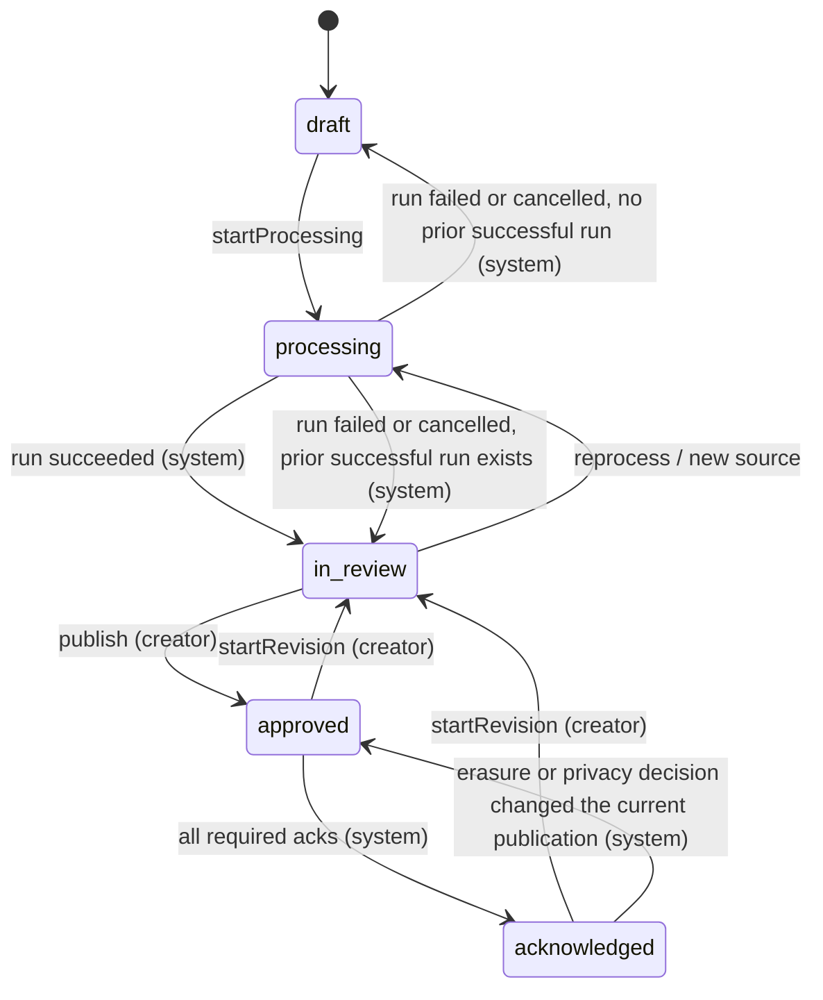
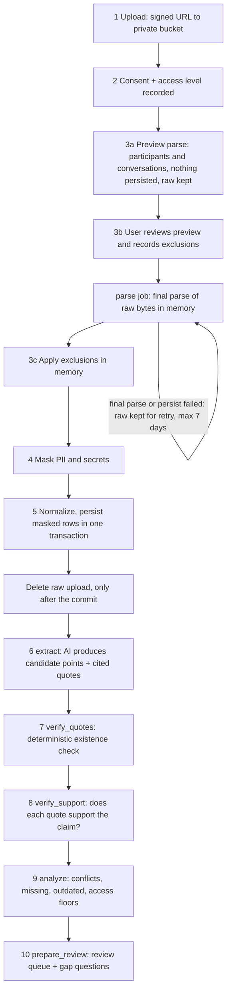

# Baton: Shared Contracts & Architecture

| | |
|---|---|
| **Status** | **REVISION 8 (contract reconciliation): APPROVED** on 2026-11-12. R8 ratifies D28–D35, accepts D24 and D25, and reconciles the contracts with the parser, Supabase and UI implementations (`docs/architecture/contract-reconciliation.md`). `lib/contracts/` implements the TypeScript layer. Feature implementations are not merged yet and must apply the changes listed in the reconciliation log. Sections changed in R8 are marked "R8". |
| **Phase** | 02B (contracts before parallel implementation) |
| **Base commit** | `89c83c6` (`master`) |
| **Owner** | Main integration workspace (`master`) |
| **Audience** | The `feature/workspace-ui`, `feature/supabase-auth` and `feature/upload-parser` agents |

Once this document is approved it is **canonical**. Implementation agents must not invent, rename or
reshape anything defined here. If something is missing or wrong, raise it with the main workspace
(§13.3) instead of working around it.

Markers such as **[PROPOSED, Dn]** point to decision `Dn` in §14. The **Status** column there is
authoritative: a marker on an accepted decision means "this is the accepted default", not "still open".

---

## Contents

1. [Product model](#1-product-model)
2. [Conventions used in this document](#2-conventions-used-in-this-document)
3. [Domain enums and types](#3-domain-enums-and-types)
4. [Evidence status semantics and transitions](#4-evidence-status-semantics-and-transitions)
5. [Review state and review actions](#5-review-state-and-review-actions)
6. [Database entities](#6-database-entities)
7. [Entity relationship diagram](#7-entity-relationship-diagram)
8. [Access control](#8-access-control)
9. [Handover lifecycle](#9-handover-lifecycle)
10. [Upload and processing pipeline](#10-upload-and-processing-pipeline)
11. [Module boundaries and API contracts](#11-module-boundaries-and-api-contracts)
12. [Security and privacy](#12-security-and-privacy)
13. [Agent coordination](#13-agent-coordination)
14. [Decisions](#14-decisions)
15. [Assumptions](#15-assumptions)

---

## 1. Product model

Baton turns a team's informal record (WhatsApp group exports, PDFs, DOCX and Markdown documents)
into a **structured, evidence-backed handover** when someone leaves a role in a student club,
project team or volunteer organisation.

A handover is a set of **points**. Each point is one piece of knowledge: a decision, an owner, an
open task and so on. Each point is backed by **evidence**, which is either:

- an exact quote from a source, or
- a statement made by a person (in the Gap Interview or during review).

The system must preserve:

| Knowledge | Represented as |
|---|---|
| Decisions and their reasoning | `decision` points (`attributes.rationale`) |
| Ownership and responsibilities | `owner` points |
| Open tasks and next actions | `open_task`, `next_action` points |
| Blockers | `blocker` points |
| Risks and dependencies | `risk`, `dependency` points |
| Recurring problems | `recurring_problem` points |
| Important contacts | `contact` points |
| Accounts and access information | `account_access` points **[PROPOSED: 10th category, see D4]** |

**Non-negotiables**

1. Every point can be traced to its evidence, and every piece of evidence to its origin: a source
   message or a person's statement.
2. Editing a point never erases its original evidence or earlier text.
3. Access restrictions are enforced in the database with RLS, not only in the UI.
4. Raw uploads are temporary. Only masked, permitted evidence and approved handover data are kept
   long-term.

---

## 2. Conventions used in this document

| Convention | Rule |
|---|---|
| IDs | `uuid` (`gen_random_uuid()`), exposed to TypeScript as `string` (branded types are optional) |
| Timestamps | `timestamptz`, exposed as ISO-8601 strings (`string`) in DTOs |
| Database baseline | **PostgreSQL 15 or later** (Supabase). Migrations may rely on: `UNIQUE NULLS NOT DISTINCT` (15), `ON DELETE SET NULL (column_list)` (15), `gen_random_uuid()` (core since 13) and stored generated columns (12). Every **partial** uniqueness rule in §6 (`… WHERE …`) is a `CREATE UNIQUE INDEX … WHERE …`, because table constraints cannot be partial. `supabase/config.toml` must pin `major_version` to 15 or later |
| Enum storage | `text` + `CHECK (col IN (...))`, generated from the TypeScript constant arrays in §3 **[PROPOSED, D20]** |
| Enum values | `snake_case` strings. Display labels live in `config/`, never in the database |
| Table names | plural `snake_case` |
| Handover scoping | Every handover-owned table carries `handover_id`, even when it could be derived, so RLS policies stay cheap and uniform |
| Same-handover integrity | References between handover-owned rows are **composite FKs** that include `handover_id` (or a narrower parent key), so a row can never point into another handover (§6.0). RLS is not relied on for referential integrity |
| Append-only tables | `point_revisions`, `review_actions`, `audit_logs`, `handover_publications`, `publication_points`, `acknowledgements`: no `UPDATE`/`DELETE` policy or grant for any client role, and a guard trigger that also blocks server-side changes. The **only** exceptions are four narrowly scoped server-side paths, each setting a transaction-local flag that the trigger checks: the participant-erasure function (§12.8), the privacy-review resolution function (§5.5), the account-name anonymisation function (§12.9) and the handover purge job (§12.6) |
| Soft delete | `deleted_at timestamptz NULL`, used only where stated in §6 |
| DTO casing | TypeScript DTOs use `camelCase`. The DB access layer maps between `snake_case` rows and DTOs. Raw database rows never reach UI code |

---

## 3. Domain enums and types

**Canonical file:** `lib/contracts/enums.ts` (owned by the main workspace).

Every enum is a `const` tuple plus a derived union type, plus a Zod schema in `lib/contracts/schemas.ts`.

```ts
// lib/contracts/enums.ts (PROPOSED canonical values)

export const POINT_CATEGORIES = [
  "decision",
  "owner",
  "open_task",
  "blocker",
  "risk",
  "dependency",
  "recurring_problem",
  "contact",
  "next_action",
  "account_access",          // [PROPOSED, D4]
] as const;
export type PointCategory = (typeof POINT_CATEGORIES)[number];

// Values match the existing types/status.ts. Do not rename.
export const EVIDENCE_STATUSES = ["sourced", "inferred", "conflicting", "missing"] as const;
export type EvidenceStatus = (typeof EVIDENCE_STATUSES)[number];

// Ordered from least to most restrictive. Array order IS the rank.
export const ACCESS_LEVELS = ["everyone", "leads_only", "reviewer_only"] as const;
export type AccessLevel = (typeof ACCESS_LEVELS)[number];

// Creator is an authority, not a membership role (see §8.2).
export const MEMBER_ROLES = ["outgoing", "incoming", "lead", "reviewer"] as const;
export type MemberRole = (typeof MEMBER_ROLES)[number];

export const HANDOVER_STATES = ["draft", "processing", "in_review", "approved", "acknowledged"] as const;
export type HandoverState = (typeof HANDOVER_STATES)[number];

export const REVIEW_STATES = ["pending", "approved", "rejected"] as const;
export type ReviewState = (typeof REVIEW_STATES)[number];

// Separate from review state and evidence status (§5.5). Set to "required" by participant erasure,
// or when a testimony the point uses is redacted or removed during another privacy review.
export const PRIVACY_REVIEW_STATES = ["none", "required", "cleared"] as const;
export type PrivacyReviewState = (typeof PRIVACY_REVIEW_STATES)[number];

export const PRIVACY_HOLD_REASONS = ["participant_erasure", "linked_evidence_changed"] as const;
export type PrivacyHoldReason = (typeof PRIVACY_HOLD_REASONS)[number];

// Decision on the point itself.
export const PRIVACY_REVIEW_DECISIONS = ["keep", "redact", "withdraw"] as const;
export type PrivacyReviewDecision = (typeof PRIVACY_REVIEW_DECISIONS)[number];

// Related text surfaces in a point's review set (§5.5). "point" (the current revision and point-level text)
// is decided with PRIVACY_REVIEW_DECISIONS; every other kind, including each earlier "revision", with
// PRIVACY_SURFACE_DECISIONS.
export const PRIVACY_SURFACE_KINDS = ["point", "revision", "review_note", "evidence_note", "gap_question", "gap_answer"] as const;
export type PrivacySurfaceKind = (typeof PRIVACY_SURFACE_KINDS)[number];

export const PRIVACY_SURFACE_DECISIONS = ["keep", "redact", "remove"] as const;
export type PrivacySurfaceDecision = (typeof PRIVACY_SURFACE_DECISIONS)[number];

export const REVIEW_ACTION_TYPES = [
  "approve",
  "reject",
  "reopen",
  "edit",
  "confirm_inferred",
  "resolve_conflict",
  "exclude_evidence",
  "restore_evidence",
  "change_access",
  "auto_reopen",             // system only: evidence changed after approval
  "privacy_hold",            // system only: participant erasure flagged the point (§5.5)
  "resolve_privacy_review",  // keep | redact | withdraw (§5.5)
] as const;
export type ReviewActionType = (typeof REVIEW_ACTION_TYPES)[number];

export const POINT_ORIGINS = ["extracted", "gap_answer", "manual"] as const;
export type PointOrigin = (typeof POINT_ORIGINS)[number];

export const EVIDENCE_KINDS = ["source_quote", "testimony"] as const;
export type EvidenceKind = (typeof EVIDENCE_KINDS)[number];

// Quote EXISTENCE: deterministic string check (§10.7)
export const QUOTE_CHECKS = ["pending", "exact", "normalized", "not_found"] as const;
export type QuoteCheck = (typeof QUOTE_CHECKS)[number];

// Quote SUPPORT: does the quote back the specific claim? (§10.8)
export const SUPPORT_VERDICTS = ["unchecked", "supports", "partial", "contradicts", "irrelevant"] as const;
export type SupportVerdict = (typeof SUPPORT_VERDICTS)[number];

export const SOURCE_KINDS = ["whatsapp_export", "pdf", "docx", "markdown", "text"] as const;
export type SourceKind = (typeof SOURCE_KINDS)[number];

export const SOURCE_STATES = ["pending_upload", "uploaded", "parsing", "parsed", "failed", "removed"] as const;
export type SourceState = (typeof SOURCE_STATES)[number];

export const MESSAGE_KINDS = ["text", "system", "media_omitted", "deleted", "document_block"] as const;
export type MessageKind = (typeof MESSAGE_KINDS)[number];

export const EXCLUSION_KINDS = ["participant", "conversation", "date_range"] as const;
export type ExclusionKind = (typeof EXCLUSION_KINDS)[number];

// Reconciliation (R8). Where an exclusion applies; conversation exclusions are always "source".
export const EXCLUSION_SCOPES = ["source", "handover"] as const;
export const EXCLUSION_REQUESTED_VIA = ["uploader", "participant_request"] as const;

// Participant identity namespaces (§12.11). "phone" is strong, "name" is weak; they never match.
export const IDENTITY_KINDS = ["phone", "name"] as const;
// How the parser uses a participant rule: "apply" drops, "detect" only reports a match (§6.8.1).
export const EXCLUSION_RULE_MODES = ["apply", "detect"] as const;
export const IDENTITY_MATCH_DECISIONS = ["same_person", "different_person"] as const;

// Derived for token listings only (§11.6); never stored.
export const ACCESS_TOKEN_STATUSES = ["active", "revoked", "expired", "exhausted"] as const;

export const MASK_KINDS = [
  "phone", "email", "upi", "bank_account", "ifsc", "card",
  "government_id", "password", "api_key", "secret",
] as const;
export type MaskKind = (typeof MASK_KINDS)[number];

export const GAP_QUESTION_STATUSES = ["open", "answered", "waived"] as const;
export type GapQuestionStatus = (typeof GAP_QUESTION_STATUSES)[number];

export const GAP_PRIORITIES = ["required", "optional"] as const;
export type GapPriority = (typeof GAP_PRIORITIES)[number];

export const GAP_ANSWER_STATUSES = ["submitted", "accepted", "rejected"] as const;
export type GapAnswerStatus = (typeof GAP_ANSWER_STATUSES)[number];

export const TOKEN_PURPOSES = ["member_invite", "gap_interview"] as const;
export type TokenPurpose = (typeof TOKEN_PURPOSES)[number];

export const RUN_STATUSES = ["queued", "running", "succeeded", "failed", "cancelled"] as const;
export type RunStatus = (typeof RUN_STATUSES)[number];   // used by processing_runs and processing_jobs

export const PIPELINE_STAGES = [
  "parse", "extract", "verify_quotes", "verify_support", "analyze", "prepare_review",
] as const;
export type PipelineStage = (typeof PIPELINE_STAGES)[number];
```

### 3.1 Category attributes

Each point has a common `title` and `statement`, plus category-specific `attributes` (`jsonb`). The
attributes are validated by a discriminated Zod union in `lib/contracts/schemas.ts`.

**Free-text person references** (`*Label` fields) hold the masked display label of a participant,
for example `"Asha (Treasurer)"`. They are not foreign keys, because the people involved often
have no Baton account.

| Category | `attributes` (all optional unless marked) |
|---|---|
| `decision` | `decidedAt: string \| null`, `decidedByLabel: string \| null`, `rationale: string \| null`, `alternativesConsidered: string[]` |
| `owner` | **`responsibility: string`**, `ownerLabel: string \| null`, `since: string \| null` |
| `open_task` | `assigneeLabel: string \| null`, `dueDate: string \| null` (ISO date), `progressNote: string \| null` |
| `blocker` | `blockingWhat: string \| null`, `unblockCondition: string \| null` |
| `risk` | `likelihood: "low" \| "medium" \| "high" \| null`, `impact: "low" \| "medium" \| "high" \| null`, `mitigation: string \| null` |
| `dependency` | `dependsOnLabel: string \| null` (external party or system), `dependencyType: "person" \| "organisation" \| "system" \| "event" \| null` |
| `recurring_problem` | `frequency: string \| null`, `knownWorkaround: string \| null`, `firstSeenAt: string \| null` |
| `contact` | **`nameLabel: string`**, `organisation: string \| null`, `roleDescription: string \| null`, `preferredChannel: "whatsapp" \| "email" \| "phone" \| "in_person" \| "other" \| null`, `directContact: { channel: "phone" \| "email"; value: string } \| null` (**typed in by a review role only; never extracted**, see the note below and D5) |
| `next_action` | `actorLabel: string \| null`, `byWhen: string \| null` |
| `account_access` | **`system: string`**, `holderLabel: string \| null`, `accessLocation: string \| null` (where credentials live, e.g. "club password manager"), `recoveryNote: string \| null` |

> `account_access` points **never** store credential values. If a password, OTP, API key or similar
> appears in a source it is masked by the parser (§12.1), and any edit containing one is masked
> again on the server.
>
> **Contact details (D5).** Phone numbers and email addresses found in sources are **always masked**
> (§12.1) and are never unmasked. The only way a real contact detail enters Baton is a review role
> (creator, outgoing or reviewer) typing it into `directContact` through `reviewPoint` (`edit`) or
> `createManualPoint`. When that happens:
>
> 1. The server validates `directContact.value` as exactly one phone number or email address. This
>    one field is exempt from masking; every other field is still masked.
> 2. The point's `access_override` is raised to at least `leads_only`. Any attempt to lower the
>    point below `leads_only` while `directContact` is set fails with `invalid_transition`. A trigger
>    on `point_revisions` enforces this in the database too.
> 3. The edit creates a new revision, so the point returns to `pending` (§5.3) and cannot be
>    published until a review role approves that revision.
>
> Extraction output that contains `directContact` fails Zod validation and is discarded.

### 3.2 Shared result and error shapes

**Canonical file:** `lib/contracts/api.ts`.

```ts
export const ERROR_CODES = [
  "validation_failed",
  "unauthenticated",
  "forbidden",            // the caller may know the resource exists but cannot act on it
  "not_found",            // ALSO returned for resources hidden by access level (§8.5)
  "conflict",             // optimistic concurrency / uniqueness
  "invalid_transition",   // lifecycle or review-state rule violated
  "precondition_failed",  // e.g. publish while readiness has blockers
  "rate_limited",
  "payload_too_large",
  "unsupported_file_type",
  "token_invalid",        // expired, revoked, exhausted or unknown. Never say which.
  "parse_failed",
  "processing_failed",
  "internal",
] as const;
export type ErrorCode = (typeof ERROR_CODES)[number];

export interface AppError {
  code: ErrorCode;
  message: string;                                   // safe for users; no stack traces or SQL
  fieldErrors?: Record<string, string[]>;            // only for validation_failed
  retryable: boolean;
  details?: Record<string, string | number | boolean>; // non-sensitive context only
}

export type Result<T> = { ok: true; data: T } | { ok: false; error: AppError };
```

**Rules**

- Every server action and every route handler returns `Result<T>`, or the same shape as a JSON
  body. They never throw across the client boundary.
- Route handlers set the HTTP status from the code: 400 `validation_failed`, 401, 403, 404, 409
  `conflict`/`invalid_transition`, 412 `precondition_failed`, 413, 415, 429, 500.
- Internal errors are logged on the server with a correlation ID. Only `{ code: "internal", message,
  retryable }` and the correlation ID (in `details.requestId`) reach the client.

**Database error categories (R8).** The DB layer (`lib/db`) throws `DbError` with a
`DbErrorCode`, which is a subset of `ErrorCode` and is passed through to `AppError.code`
**unchanged**. There is no coarser mapping: `precondition_failed`, `forbidden`, `token_invalid` and
`validation_failed` must survive to the action, because §5.5, §11.3 and §12.4 depend on them.

```ts
export const DB_ERROR_CODES = [
  "validation_failed", "unauthenticated", "forbidden", "not_found", "conflict",
  "invalid_transition", "precondition_failed", "rate_limited", "token_invalid", "internal",
] as const satisfies readonly ErrorCode[];
export interface DbErrorShape { code: DbErrorCode; retryable: boolean }
```

Baton's SQL functions raise these custom SQLSTATEs (`DB_SQLSTATE_ERROR_CODES` in `api.ts`):

| SQLSTATE | Code | | SQLSTATE | Code |
|---|---|---|---|---|
| `BTVF0` | `validation_failed` | | `BTCF0` | `conflict` |
| `BTUA0` | `unauthenticated` | | `BTIT0` | `invalid_transition` |
| `BTFB0` | `forbidden` | | `BTPF0` | `precondition_failed` |
| `BTNF0` | `not_found` | | `BTTI0` | `token_invalid` |

Standard SQLSTATEs: `23505` → `conflict`; `40001`, `40P01`, `55P03` → `conflict` with
`retryable: true` (§5.5 concurrency); `22P02`, `23502`, `23514`, `22023` → `validation_failed`;
`23503` → `not_found`; `42501` → `forbidden`; anything else → `internal`. `rate_limited` is raised by
the TypeScript rate-limit helper, not by SQL (§12.4). A hidden resource is still `not_found`, never
`forbidden` (§8.5).

---

## 4. Evidence status semantics and transitions

### 4.1 Semantics

| Status | Meaning | Required follow-up |
|---|---|---|
| `sourced` | At least one verified exact quote (or accepted testimony) **supports** the claim, and nothing verified contradicts it. | Reviewer approval |
| `inferred` | A reasonable interpretation exists, but no exact quote verifiably supports it (partial support, model inference, or support not yet verified). | **Must be explicitly confirmed** (`confirm_inferred`) before it can be approved |
| `conflicting` | Verified evidence disagrees: at least one verified quote contradicts the claim. Both sides are kept and shown **newest first**. The system never picks a winner. | A human `resolve_conflict` note before approval |
| `missing` | Not enough evidence. | Becomes a Gap Interview candidate (§10.10) |

**Potentially outdated** is a **flag**, not a status: `handover_points.is_potentially_outdated`
(rule in §4.4).

### 4.2 Status is derived, never set

`evidence_status` is **computed** from the point's evidence. No API, server action or review
action can set it directly. This prevents transitions that bypass review.

It is recomputed by a single database function, `recompute_point_status(point_id)`, owned by the
Supabase agent. That function runs:

- after any insert or update on `point_evidence`,
- after a `quote_check` update on `evidence_quotes`, and
- after an insert on `point_revisions`.

A TypeScript reference implementation (`lib/contracts/status.ts`, owned by main) mirrors it for
mocks, fixtures and tests. Both implementations must pass the test vectors in §4.5.

**Algorithm** for point `P` with current revision `R`:

```
active(l)   := l.excluded_at IS NULL
verified(l) := l.evidence.quote_check IN ('exact','normalized')
               AND l.verified_revision_id = R            -- verdict is for the CURRENT text
S := { l | active(l) AND verified(l) AND l.support_verdict = 'supports' }
C := { l | active(l) AND verified(l) AND l.support_verdict = 'contradicts' }
I := { l | active(l) AND l.evidence.quote_check <> 'not_found'
           AND l.support_verdict <> 'irrelevant'
           AND (l.support_verdict IN ('partial','unchecked')
                OR l.verified_revision_id IS DISTINCT FROM R) }   -- stale verdict

if C ≠ ∅                                  → 'conflicting'
elif S ≠ ∅                                → 'sourced'
elif I ≠ ∅ OR P.inference_rationale ≠ ∅   → 'inferred'
else                                      → 'missing'
```

Links with verdict `irrelevant` and quotes with check `not_found` are kept for audit and shown to
reviewers as "rejected by verification". They never count towards any status.

### 4.3 Allowed status changes (all of them are side effects of evidence events)

| From → To | Caused by |
|---|---|
| `missing` → `sourced` | Gap answer accepted **and** its support check returns `supports` |
| `missing` → `inferred` | Partial testimony, or a new source that partially supports |
| `inferred` → `sourced` | New verified supporting evidence (new source, gap answer) |
| `sourced` → `conflicting` | New verified contradicting evidence (new source, gap answer) |
| `conflicting` → `sourced` | A reviewer **excludes** the contradicting evidence (`exclude_evidence`, with a mandatory reason, audited) |
| any → `inferred` | A text edit makes earlier support verdicts stale, until support is re-verified (§5.3) |
| `sourced`/`inferred` → `missing` | Every remaining evidence link is excluded |

**Rules**

- If the status of an **approved** point changes, its review state goes back to `pending`. This is
  recorded as a system `review_actions` row of type `auto_reopen`.
- Excluding evidence never deletes it. The link keeps `excluded_at`, `excluded_by` and
  `exclusion_reason`.

### 4.4 Potentially outdated

```
as_of := handovers.evidence_as_of        -- [PROPOSED, D6]: the latest sent_at across the
                                         -- handover's included messages (end of the record)
last_supported_at := max over S of (evidence.message_sent_at, or testimony answered_at)
is_potentially_outdated := evidence_status = 'sourced'
                           AND last_supported_at < as_of - interval '30 days'
```

A later mention means a later supporting link, which moves `last_supported_at` forward. Document
evidence has no `sent_at`, so it uses `sources.document_date` if the uploader supplied one.
Otherwise it is never flagged.

### 4.5 Test vectors (both implementations must agree)

| # | Links (verdict / check / current revision?) | `inference_rationale` | Expected |
|---|---|---|---|
| 1 | supports / exact / yes | none | `sourced` |
| 2 | supports / exact / **no** (edited since) | none | `inferred` |
| 3 | partial / exact / yes | none | `inferred` |
| 4 | none | "implied by meeting cadence" | `inferred` |
| 5 | supports / exact / yes; contradicts / normalized / yes | none | `conflicting` |
| 6 | contradicts / exact / yes | none | `conflicting` |
| 7 | supports / not_found / yes | none | `missing` |
| 8 | irrelevant / exact / yes | none | `missing` |
| 9 | as #5 but the contradicting link is excluded | none | `sourced` |
| 10 | none | none | `missing` |

---

## 5. Review state and review actions

### 5.1 Review states

`pending` → `approved` | `rejected`. Either outcome → `pending` via `reopen`, or via `auto_reopen`
(system).

### 5.2 Approval preconditions by evidence status

| Status | Can approve? | Required in the same action |
|---|---|---|
| `sourced` | Yes | Nothing |
| `inferred` | Yes | `confirmInferred: true`. Records `inferred_confirmed_by/at`. The point **stays `inferred`** and is shown as "Inferred · confirmed by X" |
| `conflicting` | Yes | `resolutionNote` (non-empty). Both sides stay visible, newest first |
| `missing` | Only as a **known gap** (`asKnownGap: true`) **[PROPOSED, D7]** | The point is published in an "Open questions" section and is never presented as fact |

`reject` is always allowed and needs a `reason`. Rejected points are never published.

### 5.3 Edits

- An edit inserts a new `point_revisions` row (`revision_number + 1`) and moves
  `handover_points.current_revision_id`. Older revisions and **all evidence are untouched**.
- Edited text goes through server-side masking (§12.1) before it is stored.
- Support verdicts were made against the previous text, so they become stale
  (`verified_revision_id ≠ current`). Status therefore falls to `inferred` until the main
  workspace's async `verify_support` re-check runs for the new revision **[PROPOSED, D16]**.
- An edit on an `approved` point moves it back to `pending`.

### 5.4 Who can perform review actions

See §8.3. Every review action:

1. inserts a `review_actions` row (append-only), and
2. inserts an `audit_logs` row, in the same transaction.

### 5.5 Privacy review after participant erasure

A participant erasure (§12.8) can leave a point **partly affected (P)**: some of its evidence was
erased, and other people's evidence remains. Remaining support does **not** mean the point is clear
of the erased person's details. Its text, and the text recorded around it, may still carry them.
Each such point therefore enters a mandatory privacy review. Nothing is erased automatically just
because one participant's evidence was removed.

**State.** `handover_points.privacy_review` (`PrivacyReviewState`) is independent of
`evidence_status` and `review_state`:

```
none ──(erasure flags the point, or its linked testimony changes)──▶ required ──(resolve_privacy_review)──▶ cleared
                                                                       ▲                                        │
                                                                       └───────── flagged again later ─────────┘
```

A point enters `required` for one of two reasons. The reason is recorded in the `privacy_hold`
action's metadata.

- `participant_erasure`: set by `erase_participant` (§12.8, steps 3 and 4).
- `linked_evidence_changed`: set by `resolve_privacy_review` when a testimony the point uses is
  redacted or removed (see **Testimony and shared evidence** below).

When a point enters `required`, these happen in the same transaction:

- `privacy_review_flagged_at` is set.
- `review_state` becomes `pending`, with a system `review_actions` row of type `privacy_hold` and
  structural metadata only (`{ reason }`). This applies even if the evidence status did not change.
- The point's existing publication rows get `privacy_hold = true`, which hides them from readers
  (§6.18, §8.4).

**Review set.** A point's privacy review covers exactly the **surfaces** in the table below. One
SQL function, `privacy_review_surfaces(point_id)`, computes the list. Both the read path (`getPoint`)
and the resolution path use it, so the two cannot drift apart.

| Surface kind | Records | Fields inspected |
|---|---|---|
| `point` | The point itself (surface id = point id) | **Current** revision: `title`, `statement`, `attributes`, `edit_reason`; plus `inference_rationale` and `conflict_resolution_note` |
| `revision` | Every **earlier** (non-current) `point_revisions` row of the point, including revision 1 from extraction, unless it is already tombstoned (surface id = revision id) | `title`, `statement`, `attributes`, `edit_reason` |
| `review_note` | Every `review_actions` row of the point with `note IS NOT NULL` | `note` |
| `evidence_note` | Every remaining `point_evidence` link of the point with `exclusion_reason` or `verdict_rationale` set (the AI rationale may paraphrase context messages that were erased) | `exclusion_reason`, `verdict_rationale` |
| `gap_question` | Every `gap_questions` row with `point_id` = the point | `question`, `context`, `waived_reason` |
| `gap_answer` | Every `gap_answers` row of those questions, **plus** every gap answer whose testimony is linked to the point through `point_evidence` | `answer_text`, `review_note`, and the testimony copy, which always equals `answer_text` (§6.10) |

- Being in the set does **not** mean a surface contains erased information. It means it **may**, so
  a human must inspect it.
- `review_actions.metadata`, `point_evidence` verdict values and `audit_logs` are not surfaces,
  because by contract they hold structural values only (§6.14, §12.7).
- Gap questions without a `point_id` belong to no point's review set (§12.8, limitations).
- Every revision of the point is covered exactly once. The current one is covered by `point`, and
  each earlier one by its own `revision` surface. A tombstoned revision (`redaction_kind =
  'tombstone'`, §6.12) holds no original text and is left out. A revision replaced by an earlier
  review (`redaction_kind = 'replacement'`) stays in, because a later erasure may need its
  replacement text reviewed again.
- The digest covers every field of every surface listed here, including each earlier revision's
  `title`, `statement`, `attributes` and `edit_reason`.

**Holds while `required`.** These are enforced in the database and the token-redemption path, not by
hiding UI elements:

- **The point is frozen.** Every human review action on it except `resolve_privacy_review` and
  `change_access` (which can only raise access) fails with `precondition_failed`. That includes
  `approve`, `reject`, `edit`, `confirm_inferred`, `resolve_conflict` and evidence exclusion. This
  keeps the review set stable while it is being reviewed.
- **Publishing is blocked.** Readiness reports `privacy_review_required` (§11.6), and
  `publish_handover` independently refuses to snapshot a point with `privacy_review = 'required'`.
- **Publication rows stay held** (`privacy_hold = true`).
- **Gap questions and answers in the review set are privacy-held.** Two `STABLE SECURITY DEFINER`
  helpers decide this: `gap_question_privacy_held(id)` and `gap_answer_privacy_held(id)`. Each is
  true while the record is in the review set of at least one point with
  `privacy_review = 'required'`. Then:
  - Lead and incoming members, **including the assigned member**, cannot `SELECT` a held question or
    a held answer (RLS, §8.4).
  - A `BEFORE INSERT` trigger on `gap_answers` rejects any answer to a held question. Triggers run
    for every role, including the service role, so this covers both the in-app path and the Gap
    Interview token path.
  - `getGapInterview` returns only questions that are `open` and not held. A token submission for a
    held question fails with the **same** per-question `not_found` as an unknown question id.
  - `createGapQuestion` for the point, and `reviewGapAnswer` on a held answer, fail with
    `precondition_failed`.
- **Review roles keep full access.** `getPoint` returns the point, every surface with its current
  text, including the **full text of every earlier revision**, the remaining evidence with its full verification history, the review history, and the
  other points that share each answer's testimony.
- **No hints.** Held items simply disappear from other members' lists, with no placeholder. Counts
  are computed under RLS, and no notification mentions them (§8.5).

**Resolution.** A review role (creator, outgoing or reviewer) resolves the whole review in **one
atomic call**: `reviewPoint({ action: "resolve_privacy_review", decision, redacted?, surfaces,
surfacesDigest })` (§11.5).

- The request must contain **exactly one decision for every surface** in the current review set.
- `surfacesDigest` is the hash over the surface ids and their current text that `getPoint` returned.
  If it no longer matches, the call fails with `conflict`. Nobody can approve text they did not
  see, for example after another review changed a shared answer.

Decisions on the point itself:

| Decision | Live point | Publication snapshots | Evidence |
|---|---|---|---|
| `keep` | `privacy_review = 'cleared'`. Text unchanged. The point stays `pending` and must be approved normally | `privacy_hold = false` on its rows, which become visible again unchanged | Unchanged |
| `redact` | The server masks the reviewer's replacement text (§12.1). The function inserts it as a **new revision** (`edit_reason = 'privacy_redaction'`) and also replaces `inference_rationale` and `conflict_resolution_note` if the reviewer supplied replacements, or clears them. The **replaced** revision (the one that was current) has its text and `edit_reason` tombstoned (`redaction_kind = 'tombstone'`, §6.12). Earlier revisions are decided **only** through their own `revision` surfaces. `privacy_review = 'cleared'`, and the point stays `pending` | In rows that snapshot the replaced revision (`publication_points.revision_id`), `title`, `statement`, `attributes` and `conflictResolution.note` are replaced with the redacted text, and `content.textRedacted = true`. Rows that snapshot earlier revisions follow those revisions' own decisions. `privacy_hold = false`. `summary = NULL` on those publications | Links and verdicts are kept. Verdicts become stale against the new revision and are re-verified (§5.3, D16) |
| `withdraw` | `review_state = 'rejected'`, `erased_at` set, all revisions tombstoned (`redaction_kind = 'tombstone'`), exactly as for X in §12.8 step 3. `privacy_review = 'cleared'`. Every `revision` surface **must** be submitted as `remove`. Any other combination fails with `validation_failed`, so the two levels can never disagree | Rows get the tombstone and `redacted_at`, and stay hidden. `summary = NULL` on those publications | `evidence_quotes` and links are kept, because the quotes may back other points. They become invisible with the point |

Decisions on the other surfaces (`PrivacySurfaceDecision`). A replacement is required exactly when
the decision is `redact`.

| Surface | `keep` | `redact` | `remove` |
|---|---|---|---|
| `revision` | Unchanged | `title`, `statement`, `attributes` and `edit_reason` are replaced **in place** with the masked replacement. `attributes` is re-validated for the category. Sets `redacted_at` and `redaction_kind = 'replacement'`. Publication rows that snapshot this revision get the same replacement and `content.textRedacted = true` | Tombstoned: `'[removed]'`, `'[removed]'`, `'{}'`, `NULL`. Sets `redacted_at` and `redaction_kind = 'tombstone'`. Publication rows that snapshot this revision get the tombstone and `redacted_at`, and stay hidden |
| `review_note` | Unchanged | `note` becomes the masked replacement | `note` becomes `NULL`. The action row and its structural fields stay |
| `evidence_note` | Unchanged | `exclusion_reason` becomes the masked replacement. `verdict_rationale` becomes `NULL`, because AI text is not hand-edited. The verdict value is kept | Both become `NULL`. The verdict value is kept |
| `gap_question` | Unchanged | `question`, `context` and `waived_reason` become the masked replacements | Waived: `status = 'waived'`, `question = '[removed]'`, `context = NULL`, `waived_reason = 'privacy_review'`. Its answers are still decided one by one, as their own surfaces |
| `gap_answer` | Unchanged | `answer_text` (and `review_note`, if supplied) become the masked replacement. The testimony is updated (below) | `answer_text = '[removed]'`, `review_note = NULL`, `status = 'rejected'`. The testimony is deleted (below) |

**One decision per stored text.** Each revision row is decided by exactly one surface (`point` for
the current one, its own `revision` surface for the others). Each `publication_points` row snapshots
exactly one revision through `revision_id`, so it follows exactly that revision's decision.

After `redact` or `remove`, no original text remains in any of these places:

- `point_revisions`, because the text is overwritten in place;
- `PointDetail.revisions`, which reads the stored row;
- review history, which carries no revision text;
- audit, which is structural only;
- any publication.

**Masking is not enough.** Replacement text goes through server-side masking (§12.1), but masking
only finds phone numbers, emails, financial and government identifiers and secrets. It **does not
detect names or other identifying details**, so masked replacement text is no proof that such
details are gone. The reviewer's judgement is the control. The UI says so next to every redaction
field, and `keep` is recorded as the reviewer's explicit statement that the surface contains no
erased or identifying content.

**Testimony and shared evidence.** One testimony row (`evidence_quotes`, `kind = 'testimony'`) can
support several points. When a `gap_answer` surface with a testimony is redacted or removed:

1. **No stale copy in the live data.**
   - `redact`: the testimony's `quote_text` is set to the new `answer_text`. A trigger enforces that
     a testimony's text always equals its answer's text.
   - `remove`: the testimony row is hard-deleted, and its `point_evidence` links cascade.
2. **No stale copy in snapshots.** In **every** publication, each evidence item with that
   `evidenceId` becomes `{ evidenceId, redacted: true }`, and that row's `evidenceRedacted` is set to
   `true`. This applies to both `redact` and `remove`, because a snapshot quote is never rewritten
   with new text.
3. **Verification is re-run.** After a `redact`, every remaining link of the testimony, on any
   point, gets `support_verdict = 'unchecked'`, `verified_revision_id = NULL` and
   `verdict_rationale = NULL`. `verifier_provenance` and `verified_at` are kept as history.
   `verify_support` is then queued (D16). Status is recomputed for every affected point
   (`recompute_point_status`), with `auto_reopen` where an approved point's status changes.
4. **Other points are never changed silently.** Each **other** point linked to the testimony enters
   privacy review (`required`, reason `linked_evidence_changed`). Its rows are held, and a human
   reviews it with its own review set, which includes the changed answer. Its text is not edited by
   this resolution.

**Publication and acknowledgements.** If a resolution changes published substance (point text
replaced, a row tombstoned, or an evidence item redacted), every changed publication gets
`summary = NULL`. If the **current** publication changed, its acknowledgements are invalidated
(`invalidation_reason = 'privacy_review'`) and the handover moves `acknowledged → approved` (§9.1).
Members then acknowledge again, exactly as in §12.8 step 6. Releasing a hold after `keep` changes no
substance and invalidates nothing.

**Concurrency and atomicity.** These guarantees are enforced inside the database. They never rely on
UI state, client-side locking or optimistic UI.

1. **One handover lock serialises every privacy mutation.**
   - `resolve_privacy_review` and `erase_participant` both start by taking
     `SELECT … FROM handovers WHERE id = H FOR UPDATE`.
   - All points, answers and testimony that can share a review set belong to the same handover,
     which the composite FKs in §6.0 guarantee. Two resolutions with overlapping surfaces therefore
     never run at the same time: the second waits for the first to commit or roll back.
2. **Every other writer takes a handover lock first, in the mode it needs for the whole
   transaction.** A transaction **never** takes `FOR SHARE` and later upgrades, because two
   transactions doing that deadlock each other.
   - **Child-row-only writers** take `SELECT … FROM handovers WHERE id = H FOR SHARE` before
     writing:
     - gap answer insert (in-app and token);
     - `reviewGapAnswer`;
     - `createGapQuestion`;
     - review actions with notes;
     - point edits;
     - evidence exclusion and restore;
     - pipeline workers that write points, links, verdicts or gap questions (`verify_support`,
       `analyze`, `prepare_review`).

     None of these updates the `handovers` row.
   - **Writers that update the `handovers` row, or may do so,** take
     `SELECT … FROM handovers WHERE id = H FOR UPDATE` as their **first** statement:
     - `publish_handover` (sets `current_publication_id` and `state`);
     - `acknowledgePublication` (every call, because any acknowledgement may be the final one that
       moves `approved → acknowledged`);
     - `transition_handover` and every action or worker transaction that may call it (start,
       cancel or finish processing, `startRevision`, soft delete);
     - `transfer_creator`;
     - the creator-transfer offer and response actions.

     A worker that writes child rows and then finishes a run does the transition in its own
     transaction, which begins with `FOR UPDATE`.
   - `FOR SHARE` and `FOR UPDATE` both conflict with the privacy functions' `FOR UPDATE`. So no
     writer runs while a privacy function holds the handover, and a privacy function waits until
     they finish. No new surface, verdict, publication or acknowledgement can appear between
     revalidation and commit.
   - Parent-row writers serialise with each other. Two concurrent acknowledgements run one after
     the other, and the second sees the first, so the final state transition is computed exactly
     once.
   - `publish_handover` recomputes readiness (§11.6) **under its lock**, so it can never snapshot a
     point that became `required` just before.
3. **Deterministic lock order.** After the handover row, a privacy function locks rows with
   `FOR UPDATE` in this fixed table order, and by ascending `id` within each table:
   1. `handover_points`: the point being resolved, plus every dependent point it may flag;
   2. `point_revisions`;
   3. `point_evidence`;
   4. `review_actions`;
   5. `gap_questions`;
   6. `gap_answers`;
   7. `evidence_quotes` (testimony);
   8. `handover_publications`;
   9. `publication_points`;
   10. `acknowledgements`.

   Every other writer that touches more than one of these tables uses the same order. Since the
   handover lock is always taken first, deadlocks between privacy functions are impossible. The
   order is defence in depth against other writers.
4. **Revalidate after locking.** With every lock held, the function:
   - recomputes `privacy_review_surfaces(point_id)` and the digest from the **locked** rows;
   - checks that the point is still `required` and that `current_revision_id = expectedRevisionId`;
   - checks that the decisions cover the recomputed set exactly, with nothing missing and nothing
     extra.

   Any mismatch raises `conflict` before **any** write. The caller reloads `getPoint`, which returns
   the new set and digest.
5. **Atomic effects.** Everything happens in **one transaction**, or nothing does:
   - surface changes, testimony updates and deletes, and verdict resets;
   - flagging dependent points and holding their publication rows;
   - snapshot rewrites and `summary = NULL`;
   - acknowledgement invalidation and the `acknowledged → approved` transition;
   - `review_actions` and `audit_logs` rows;
   - the follow-up work (`verify_support` jobs, member notices), inserted as `processing_jobs` and
     outbox rows **in the same transaction** and processed only after commit.

   Any error at any step rolls back the whole resolution. No partial state can be observed, and no
   job or notice exists for a resolution that did not commit.
6. **Overlapping resolutions.** Points A and B share a gap answer, and both are `required`. Two
   reviewers resolve them at the same time:
   - A's call takes the handover lock first. B's call waits.
   - A commits. A `redact` or `remove` of the shared answer changes its text or testimony and flags
     B again with `linked_evidence_changed`. A `keep` changes nothing.
   - B's call then acquires the lock and revalidates:
     - If A changed the shared answer, B's digest is **stale**. B fails with `conflict`, writes
       nothing, and B's reviewer sees the answer's new state, such as the replacement text or
       `[removed]`, before deciding again.
     - If A kept it, B's digest still matches and B proceeds.
   - **Already removed or redacted by a competing transaction:** the answer stays in B's set, with
     its current text (`[removed]` or the replacement). Its testimony is already deleted or updated,
     so B can never act on the old text. Removing an already-removed answer, or redacting an
     already-redacted one, is just an ordinary decision on its current state.
7. **Lock waits are bounded.** Privacy functions set `lock_timeout` (proposed 5 s). A timeout, a
   serialization failure (`40001`) or a deadlock (`40P01`) rolls back and is retried by the server
   action up to twice with jitter. After that it returns `conflict` with `retryable: true`.

**Database tests** (Supabase agent; each needs two or more real concurrent sessions, not mocks):

| # | Scenario | Must hold |
|---|---|---|
| T1 | A and B share an answer. Both redact it concurrently | Exactly one commits. The other gets `conflict` and changes nothing. Testimony text equals the answer text. Each snapshot item is redacted once. B ends `required` with a new digest |
| T2 | A redacts the shared answer while B keeps it concurrently | Whichever commits second gets `conflict` if the first changed the answer. The final answer, testimony and snapshot state matches exactly one committed decision |
| T3 | A removes the shared answer, then B (stale digest) submits `redact` | `conflict`. The testimony stays deleted. No text is resurrected |
| T4 | Stale `surfacesDigest` with no concurrency (the text changed since `getPoint`) | `conflict`. No row changes, no audit row, no job |
| T5 | A gap answer insert (session and token) races a resolution | Either the insert commits first, so the set changes and the resolution gets `conflict`, or it waits and is rejected afterwards, because the question is still held or now removed. Never a silent extra surface |
| T6 | `verify_support` writes a verdict while a resolution resets that testimony's verdicts | The worker waits. The committed state never holds a verdict for removed or replaced testimony text |
| T7 | Failure injected after half the steps (e.g. raise before the acknowledgement step) | Full rollback. Surfaces, testimony, flags, snapshots, acknowledgements, audit and jobs are all unchanged |
| T8 | `erase_participant` and `resolve_privacy_review` on the same handover concurrently | They serialise. No deadlock. The final state equals running them in commit order |
| T9 | Opposite-order resolutions (A then B in one session, B then A in another) | No deadlock. Both complete or one gets `conflict` |
| T10 | `acknowledgePublication` races a resolution that changes the current publication | The acknowledgement either commits before and is invalidated, or after and refers to the changed publication. Never a valid acknowledgement of superseded content |
| T11 | Redact and remove of earlier revisions | The original text is absent from `point_revisions`, `PointDetail.revisions`, every publication row snapshotting that revision, and every audit or review-action row |
| T12 | Two different required incoming members submit their **final** acknowledgements concurrently | Both acknowledgements commit and are valid. The handover ends `acknowledged`, with exactly one transition and one audit entry for it. No deadlock and no lost acknowledgement |
| T13 | `publish_handover` races `erase_participant` | They serialise, and there is no deadlock. Erasure first: publish recomputes readiness under its lock and refuses while any point is `required`. Publish first: the erasure then redacts the new publication and invalidates nothing beyond it. No committed publication ever contains erased evidence |
| T14 | `publish_handover` races `resolve_privacy_review` | They serialise, and there is no deadlock. Publish never snapshots a point that is `required` at its commit. If the resolution commits first, publish uses the resolved state |
| T15 | `acknowledgePublication` races a privacy function that changes the current publication | The acknowledgement is either before the change (then invalidated, and the state returns to `approved`) or after it (acknowledging the changed publication). Never a valid acknowledgement of superseded content, and never an `acknowledged` state that rests on one |
| T16 | Mixed load: child-row writers (`FOR SHARE`), parent-row writers (`FOR UPDATE`) and privacy functions on one handover, repeated many times | Zero deadlocks (`40P01`). Every parent-row writer's first lock on `handovers` is `FOR UPDATE`, which the test asserts from the lock log |

**Function.** `resolve_privacy_review(p_point_id, p_decisions jsonb, p_surfaces_digest text,
p_actor_profile_id)` is `SECURITY DEFINER`:

- **Who can call it.** It runs only under `service_role`. It checks that the actor holds a review
  role, that the point is `required`, that the digest matches, and that every surface has exactly
  one decision.
- **One transaction.** It sets the transaction-local flag that the append-only guard triggers accept
  (§2).
- **Columns it may change:**
  - the fields listed above, on records in this point's review set;
  - the testimony rows of answers in the set, and those testimonies' links (verdict fields only, or
    cascade delete on `remove`);
  - `privacy_review`, `privacy_review_flagged_at` and `review_state` of other points linked to those
    testimonies, plus their `privacy_hold` actions;
  - `content`, `privacy_hold` and `redacted_at` of the affected `publication_points`;
  - `summary` and `redacted_at` of the affected `handover_publications`;
  - `invalidated_at` and `invalidation_reason` of the affected `acknowledgements`.

  **Nothing else.** It is not a general-purpose update path.

**Audit.** Each resolution writes one `review_actions` row (`resolve_privacy_review`, with
`metadata = { decision, newRevisionId?, surfaceDecisions: { [kind]: { keep, redact, remove } } }`
and no note) and one `audit_logs` row, `point.privacy_review.resolved`.

- **The audit row is structural only:** the point id; the ids of the surfaces grouped by kind and
  decision; revision ids; and counts of changed publications, invalidated acknowledgements and other
  points flagged.
- **What it never contains:** old text, replacement text, answers, notes, or anything about the
  erased participant (§12.7).

Review history therefore cannot become a side route to erased text. `review_actions` are readable
only by review roles (§8.4), and their notes are surfaces of this review.

---

## 6. Database entities

The Supabase agent turns this section into migrations. Types are Postgres types. "FK →" means
`REFERENCES`. Unless stated, FKs to `handovers` use `ON DELETE CASCADE`, because hard purge of a
handover removes everything. FKs between two handover-owned tables are composite. They are listed in
§6.0 and marked "(composite, §6.0)" in the tables below.

### 6.0 Same-handover referential integrity

RLS decides who may **see** a row. It does not stop a bug in a server action, a pipeline worker or a
service-role job from linking a point in handover A to a quote in handover B. The schema therefore
makes cross-handover references impossible:

1. Every handover-owned table that is the target of a reference declares `UNIQUE (handover_id, id)`
   in addition to its primary key. It adds no real uniqueness, but Postgres requires a unique
   constraint on the referenced columns of a composite FK.
2. Children reference such a parent with `FOREIGN KEY (handover_id, parent_id) REFERENCES parent
   (handover_id, id)`, never with the bare `parent_id`. Every child already carries `handover_id`
   (§2), so no column is added.
3. Where a child must point at a row of the **same point** or the **same source**, not just the same
   handover, the key is narrower. For example, `(point_id, revision_id) → point_revisions (point_id,
   id)` guarantees the revision belongs to that point. The parent then declares `UNIQUE (point_id, id)`.
4. Optional references use the default `MATCH SIMPLE`. While the optional column is `NULL`, the
   constraint is not checked, which is the intended behaviour.
5. `ON DELETE SET NULL` on a composite FK **names its column**, for example `ON DELETE SET NULL
   (source_message_id)` (Postgres 15+; Supabase runs 15 or later). A bare `SET NULL` would also null
   `handover_id` and violate `NOT NULL`.
6. Composite FKs use `NO ACTION`, not `RESTRICT`, wherever no delete rule is stated. `NO ACTION` is
   checked at the end of the statement, so a handover purge that cascades through every table succeeds.
7. Circular references (`handovers.current_publication_id`, `handover_points.current_revision_id`)
   are `DEFERRABLE INITIALLY DEFERRED`.

**Extra unique keys that serve as FK targets**

| Table | Extra unique keys |
|---|---|
| `handover_members` | `(handover_id, id)`, `(handover_id, profile_id)` (already the one-role rule) |
| `access_tokens` | `(handover_id, id)`, `(id, purpose)` |
| `sources`, `source_exclusions` | `(handover_id, id)` |
| `source_participants`, `source_conversations` | `(source_id, id)` |
| `source_messages`, `evidence_quotes`, `gap_questions`, `gap_answers` | `(handover_id, id)` |
| `handover_points` | `(handover_id, id)` |
| `point_revisions`, `point_evidence` | `(point_id, id)` |
| `processing_runs`, `handover_publications` | `(handover_id, id)` |

**Composite foreign keys**

| Child | Columns | References | On delete |
|---|---|---|---|
| `handovers` | `(id, current_publication_id)` | `handover_publications (handover_id, id)` | No action (deferrable) |
| `handovers` | `(id, pending_creator_member_id)` | `handover_members (handover_id, id)` | `SET NULL (pending_creator_member_id)`. A creator-transfer offer can only target a member of **this** handover (§12.9) |
| `handover_members` | `(handover_id, invitation_token_id)` | `access_tokens (handover_id, id)` | `SET NULL (invitation_token_id)` |
| `access_token_questions` | `(handover_id, token_id)` | `access_tokens (handover_id, id)` | Cascade |
| `access_token_questions` | `(token_id, token_purpose)` | `access_tokens (id, purpose)` | Cascade. `token_purpose` is fixed to `'gap_interview'` by a `CHECK`, so only Gap Interview tokens can have a question scope |
| `access_token_questions` | `(handover_id, gap_question_id)` | `gap_questions (handover_id, id)` | Cascade |
| `source_participants`, `source_conversations`, `source_messages`, `processing_jobs` | `(handover_id, source_id)` | `sources (handover_id, id)` | Cascade |
| `source_exclusions` | `(handover_id, source_id)` | `sources (handover_id, id)` | Cascade (`source_id IS NULL` means handover-wide and is not checked) |
| `participant_erasures` | `(handover_id, exclusion_id)` | `source_exclusions (handover_id, id)` | Cascade |
| `participant_erasures` | `(handover_id, scope_source_id)` (R8) | `sources (handover_id, id)` | `SET NULL (scope_source_id)` |
| `source_identity_confirmations` | `(handover_id, source_id)` (R8) | `sources (handover_id, id)` | Cascade |
| `source_identity_confirmations` | `(handover_id, exclusion_id)` (R8) | `source_exclusions (handover_id, id)` | Cascade |
| `source_messages` | `(source_id, conversation_id)` | `source_conversations (source_id, id)` | Cascade |
| `source_messages` | `(source_id, participant_id)` | `source_participants (source_id, id)` | Cascade |
| `evidence_quotes` | `(handover_id, source_id)` | `sources (handover_id, id)` | `SET NULL (source_id)` |
| `evidence_quotes` | `(handover_id, source_message_id)` | `source_messages (handover_id, id)` | `SET NULL (source_message_id)`: the quote survives message pruning |
| `evidence_quotes` | `(handover_id, gap_answer_id)` | `gap_answers (handover_id, id)` | Cascade |
| `handover_points` | `(id, current_revision_id)` | `point_revisions (point_id, id)` | No action (deferrable). The current revision is always one of **this** point's revisions |
| `handover_points` | `(handover_id, extraction_run_id)` | `processing_runs (handover_id, id)` | `SET NULL (extraction_run_id)` (runs are pruned) |
| `point_revisions`, `point_evidence`, `review_actions`, `publication_points` | `(handover_id, point_id)` | `handover_points (handover_id, id)` | Cascade |
| `point_evidence` | `(handover_id, evidence_id)` | `evidence_quotes (handover_id, id)` | Cascade (participant erasure) |
| `point_evidence` | `(point_id, verified_revision_id)` | `point_revisions (point_id, id)` | No action. A verdict is always for a revision of the **same** point |
| `review_actions` | `(point_id, revision_id)` | `point_revisions (point_id, id)` | No action |
| `review_actions` | `(point_id, point_evidence_id)` | `point_evidence (point_id, id)` | `SET NULL (point_evidence_id)` (erasure deletes links; the action row stays) |
| `gap_questions` | `(handover_id, point_id)` | `handover_points (handover_id, id)` | Cascade |
| `gap_questions` | `(handover_id, assigned_member_id)` | `handover_members (handover_id, id)` | `SET NULL (assigned_member_id)` |
| `gap_answers` | `(handover_id, gap_question_id)` | `gap_questions (handover_id, id)` | Cascade |
| `gap_answers` | `(handover_id, answered_via_token_id)` | `access_tokens (handover_id, id)` | No action |
| `gap_answers` | `(answered_via_token_id, gap_question_id)` | `access_token_questions (token_id, gap_question_id)` | No action. A token answer can only target a question **in that token's scope** |
| `gap_answers` | `(handover_id, answered_by_profile_id)` | `handover_members (handover_id, profile_id)` | No action. An in-app answerer must be a member of **this** handover. Member rows are never hard-deleted (§12.9) |
| `processing_jobs` | `(handover_id, run_id)` | `processing_runs (handover_id, id)` | Cascade |
| `handover_publications` | `(handover_id, supersedes_id)` | `handover_publications (handover_id, id)` | No action |
| `publication_points`, `acknowledgements` | `(handover_id, publication_id)` | `handover_publications (handover_id, id)` | Cascade |
| `publication_points` | `(point_id, revision_id)` | `point_revisions (point_id, id)` | No action. The snapshot's revision belongs to the snapshot's point |
| `acknowledgements` | `(handover_id, profile_id)` | `handover_members (handover_id, profile_id)` | Cascade. Only a member of **this** handover can acknowledge |

Each child also keeps its plain `handover_id → handovers` FK (`ON DELETE CASCADE`).

**Exceptions: rules that a composite FK cannot express**

These are enforced by triggers or `SECURITY DEFINER` functions. Each one must have a database test
written by the Supabase agent.

| Rule | Why a composite FK is impractical | Enforced by |
|---|---|---|
| An `evidence_quotes` row's message belongs to that row's source (`source_messages.source_id = evidence_quotes.source_id`) | `source_id` and `source_message_id` are set to `NULL` **independently**, by source purge and by message pruning. A composite `(source_id, source_message_id)` key with one column `NULL` stops being checked, and the two `SET NULL` actions would race | A `BEFORE INSERT` trigger. Both columns are immutable after insert (no `UPDATE` grant) |
| `processing_runs.source_ids uuid[]` belong to the run's handover | Array elements can't carry FKs. The array is a **historical snapshot** of the run's scope and must survive source purge. The work itself is FK-checked through `processing_jobs` | The `start_processing` function validates every id at insert. The column is immutable |
| `audit_logs.entity_id` | Polymorphic, and must outlive the entity it describes. `audit_logs.handover_id` is `SET NULL` on purge (D17), so it can't anchor a composite key | No FK by design. `actor_token_id` is a plain FK → `access_tokens` `ON DELETE SET NULL` |
| `handover_members.invitation_token_id` refers to a `member_invite` token | It would need a second purpose column on every member row only for this check | `redeem_member_invite` (R8 name; formerly `redeem_access_token`), the only code path that writes this column |
| A token's scoped questions are at or below the token's `max_access_level` | The rule compares values (`access_rank`), not identities | Trigger on `access_token_questions` insert |
| `gap_questions.access_level` is at least the linked point's `access_level`; testimony `access_level` matches its gap question | Value comparisons across rows | Triggers on insert and on point access change |
| The creator's membership row keeps role `outgoing` or `reviewer` and is never removed (§6.3) | Depends on `handovers.created_by` | Trigger on `handover_members` |

### 6.1 `profiles`

| | |
|---|---|
| Purpose | Public-facing user data for each authenticated user |
| PK | `id uuid`, FK → `auth.users(id)` **ON DELETE RESTRICT** (never a silent cascade; see §12.9) |
| Fields | `display_name text NOT NULL`, `avatar_url text NULL`, `created_at`, `updated_at` |
| Notes | The email address stays in `auth.users`. It is not duplicated here. Other members read display names through a `handover_member_directory` view limited to shared handovers |
| Indexes | PK only |
| Soft delete | **Yes, by anonymisation.** `deleted_at timestamptz NULL`. Account deletion replaces the display name with "Former member", clears `avatar_url` and soft-deletes the auth user. The row is kept, so handover history stays intact (§12.9). Baton never hard-deletes a profile while it is referenced |

### 6.2 `handovers`

| | |
|---|---|
| Purpose | One handover of one role or team, from outgoing to incoming members |
| PK | `id uuid` |
| Fields | `title text NOT NULL`, `team_name text NOT NULL`, `role_title text NULL` (the role being handed over), `description text NULL`, `created_by uuid NOT NULL` FK → `profiles` ON DELETE RESTRICT, `state text NOT NULL DEFAULT 'draft'` (HandoverState), `current_publication_id uuid NULL` (composite, §6.0: must be a publication of **this** handover; deferrable), `evidence_as_of timestamptz NULL`, `pending_creator_member_id uuid NULL` (composite, §6.0) and `creator_transfer_offered_at timestamptz NULL` (an open creator-transfer offer, §12.9; `created_by` changes only through `transfer_creator`), `last_error_code text NULL`, `last_error_message text NULL`, `created_at`, `updated_at`, `deleted_at timestamptz NULL` |
| Indexes | `(created_by)`, `(state)` partial `WHERE deleted_at IS NULL` |
| Soft delete | **Yes.** Grace period (proposed 30 days, D17), then a hard purge job deletes the row and everything that cascades from it, including storage objects |
| Never add | Aggregate counts of points (they would hint at restricted content, §8.5) |

### 6.3 `handover_members`

| | |
|---|---|
| Purpose | Membership, role and clearance per handover |
| PK | `id uuid` |
| FKs | `handover_id` → `handovers`, `profile_id` → `profiles` **ON DELETE RESTRICT** (rows are revoked with `removed_at`, never cascade-deleted, §12.9), `invited_by` → `profiles` NULL ON DELETE SET NULL, `invitation_token_id` NULL (composite, §6.0) |
| Fields | `role text NOT NULL` (MemberRole), `clearance text NOT NULL` (AccessLevel, default from role per §8.2), `ack_required boolean NOT NULL` (set by the insert path: `true` for `incoming`, otherwise `false`; a column default can't reference `role`), `joined_at`, `removed_at timestamptz NULL` |
| Check | `role IN ('outgoing','reviewer') ⇒ clearance = 'reviewer_only'`. Review roles always see everything under review, so readiness (§11.6) is never computed over a partial view. Only `lead` and `incoming` clearance can be changed |
| Unique | `(handover_id, profile_id)`: one role per person per handover. Also `(handover_id, id)` as an FK target (§6.0) |
| Indexes | `(profile_id)` (dashboard lookup), `(handover_id, role)` |
| Soft delete | `removed_at` (access is revoked immediately; the row is kept for audit) |
| Creator | The creator (`handovers.created_by`) gets a member row in the **same transaction** that creates the handover. Its role is **`outgoing` or `reviewer`, chosen by the creator** (`createHandover.creatorRole`), so its clearance is always `reviewer_only`. The creator is **never forced into `outgoing`**. If someone else is leaving the role, the creator picks `reviewer` and invites that person as `outgoing` (§12.3). A trigger keeps the creator's row in one of these two roles and prevents its removal |
| Outgoing members | Zero or more per handover, each with their own row. Being outgoing never confers creator authority. Having no outgoing member is allowed, because the person leaving may already be gone and the creator may work from their exports alone |

### 6.4 `access_tokens`

| | |
|---|---|
| Purpose | Invitation links (`/h/[token]`) and Gap Interview links (`/g/[token]`) |
| PK | `id uuid` |
| FKs | `handover_id` → `handovers`, `created_by` → `profiles` |
| Fields | `purpose text NOT NULL` (TokenPurpose), `token_hash bytea NOT NULL` (SHA-256 of the raw token; **the raw token is never stored**), `recipient_email citext NULL`, `grant_role text NULL` (member_invite only), `grant_clearance text NULL`, `max_access_level text NOT NULL DEFAULT 'everyone'` (gap_interview: the highest-access questions the token can reveal; question scope lives in `access_token_questions`, §6.4.1), `expires_at timestamptz NOT NULL`, `max_uses int NOT NULL DEFAULT 1`, `use_count int NOT NULL DEFAULT 0`, `revoked_at timestamptz NULL`, `last_used_at timestamptz NULL`, `created_at` |
| Check | `purpose = 'member_invite'` ⇒ `grant_role IS NOT NULL AND recipient_email IS NOT NULL`. `grant_role IN ('outgoing','reviewer')` ⇒ `grant_clearance IS NULL OR grant_clearance = 'reviewer_only'` (mirrors §6.3) |
| Unique | `(token_hash)`. Also `(handover_id, id)` and `(id, purpose)` as FK targets (§6.0) |
| Indexes | `(handover_id, purpose)` |
| RLS | **No client `SELECT`.** Only server code using the service role redeems tokens. The server hashes the raw token (SHA-256) and passes only the hash to purpose-specific RPCs (R8: `peek_member_invite`, `redeem_member_invite`, `get_gap_interview`, `submit_gap_answers_with_token`), which look the hash up by its unique index, check expiry, revocation and uses, and increment `use_count` atomically. The raw token never reaches the database. Listings for settings go through `list_access_tokens` (§11.6 `AccessTokenSummary`), never the table |
| Soft delete | `revoked_at` |

### 6.4.1 `access_token_questions`

| | |
|---|---|
| Purpose | The gap questions a Gap Interview token may show and accept answers for. This replaces an array column, so the scope can be enforced with FKs (§6.0) |
| PK | `(token_id, gap_question_id)` |
| FKs | `handover_id` → `handovers`. `token_id` and `gap_question_id` are composite (§6.0) |
| Fields | `handover_id uuid NOT NULL`, `token_id uuid NOT NULL`, `gap_question_id uuid NOT NULL`, `token_purpose text NOT NULL DEFAULT 'gap_interview' CHECK (token_purpose = 'gap_interview')`, `created_at` |
| Indexes | `(gap_question_id)` |
| RLS | No client access. Same rule as `access_tokens` |
| Soft delete | No. Revoke the token instead |

### 6.5 `sources`

| | |
|---|---|
| Purpose | One uploaded file (a chat export or a document) |
| PK | `id uuid` |
| FKs | `handover_id` → `handovers`, `uploaded_by` → `profiles`, `consent_recorded_by` → `profiles` NULL |
| Fields | `kind text NOT NULL` (SourceKind), `title text NOT NULL` (from the filename, editable), `original_filename text NOT NULL`, `mime_type text NOT NULL`, `size_bytes bigint NOT NULL`, `sha256 bytea NOT NULL`, `state text NOT NULL` (SourceState), `access_level text NOT NULL DEFAULT 'everyone'`, `consent_statement_version text NULL`, `consent_ai_provider text NULL` (the AI provider named in the statement the uploader accepted, §11.8), `consent_recorded_at timestamptz NULL`, `raw_storage_path text NULL`, `raw_deleted_at timestamptz NULL`, `timezone text NOT NULL` (IANA, used for chat timestamps), `date_order text NULL` (`'dmy'\|'mdy'\|'ymd'`, chat exports), `document_date date NULL`, `parser_version text NULL`, `message_count int NULL`, `first_message_at`, `last_message_at`, `masking_counts jsonb NULL` (`Record<MaskKind, number>`), `error_code text NULL`, `created_at`, `updated_at`, `deleted_at timestamptz NULL` |
| Unique | `(handover_id, sha256) WHERE deleted_at IS NULL` (no duplicate uploads). Also `(handover_id, id)` as an FK target (§6.0) |
| Indexes | `(handover_id, state)` |
| Rules | Processing is blocked until `consent_recorded_at IS NOT NULL` **and** `consent_ai_provider` equals the configured provider (§11.8). The raw file is deleted only after a successful final parse has been persisted (§10.3), and then `raw_storage_path` is set to `NULL`. A preview never deletes it |
| Soft delete | **Yes.** Soft-deleting a source excludes all its evidence links (`exclusion_reason = 'source_removed'`), which triggers recompute. A purge job then hard-deletes its messages and raw file |

### 6.6 `source_participants`

| | |
|---|---|
| Purpose | Distinct authors in a chat export, so exclusion and opt-out can work |
| PK | `id uuid` |
| FKs | `handover_id`, `source_id` (composite, §6.0) |
| Fields | `local_id text NOT NULL` (from the parser, e.g. `p_3`), `display_label text NOT NULL` (masked: a saved contact name or `"Participant 3"`; **never a raw phone number**), `identity_kind text NOT NULL CHECK (identity_kind IN ('phone','name'))` (R8: the namespace the hash was computed in, §12.11), `identity_hash bytea NOT NULL` (HMAC-SHA256 of the normalized sender string with the server-side identity pepper; used to match opt-outs across sources without storing the identifier), `identity_pepper_version text NOT NULL CHECK (identity_pepper_version = 'p1')` (the pepper version that produced the hash; v1 allows only `p1`, §12.8 point 9), `message_count int`, `excluded boolean NOT NULL DEFAULT false` |
| Unique | `(source_id, local_id)`. Also `(source_id, id)` as an FK target (§6.0) |
| Indexes | `(handover_id, identity_kind, identity_hash)` |
| Soft delete | No |

### 6.7 `source_conversations`

| | |
|---|---|
| Purpose | Conversation segments the parser detects inside one export, so uploaders can exclude a whole discussion |
| PK | `id uuid` |
| FKs | `handover_id`, `source_id` (composite, §6.0) |
| Fields | `local_id text NOT NULL`, `started_at`, `ended_at`, `message_count int`, `participant_local_ids text[]`, `preview text NULL` (first masked line, at most 140 characters), `excluded boolean NOT NULL DEFAULT false` |
| Derived values | `started_at`, `ended_at`, `message_count`, `participant_local_ids` and `preview` describe **retained** messages only. A participant erasure updates them (§12.8 step 1) so they never describe erased content |
| Unique | `(source_id, local_id)`. Also `(source_id, id)` as an FK target (§6.0) |
| Soft delete | No |

### 6.8 `source_exclusions`

| | |
|---|---|
| Purpose | Exclusion requests ("leave my messages out", "skip this conversation"). They are applied at parse time **and** after the fact |
| PK | `id uuid` |
| FKs | `handover_id`, `source_id` NULL (composite, §6.0; NULL means it applies to every source in the handover), `requested_by` → `profiles` NULL ON DELETE SET NULL |
| Fields | `kind text NOT NULL` (ExclusionKind), `participant_identity_kind text NULL CHECK (participant_identity_kind IN ('phone','name'))` (R8), `participant_identity_hash bytea NULL`, `participant_identity_pepper_version text NULL CHECK (participant_identity_pepper_version = 'p1')` (set together with the hash), `conversation_local_id text NULL`, `parse_timezone text NULL`, `parse_date_order text NULL`, `parser_version text NULL` (R8: the `ParseContext` a conversation id was chosen in, §10.3), `range_start timestamptz NULL`, `range_end timestamptz NULL`, `reason text NULL`, `requested_via text NOT NULL` (`'uploader'\|'participant_request'`), `created_at` |
| Check | The fields required by `kind` are present. `kind = 'participant'` requires `participant_identity_kind`, `participant_identity_hash` and `participant_identity_pepper_version` (all three or none). `kind = 'conversation'` requires `source_id`, `conversation_local_id`, `parse_timezone` and `parser_version` (`parse_date_order` is NULL only for sources without a date order). `kind = 'date_range'` requires both ends, with `range_start <= range_end` |
| Scope | `source_id` set: this source only. `source_id` NULL: handover-wide. A handover-wide **`phone`** exclusion applies to every source (`mode = 'apply'`). A handover-wide **`name`** exclusion applies without confirmation only to sources where a `same_person` confirmation exists (§6.8.1); everywhere else it is passed to the parser as `mode = 'detect'` and never drops content by itself (R8, §12.2) |
| Unique | Partial unique index `(handover_id, participant_identity_kind, participant_identity_hash, participant_identity_pepper_version) WHERE kind = 'participant' AND source_id IS NULL`, so replaying an erasure (§12.8) never duplicates the handover-wide exclusion. Also `(handover_id, id)` as an FK target (§6.0) |
| Indexes | `(handover_id)` |
| Soft delete | No (append-only; reversing one is a new decision, made by the creator) |

### 6.8.1 `source_identity_confirmations` (R8)

| | |
|---|---|
| Purpose | A creator's explicit decision on whether a participant in one source is the same person as a handover-wide **`name`** exclusion. Names are weak identities, so this mapping is never inferred |
| PK | `id uuid` |
| FKs | `handover_id`; `source_id` and `exclusion_id`, both composite (§6.0); `decided_by` → `profiles` NULL ON DELETE SET NULL |
| Fields | `decision text NOT NULL` (IdentityMatchDecision: `'same_person'\|'different_person'`), `decided_at timestamptz NOT NULL` |
| Check | The referenced exclusion has `kind = 'participant'`, `participant_identity_kind = 'name'` and `source_id IS NULL` (trigger) |
| Unique | `(source_id, exclusion_id)`: one decision per source and exclusion. Changing it before the final parse replaces the row; every decision is audited |
| Writes | `confirmIdentityMatch` (creator only, server-only mutation, §8.3). Only for sources that are not yet `parsed` (the parse decides what is persisted) |
| Effect | `same_person`: the rule is passed to that source's preview and final parse with `mode = 'apply'`. `different_person`: it is not passed for that source. No decision: it is passed with `mode = 'detect'`, and a final parse that reports a match for it **fails before anything is persisted** (§10.3 step 3), so the raw upload is kept and the creator is asked |
| RLS | Review roles read. No client writes |
| Soft delete | No |

### 6.9 `source_messages`

| | |
|---|---|
| Purpose | Normalized, **masked** units of text (chat messages or document blocks). These are what quotes are verified against |
| PK | `id uuid` |
| FKs | `handover_id`, `source_id`, `conversation_id` NULL, `participant_id` NULL. All three are composite (§6.0): the conversation and participant must belong to the **same source** |
| Fields | `seq int NOT NULL` (order within the source), `sent_at timestamptz NULL`, `kind text NOT NULL` (MessageKind), `body text NOT NULL` (masked, NFC), `body_sha256 bytea NOT NULL`, `location jsonb NULL` (`{ page?, heading?, lineStart, lineEnd }`) |
| Unique | `(source_id, seq)`. Also `(handover_id, id)` as an FK target (§6.0) |
| Indexes | `(source_id, seq)`, `(handover_id, sent_at)`, `(conversation_id)` |
| Retention | **Temporary.** Pruned once their evidence no longer needs them (§12.6). Quotes stay meaningful afterwards because `evidence_quotes` snapshots what it needs |
| Soft delete | No (hard-deleted by pruning) |
| Never stored | Excluded content. The parser drops it in memory before anything is persisted (§10.3). Exclusions made after processing **hard-delete** the affected rows (participant erasure, §12.8). This table therefore has no `excluded` column |

### 6.10 `evidence_quotes`

| | |
|---|---|
| Purpose | One piece of evidence: either an exact quote from a source message or a person's testimony. **One quote can back many points** |
| PK | `id uuid` |
| FKs | `handover_id`; `source_id` NULL, `source_message_id` NULL and `gap_answer_id` NULL, all composite (§6.0). `source_id` and `source_message_id` use `ON DELETE SET NULL (column)`, so the quote **survives message pruning** and source purge. `stated_by_profile_id` → `profiles` NULL ON DELETE SET NULL. The message's source must equal `source_id` (insert trigger, §6.0 exceptions) |
| Fields | `kind text NOT NULL` (EvidenceKind), `quote_text text NOT NULL` (masked), `quote_start int NULL`, `quote_end int NULL` (character offsets in `body`), `message_sent_at timestamptz NULL`, `author_label text NULL` (snapshot: the chat participant's label, or, for testimony, the answerer's name; account-derived when `stated_by_profile_id` is set or the gap answer has `answered_by_profile_id`, see §12.9), `author_identity_kind text NULL CHECK (author_identity_kind IN ('phone','name'))` (R8, snapshot, set together with the hash), `author_identity_hash bytea NULL` (snapshot of the author's `source_participants.identity_hash`; lets erasure find the quote after message pruning, §12.8), `author_identity_pepper_version text NULL CHECK (author_identity_pepper_version = 'p1')` (snapshot, set together with the hash), `source_title text NULL` (snapshot), `location jsonb NULL` (snapshot), `quote_check text NOT NULL DEFAULT 'pending'` (QuoteCheck), `quote_checked_at timestamptz NULL`, `access_level text NOT NULL` (copied from the source, or from the gap question for testimony), `created_at` |
| Testimony sync | For testimony from a gap answer, `quote_text` always equals `gap_answers.answer_text`; a trigger enforces this. It changes only through `resolve_privacy_review` (redact), and the row is hard-deleted when that answer is removed (§5.5) |
| Check | `kind = 'source_quote'` ⇒ `source_id IS NOT NULL` (at creation). `kind = 'testimony'` ⇒ `gap_answer_id IS NOT NULL OR stated_by_profile_id IS NOT NULL`. Testimony is `quote_check = 'exact'` by construction |
| Unique | `(source_message_id, quote_start, quote_end) WHERE source_message_id IS NOT NULL` (deduplicates quotes shared across points). Also `(handover_id, id)` as an FK target (§6.0) |
| Indexes | `(handover_id)`, `(source_id)`, `(gap_answer_id)` |
| Soft delete | No. Removed only by a handover purge (§12.6) or a participant erasure (§12.8) |

### 6.11 `handover_points`

| | |
|---|---|
| Purpose | One extracted or added point of knowledge. Stores the **derived** status and review state |
| PK | `id uuid` |
| FKs | `handover_id`; `current_revision_id` (composite `(id, current_revision_id)`, §6.0: always one of **this** point's revisions; deferrable, NOT NULL after insert); `extraction_run_id` NULL (composite, §6.0); `inferred_confirmed_by` → `profiles` NULL, `conflict_resolved_by` → `profiles` NULL (both ON DELETE SET NULL) |
| Fields | `category text NOT NULL`, `origin text NOT NULL` (PointOrigin), `evidence_status text NOT NULL DEFAULT 'missing'` (**written only by `recompute_point_status`**), `review_state text NOT NULL DEFAULT 'pending'`, `approved_as_known_gap boolean NOT NULL DEFAULT false`, `inference_rationale text NULL`, `inferred_confirmed_at timestamptz NULL`, `conflict_resolution_note text NULL`, `conflict_resolved_at timestamptz NULL`, `access_floor text NOT NULL` (computed: the strictest level across **all** linked evidence, excluded or not), `access_override text NULL` (only raises, never lowers), `access_level text GENERATED` (the stricter of floor and override, via a rank function), `last_supported_at timestamptz NULL`, `is_potentially_outdated boolean NOT NULL DEFAULT false`, `sort_key double precision NOT NULL`, `extraction_run_id uuid NULL`, `extraction_access_level text NULL` (the access level of the single-level message chunk the point was extracted from, §12.10; counted in `access_floor`), `erased_at timestamptz NULL` (set by participant erasure, §12.8, or a `withdraw` privacy decision, §5.5; erased points are hidden from every read), `privacy_review text NOT NULL DEFAULT 'none'` (PrivacyReviewState, §5.5; set to `required` only by `erase_participant` or, for points sharing a changed testimony, by `resolve_privacy_review`; set to `cleared` only by `resolve_privacy_review`), `privacy_review_flagged_at timestamptz NULL`, `status_computed_at`, `created_at`, `updated_at` |
| Unique | `(handover_id, id)` as an FK target (§6.0) |
| Indexes | `(handover_id, category)`, `(handover_id, evidence_status)`, `(handover_id, review_state)`, `(handover_id, access_level)` |
| Soft delete | **No.** Points are rejected, never deleted (audit trail). Removed only by handover purge |

### 6.12 `point_revisions`

| | |
|---|---|
| Purpose | Append-only history of a point's text. Revision 1 is what extraction produced |
| PK | `id uuid` |
| FKs | `handover_id`, `point_id` (composite, §6.0), `author_profile_id` → `profiles` NULL ON DELETE SET NULL |
| Fields | `revision_number int NOT NULL`, `title text NOT NULL`, `statement text NOT NULL`, `attributes jsonb NOT NULL` (validated against the category schema, §3.1), `author_kind text NOT NULL` (`'system'\|'profile'`), `ai_provenance jsonb NULL` (`AiProvenance`, §11.8; required when `author_kind = 'system'`), `edit_reason text NULL`, `redacted_at timestamptz NULL` (marks that the original `title`, `statement`, `attributes` and `edit_reason` are no longer stored in this row), `redaction_kind text NULL` (`'tombstone'` \| `'replacement'`: how they were removed), `created_at` |
| Check | `(redacted_at IS NULL) = (redaction_kind IS NULL)` |
| Redaction | Only `erase_participant` and `resolve_privacy_review` can set these, through the append-only guard exception in §2, and never clear them. **Tombstone:** participant erasure, on every revision of a point in X (§12.8 step 3); a point-level `redact`, on the replaced revision; a point-level `withdraw`, on every revision; a `revision` surface `remove` (§5.5). **Replacement:** a `revision` surface `redact`, which overwrites the text in place with masked replacement text (§5.5). Earlier revisions are privacy surfaces (`revision`), and the current revision is part of the `point` surface |
| Unique | `(point_id, revision_number)`. Also `(point_id, id)` as an FK target (§6.0) |
| Indexes | `(point_id)` |
| Soft delete | No (append-only) |

### 6.13 `point_evidence` (the many-to-many link)

| | |
|---|---|
| Purpose | Links a point to an evidence quote and records whether **that quote supports that claim**. Quote existence lives on `evidence_quotes`. Support lives here, because it depends on the claim |
| PK | `id uuid` |
| FKs | `handover_id`; `point_id`, `evidence_id` and `verified_revision_id` NULL, all composite (§6.0): the point and the quote are in the **same handover**, and the verdict's revision belongs to the **same point**. `excluded_by` → `profiles` NULL ON DELETE SET NULL |
| Fields | `support_verdict text NOT NULL DEFAULT 'unchecked'` (SupportVerdict), `verdict_rationale text NULL`, `verifier_provenance jsonb NULL` (`AiProvenance`, §11.8: provider, model and prompt version), `verified_at timestamptz NULL`, `excluded_at timestamptz NULL`, `exclusion_reason text NULL`, `created_at` |
| Check | `support_verdict <> 'unchecked'` ⇒ `verified_revision_id`, `verifier_provenance` and `verified_at` are all NOT NULL |
| Privacy | `exclusion_reason` and `verdict_rationale` are `evidence_note` surfaces (§5.5). Besides the normal verification path, only `resolve_privacy_review` may change them, or reset a verdict when a testimony is redacted |
| Unique | `(point_id, evidence_id)`. Also `(point_id, id)` as an FK target (§6.0) |
| Indexes | `(evidence_id)` (find every point a quote supports), `(point_id)`, `(handover_id)` |
| Soft delete | Exclusion only (`excluded_at`). Never deleted while the point exists |

**Cardinality**

- One point has many `point_evidence` rows.
- One `evidence_quotes` row has many `point_evidence` rows (one quote can back several points).
- One source has many quotes, so one source supports many points.

### 6.14 `review_actions`

| | |
|---|---|
| Purpose | Append-only log of every human or system action on a point |
| PK | `id uuid` |
| FKs | `handover_id`; `point_id`, `revision_id` NULL and `point_evidence_id` NULL, all composite (§6.0): the revision and the evidence link belong to the **same point**. `actor_profile_id` → `profiles` NULL ON DELETE SET NULL (NULL with `action = 'auto_reopen'` means system) |
| Fields | `action text NOT NULL` (ReviewActionType), `from_review_state text NULL`, `to_review_state text NULL`, `note text NULL` (reason, resolution or edit reason; human text, an `review_note` privacy surface, §5.5), `metadata jsonb NULL` (**structural values only**, e.g. `{ fromAccess, toAccess }` or `{ reason }`; never free text), `created_at` |
| Append-only | `note` can be cleared or replaced only by `erase_participant` (§12.8 step 2) and `resolve_privacy_review` (§5.5), through the guard exception in §2. Nothing else changes a row |
| Indexes | `(point_id, created_at DESC)`, `(handover_id, created_at DESC)` |
| Soft delete | No (append-only) |

### 6.15 `gap_questions`

| | |
|---|---|
| Purpose | Questions for the Gap Interview, generated for `missing` points or category gaps, or written by reviewers |
| PK | `id uuid` |
| FKs | `handover_id`; `point_id` NULL and `assigned_member_id` NULL, both composite (§6.0): the point and the assignee belong to **this** handover. `created_by` → `profiles` NULL ON DELETE SET NULL (NULL means system) |
| Fields | `category text NULL`, `question text NOT NULL`, `context text NULL` (why it is being asked; masked, and **must not quote restricted evidence above `access_level`**), `priority text NOT NULL` (GapPriority), `status text NOT NULL DEFAULT 'open'`, `access_level text NOT NULL` (at least as strict as the linked point's `access_level`), `waived_reason text NULL`, `sort_key double precision`, `created_at`, `updated_at` |
| Privacy hold | No stored column. A question is **privacy-held** while it is in the review set of a point with `privacy_review = 'required'`, i.e. its `point_id` names such a point (`gap_question_privacy_held(id)`, §5.5). While held it is hidden from lead and incoming members (including the assignee), absent from token interviews, and cannot be answered. `question`, `context` and `waived_reason` are a `gap_question` surface. During a review they change only through `resolve_privacy_review`; `remove` waives the question with `waived_reason = 'privacy_review'` |
| Unique | `(handover_id, id)` as an FK target (§6.0) |
| Indexes | `(handover_id, status)`, `(point_id)` |
| Soft delete | No (`waived` instead) |

### 6.16 `gap_answers`

| | |
|---|---|
| Purpose | Answers submitted by a signed-in member or through a Gap Interview token |
| PK | `id uuid` |
| FKs | `handover_id`; `gap_question_id`, `answered_via_token_id` NULL and `answered_by_profile_id` NULL, all composite (§6.0). A token answer must target a question in **that token's** scope (`access_token_questions`), and an in-app answerer must be a **member of this handover**. `reviewed_by` → `profiles` NULL ON DELETE SET NULL |
| Fields | `answer_text text NOT NULL` (masked on the server before insert), `answerer_label text NOT NULL` (the profile's display name, which is **account-derived** and anonymised on account deletion, §12.9; or a self-declared name for token answers, which is not account-derived and is never rewritten), `status text NOT NULL DEFAULT 'submitted'`, `reviewed_at timestamptz NULL`, `review_note text NULL`, `created_at` |
| Check | Exactly one of `answered_by_profile_id` or `answered_via_token_id` is non-null. Accounts are anonymised, never hard-deleted (§12.9), so the profile reference stays valid |
| Privacy hold | No stored column. An answer is **privacy-held** while it is in the review set of a point with `privacy_review = 'required'` (`gap_answer_privacy_held(id)`, §5.5): either its question is held, or its testimony is linked to such a point. A `BEFORE INSERT` trigger rejects answers to held questions for every role, including the service-role token path. `answer_text` and `review_note` are a `gap_answer` surface: `redact` replaces them (masked) and updates the testimony; `remove` sets `answer_text = '[removed]'`, `review_note = NULL`, `status = 'rejected'` and deletes the testimony (§5.5) |
| Unique | `(handover_id, id)` as an FK target (§6.0) |
| Indexes | `(gap_question_id)`, `(handover_id, status)` |
| Effect | When accepted, the server creates an `evidence_quotes` row (`kind = 'testimony'`, `gap_answer_id`, `quote_text = answer_text`, `quote_check = 'exact'`) and a `point_evidence` link with `support_verdict = 'unchecked'`. The main workspace then queues `verify_support` for it, like any other link: an answer can exist without supporting the claim, and it can also contradict it. Until that check runs, the point is `inferred`. The answer and its provenance are retained for the life of the handover, unless a privacy review redacts or removes it (§5.5) |
| Soft delete | No |

### 6.17 `processing_runs` and `processing_jobs`

These are **separate from** `handovers.state` (§9.4).

| `processing_runs` | |
|---|---|
| Purpose | One end-to-end pipeline execution for a handover |
| PK | `id uuid` |
| FKs | `handover_id`, `triggered_by` → `profiles` NULL ON DELETE SET NULL |
| Fields | `status text NOT NULL` (RunStatus), `source_ids uuid[] NOT NULL` (immutable snapshot of the run's scope; see the §6.0 exceptions), `pipeline_version text NOT NULL`, `ai_provider text NOT NULL` (§11.8), `ai_config jsonb NOT NULL` (`AiRunConfig`, §11.8: the exact provider, adapter version, and extraction and verification models, prompt versions and schema versions, **snapshotted when the run is created**; workers use this snapshot, never live environment values), `started_at`, `finished_at`, `error_code text NULL`, `error_message text NULL`, `created_at` |
| Unique | At most one active run per handover: partial unique `(handover_id) WHERE status IN ('queued','running')`. Also `(handover_id, id)` as an FK target (§6.0) |

| `processing_jobs` | |
|---|---|
| Purpose | One stage of a run, per source where applicable. This is the unit of retry |
| PK | `id uuid` |
| FKs | `handover_id`; `run_id` and `source_id` NULL, both composite (§6.0): the job's run and source belong to the **same handover** |
| Fields | `stage text NOT NULL` (PipelineStage), `status text NOT NULL`, `attempt int NOT NULL DEFAULT 0`, `max_attempts int NOT NULL DEFAULT 3`, `input_hash bytea NOT NULL` (idempotency only; never the record of configuration), `ai_provenance jsonb NULL` (`AiProvenance` for AI stages, written **when the job is claimed, before the provider is called**, so failed jobs keep it), `attempt_log jsonb NOT NULL DEFAULT '[]'` (`AiAttemptRecord[]`, one entry per attempt, non-sensitive only, §11.8), `progress_done int`, `progress_total int`, `lease_expires_at timestamptz NULL` (worker lease), `next_attempt_at timestamptz NULL`, `error_code text NULL`, `error_message text NULL`, `started_at`, `finished_at` |
| Unique | `CONSTRAINT processing_jobs_run_stage_source_key UNIQUE NULLS NOT DISTINCT (run_id, stage, source_id)` (PostgreSQL 15+). Handover-level stages have `source_id = NULL` and must still be unique per run; without `NULLS NOT DISTINCT`, any number of `(run, stage, NULL)` rows would be allowed |
| Indexes | `(status, next_attempt_at)` (worker polling), `(run_id)` |
| Soft delete | Neither table. Old runs can be pruned after 90 days **[PROPOSED]** |

### 6.18 `handover_publications` and `publication_points`

| `handover_publications` | |
|---|---|
| Purpose | An immutable, versioned snapshot of an approved handover. This is what incoming members read |
| PK | `id uuid` |
| FKs | `handover_id`, `published_by` → `profiles` ON DELETE RESTRICT (always the creator), `supersedes_id` NULL (composite self-reference, §6.0) |
| Fields | `version int NOT NULL`, `published_at timestamptz NOT NULL`, `summary text NULL`, `supersedes_id uuid NULL`, `redacted_at timestamptz NULL` (set by participant erasure, §12.8, or by a privacy-review resolution that changed a row, §5.5) |
| Unique | `(handover_id, version)`. Also `(handover_id, id)` as an FK target (§6.0) |
| Soft delete | No (append-only) |

| `publication_points` | |
|---|---|
| Purpose | One published point per row, with an **access level per row** so RLS can filter each viewer's copy |
| PK | `id uuid` |
| FKs | `handover_id`; `publication_id`, `point_id` and `revision_id`, all composite (§6.0): the publication and the point are in the **same handover**, and the revision belongs to the **same point** |
| Fields | `category text NOT NULL`, `evidence_status text NOT NULL`, `access_level text NOT NULL`, `is_potentially_outdated boolean`, `is_known_gap boolean`, `sort_key double precision`, `content jsonb NOT NULL` (a `PublishedPointContent` snapshot, §11.6: title, statement, attributes, confirmations, resolution note and **evidence quotes newest first**, each with its stable `evidenceId`, author label, timestamp and source title), `redacted_at timestamptz NULL` (set by participant erasure, §12.8, or by a privacy decision that withdraws the point or removes the revision this row snapshots, §5.5; such rows hold a tombstone and are hidden from readers. A row whose snapshotted revision was redacted with a replacement shows that replacement with `textRedacted = true`), `privacy_hold boolean NOT NULL DEFAULT false` (set whenever the row's point enters `privacy_review = 'required'`, whether through erasure or a linked-evidence change, and cleared by that point's privacy-review resolution, §5.5; held rows are hidden from readers). Evidence items whose testimony was redacted or removed become `{ evidenceId, redacted: true }` in **every** publication (§5.5) |
| Unique | `(publication_id, point_id)` |
| Indexes | `(publication_id, access_level)`, `(publication_id, category, sort_key)` |
| Invariant | Every evidence item inside `content` has `access_level ≤` the row's `access_level`. This holds because a point's access is the strictest of all its evidence (§8.4) |
| Soft delete | No |

The snapshot makes published handovers independent of message pruning and of later edits.

### 6.19 `acknowledgements`

| | |
|---|---|
| Purpose | An incoming member confirms they received and read a specific publication |
| PK | `id uuid` |
| FKs | `handover_id`; `publication_id` and `profile_id`, both composite (§6.0): the publication is **this** handover's, and the acknowledger is a **member of this handover** (`(handover_id, profile_id)` → `handover_members`) |
| Fields | `statement_version text NOT NULL`, `acknowledged_at timestamptz NOT NULL`, `note text NULL`, `invalidated_at timestamptz NULL`, `invalidation_reason text NULL` (`'participant_erasure'` or `'privacy_review'`; set only by the erasure function, §12.8, or the privacy-review function, §5.5) |
| Unique | Partial unique index `(publication_id, profile_id) WHERE invalidated_at IS NULL`: one **valid** acknowledgement per member per publication, so a member can acknowledge again after an invalidation |
| Insert path | `acknowledgePublication` takes `FOR UPDATE` on the handover first, inserts the row, and in the same transaction calls `transition_handover` if every required acknowledgement is now present (§5.5, §9.1) |
| Soft delete | No |

### 6.20 `audit_logs`

| | |
|---|---|
| Purpose | Append-only, cross-entity security and activity trail |
| PK | `id bigint GENERATED ALWAYS AS IDENTITY` (ordered) |
| FKs | `handover_id` → `handovers` NULL (`ON DELETE SET NULL`; see D17), `actor_profile_id` → `profiles` NULL ON DELETE SET NULL, `actor_token_id` → `access_tokens` NULL |
| Fields | `action text NOT NULL` (dotted names, e.g. `handover.published`, `source.raw_deleted`, `point.review.approve`, `token.redeemed`, `member.invited`), `entity_type text NOT NULL`, `entity_id uuid NULL`, `before jsonb NULL`, `after jsonb NULL` (masked; **no secrets or raw tokens**), `access_level text NOT NULL DEFAULT 'reviewer_only'`, `request_id text NULL`, `created_at` |
| Indexes | `(handover_id, created_at DESC)`, `(entity_type, entity_id)` |
| Writes | Only through `SECURITY DEFINER` functions or triggers. No client `INSERT`, `UPDATE` or `DELETE` |
| Content rule | `before`, `after` and every metadata field hold structural values only (ids, states, levels, verdicts, counts, flags). They never hold quote, point, note, answer or replacement text, or participant or account names (§12.7) |
| Soft delete | No |

### 6.21 `participant_erasures`

| | |
|---|---|
| Purpose | The in-database record that an erasure has been **applied**, so replaying it after a restore is idempotent (§12.8). The durable copy that survives handover purge and database loss is the external recovery manifest, not this table |
| PK | `id uuid`: the erasure's idempotency key, taken from the manifest entry. It is **not** generated by the database. This table stores no identity hash; the hash and its pepper version live on the referenced exclusion row |
| FKs | `handover_id` → `handovers` (cascade on purge), `exclusion_id` (composite, §6.0), `scope_source_id` NULL (R8; composite, §6.0, `ON DELETE SET NULL (scope_source_id)`), `actor_profile_id` → `profiles` NULL ON DELETE SET NULL |
| Fields | `identity_kind text NOT NULL` (R8), `applied_at timestamptz NOT NULL`, `replayed boolean NOT NULL DEFAULT false` (true when it was applied by the restore runbook) |
| Check | `identity_kind = 'phone'` ⇒ `scope_source_id IS NULL` (phone erasures are handover-wide). A `name` erasure is inserted with `scope_source_id` set; it may later become NULL only through the source purge (§12.8) |
| RLS | No client access. Written only by `erase_participant` |
| Soft delete | No |

### 6.22 `rate_limit_counters` (R8, D12)

| | |
|---|---|
| Purpose | Fixed-window counters for token and invitation paths (§12.4). Postgres-backed, no new infrastructure (D12) |
| PK | `(scope, subject)` |
| Fields | `scope text NOT NULL` (CHECK: one of the eight scopes in §12.4), `subject text NOT NULL CHECK (subject ~ '^[0-9a-f]{64}$')`, `window_start timestamptz NOT NULL`, `hits int NOT NULL CHECK (hits >= 1)` |
| Subjects | Never raw values. Per client: SHA-256 hex of `baton-rate-limit:client:` + the lower-cased client IP. Per token: SHA-256 hex of the raw token, i.e. the same digest stored as `access_tokens.token_hash` |
| Writes | Only `consume_rate_limit(scope, subject) returns boolean` (`SECURITY DEFINER`, service role only). Limits and windows live inside that function, not with callers. An unknown scope or malformed subject raises `BTVF0` |
| Retention | `prune_rate_limit_counters()` (cron, service role) deletes rows whose window started more than 1 day ago |
| RLS | Enabled, no policies: no client access |
| Soft delete | No |

---

## 7. Entity relationship diagram



Every edge between two handover-owned tables is a composite FK (§6.0), so both ends always belong to
the same handover. The diagram leaves out the `handover_id` edge that every handover-owned table also
has to `handovers`, and the `profiles` edges for actor and reviewer columns.

---

## 8. Access control

### 8.1 Access hierarchy

```
everyone (rank 0)  <  leads_only (rank 1)  <  reviewer_only (rank 2)
```

A viewer with clearance `c` can see an item at level `a` only if `rank(a) ≤ rank(c)`. The SQL helper
`access_rank(text) returns int` is `IMMUTABLE`.

### 8.2 Roles, clearance and permissions

**Creator** is an authority, not a membership role: `handovers.created_by = auth.uid()`. The creator
also has their own membership row, with role `outgoing` **or** `reviewer`. The creator chooses the role
at creation, and either way holds clearance `reviewer_only` (§6.3). The creator and the outgoing member
may be **different people**. No new role is introduced:

| Situation | Creator's member row | Outgoing member |
|---|---|---|
| The person leaving sets up their own handover | `outgoing` | The creator |
| A president, advisor or incoming lead sets it up for someone who is leaving | `reviewer` | Invited by the creator as `outgoing` (separate row, §12.3) |
| The person leaving is unreachable; the creator works from exports | `reviewer` | None |

A person's permissions are the **union** of their role's column below and, if they are the creator,
the Creator column. Creator authority comes only from `handovers.created_by`, never from the role, so
it is the same whichever role the creator holds. Conversely, an `outgoing` member who is not the creator
has no creator-only permissions.

| Role | Default clearance | Who |
|---|---|---|
| Creator | `reviewer_only` (fixed, via their `outgoing` or `reviewer` row) | Started the handover. May or may not be the person leaving |
| `outgoing` | `reviewer_only` (fixed by `CHECK`) | A person leaving the role |
| `reviewer` | `reviewer_only` (fixed by `CHECK`) | A trusted checker, e.g. a faculty advisor or president **[D2]** |
| `lead` | `leads_only` | A club or team lead who should see lead-level information |
| `incoming` | `everyone` (the creator can raise it, e.g. for an incoming lead) | A person taking over the role |

| Permission | Creator | Outgoing | Reviewer **[D2]** | Lead **[D3]** | Incoming |
|---|:-:|:-:|:-:|:-:|:-:|
| View handover settings and members | ✅ | ✅ | ✅ | ✅ | names only |
| Upload sources, record consent, set source access | ✅ | ✅ | ❌ | ❌ | ❌ |
| Add exclusions | ✅ | ✅ | ❌ | ❌ | ❌ |
| Start or retry processing | ✅ | ✅ | ❌ | ❌ | ❌ |
| View the review workspace (points, evidence, sources) | ✅ | ✅ | ✅ | ❌ | ❌ |
| Approve, reject, edit, confirm inferred, resolve conflict, exclude evidence | ✅ | ✅ | ✅ (proposed) | ❌ | ❌ |
| Resolve a privacy review: keep, redact or withdraw (§5.5) | ✅ | ✅ | ✅ | ❌ | ❌ |
| Raise point access (`change_access`) | ✅ | ✅ | ✅ | ❌ | ❌ |
| Create gap questions and Gap Interview links | ✅ | ✅ | ✅ | ❌ | ❌ |
| Answer gap questions (in app) | ✅ | ✅ | ✅ | ✅ | ✅ (only questions within their clearance) |
| Accept or reject gap answers | ✅ | ✅ | ✅ | ❌ | ❌ |
| Invite and remove members, change clearance | ✅ | ❌ | ❌ | ❌ | ❌ |
| **Publish (in_review → approved)** | ✅ **[D1]** | ❌ | ❌ | ❌ | ❌ |
| Start a revision of a published handover | ✅ | ❌ | ❌ | ❌ | ❌ |
| Read the published handover | ✅ | ✅ | ✅ | ✅ (to `leads_only`) | ✅ (to own clearance) |
| Acknowledge a publication | ❌ | ❌ | ❌ | ❌ | ✅ |
| View audit log | ✅ | ✅ | ✅ | ❌ | ❌ |
| Delete a handover or source | ✅ | source only | ❌ | ❌ | ❌ |
| Erase a participant (§12.8) | ✅ | ❌ | ❌ | ❌ | ❌ |
| Offer creatorship transfer (§12.9) | ✅ | ❌ | ❌ | ❌ | ❌ |
| Accept a creatorship offer made to them | n/a | ✅ | ✅ | ❌ | ❌ |

**[D1] Only the creator publishes.** The creator and outgoing members review on equal footing: both
can approve, reject, edit, confirm inferred points and resolve conflicts, and their review actions
count the same towards readiness. Publication is the one irreversible, outward-facing act, so it has
a single accountable owner. That avoids races between two approvers and makes clear who answers for
what the incoming member receives. When the creator and outgoing member are different people, the
outgoing member reviews but cannot publish, invite members or start a revision.

### 8.3 Enforcement layers

1. **RLS (authoritative).** Every table has RLS enabled. The policies are built on helper
   functions, all `STABLE SECURITY DEFINER` with `search_path = ''`:
   - `is_member(handover_id)`
   - `member_role(handover_id)`
   - `clearance(handover_id)`
   - `is_creator(handover_id)`
2. **Server-only mutations (R8).** Reads and writes take different paths:
   - **Reads** use the **user-scoped** client (the session's JWT), so RLS applies to every row.
     Clients have `SELECT` on RLS-protected tables and `EXECUTE` on the read API and RLS helpers
     only.
   - **Every application mutation** runs in server-only code (`lib/actions/**` calling
     `lib/db/mutations`). The action obtains the actor from a **verified** session:
     `auth.getUser()`, which asks the Supabase Auth server, never `getSession()` or a decoded cookie.
     `getVerifiedActor()` in `lib/db/actor.ts` is the only way to create a `VerifiedActor`; nothing
     turns an arbitrary `{ id }` into one.
   - The action calls a `SECURITY DEFINER` database function with the **service-role** client and
     passes `p_actor_profile_id`. Each function independently re-validates that actor (an
     existing, non-deleted profile and auth user, `_require_actor`) and checks membership,
     clearance, role and lifecycle itself. The TypeScript checks are a convenience, never the
     control.
   - `EXECUTE` on mutation functions is granted to `service_role` only. `anon` and
     `authenticated` have no `INSERT`, `UPDATE`, `DELETE` or `TRUNCATE` on any table and cannot
     execute any mutation function, so a browser holding the public key cannot mutate anything
     through PostgREST. `service_role` has no direct table writes either, so append-only and
     lifecycle rules cannot be bypassed with the secret key.
   - The service-role key is server-only (§12.5). Modules that hold it start with
     `import "server-only"`.
   - `erase_participant` and `purge_handover` are granted to **no** application role until the
     recovery manifest exists (§12.8, D27). Even then the TypeScript path refuses to call them
     without a verified manifest receipt bound to the exact operation (§12.8, receipts).
3. **UI.** Only hides controls. It is never relied on for security.

Besides application mutations, the service-role client is used only in:

- token redemption and the rate-limit counters (§12.4);
- pipeline workers;
- retention and purge jobs;
- the narrowly scoped privacy functions named in §2.

All of these are server-only modules (§12.4). Service-role code bypasses RLS, so every
privacy-hold rule that must also hold on those paths is enforced by a trigger or inside the
function:

- the `gap_answers` insert trigger;
- `publish_handover`;
- the token query, which filters held questions (§5.5).

### 8.4 Point access inheritance

```
evidence_quotes.access_level  := source.access_level              (source_quote)
                              := gap_question.access_level         (testimony from a gap answer)
                              := chosen by stater, default 'everyone' (manual testimony)

handover_points.access_floor  := max_rank( access_level of ALL evidence linked by point_evidence,
                                           including excluded links,
                                           extraction_access_level )   -- §12.10
handover_points.access_level  := max_rank( access_floor, access_override )
```

- Excluded links still count. Excluding a restricted quote must not quietly downgrade the point
  that was derived from it.
- `access_override` can only **raise** access. An attempt to lower it below the floor fails with
  `invalid_transition`.
- Gap questions created from a point inherit at least that point's `access_level`.
- Changing a source's `access_level` recomputes the floor of every point that references it.
  Lowering a source's level requires the creator and is audited.

**RLS predicates by table**

| Table | `SELECT` visible when |
|---|---|
| `handover_points`, `point_revisions`, `point_evidence`, `review_actions` | role ∈ {creator, outgoing, reviewer} **and** `rank(point.access_level) ≤ rank(clearance)` **and** `point.erased_at IS NULL` |
| `evidence_quotes`, `sources`, `source_*` | role ∈ {creator, outgoing, reviewer} **and** `rank(row.access_level) ≤ rank(clearance)` (participants, conversations and messages use their source's level) |
| `gap_questions` | Review roles: by clearance, held or not. Other members: only questions assigned to them, `status = 'open'`, `rank(access_level) ≤ rank(clearance)` **and** `NOT gap_question_privacy_held(id)` |
| `gap_answers` | Review roles: by the question's clearance, held or not. Other members: only their own answers (`answered_by_profile_id = auth.uid()`), to an `open` question they can see, **and** `NOT gap_answer_privacy_held(id)`. Inserting an answer to a held question is rejected by trigger for every role (§6.16) |
| `publication_points` | `is_member` and `rank(access_level) ≤ rank(clearance)` and `redacted_at IS NULL` and `NOT privacy_hold` |
| `audit_logs` | role ∈ {creator, outgoing, reviewer} and `rank(access_level) ≤ rank(clearance)` |
| `access_tokens`, `access_token_questions`, `participant_erasures` | Never (server-side only, §6.4, §6.21) |

"role ∈ {creator, outgoing, reviewer}" means `is_creator(handover_id) OR member_role(handover_id) IN
('outgoing','reviewer')`. Because the creator's row is always `outgoing` or `reviewer`, the first test
is a safeguard, not a separate path.

### 8.5 No indirect hints

Restricted points must be **undetectable** to anyone without clearance:

- No counts, totals, progress or readiness values computed over rows the viewer can't see. All
  aggregates are computed **in SQL under the viewer's RLS**, or in application code from rows already
  filtered by RLS.
- No contiguous visible numbering ("Point 4 of 9"). Ordering uses `sort_key`, which is never shown.
- Fetching a restricted resource by ID returns `not_found`, never `forbidden`.
- Empty categories are simply omitted. There are no "some items are hidden" placeholders.
- Privacy-held points, publication rows, gap questions and gap answers (§5.5) vanish from other
  members' views and from token interviews, with no placeholder. A token submission for a held
  question gets the same `not_found` as an unknown id.
- Evidence from a restricted source never appears inside a less-restricted point. This is
  guaranteed by §8.4.
- Gap question `context` text and AI-generated summaries for an access level may only be built from
  inputs at or below that level. A publication's `summary` is built only from `everyone`-level
  points, or one summary is stored per level **[D13]**.
- Notifications and emails never mention restricted content or counts.
- Search, if added later, must run under RLS.

---

## 9. Handover lifecycle

### 9.1 States and transitions



| Transition | Triggered by | Preconditions | Effects |
|---|---|---|---|
| `draft → processing` | Creator or outgoing (`startProcessing`) | At least one included source that is `parsed`, or `uploaded`/`failed` with its raw upload still present. Every included source has consent recorded with `consent_ai_provider` equal to the configured provider (§11.8). No active run | Creates a `processing_runs` row and queues jobs. A `parse` job is queued only for sources that are not yet `parsed` (§10.3) |
| `processing → in_review` | System | Run `succeeded` | Sets `evidence_as_of` and recomputes statuses |
| `processing → draft` or `→ in_review` | System, or creator cancel | Run `failed` (retries exhausted) or `cancelled` | Returns to **`in_review` if an earlier run succeeded**, otherwise to `draft`. Sets `last_error_*`. Points from earlier successful runs are untouched |
| `in_review → processing` | Creator or outgoing | New sources, or an explicit reprocess. Same consent and provider check as above | Already-`parsed` sources are reprocessed from their persisted, masked `source_messages` and need **no raw upload**. Only new (or failed, raw still present) sources are parsed. A changed file is a new upload, so a new source row (new `sha256`). Existing points, revisions and review actions are **preserved**. New evidence attaches to existing points where it matches (dedup by the main workspace), otherwise new points are created. Changed statuses trigger `auto_reopen` |
| `in_review → approved` | **Creator** | `readiness.canPublish = true` (§11.6) | Creates `handover_publications` (version n + 1) and `publication_points` snapshots. Sets `current_publication_id`. Schedules the message retention step (§12.6). Raw uploads are already gone by now (deleted after final parse, §10.3) |
| `approved → acknowledged` | System | Every member with `ack_required = true` has acknowledged `current_publication_id`, **and** no unredeemed, unexpired, unrevoked `member_invite` token with `grant_role = 'incoming'` exists **[D9]** | None |
| `approved`/`acknowledged → in_review` | Creator (`startRevision`) | None | The current publication **stays readable** until the next publish. A new publication requires new acknowledgements |
| `acknowledged → approved` | System (`erase_participant` or `resolve_privacy_review`) | Participant erasure (§12.8), or a privacy-review resolution (§5.5) that changed published substance (point text, a tombstoned row, or a redacted evidence item, including redacted or removed testimony), changed the current publication | Acknowledgements of it are invalidated. Incoming members are asked to acknowledge again, and the normal `approved → acknowledged` rule applies |
| any → soft-deleted | Creator | None | Sets `deleted_at` and revokes all tokens |

**Rules**

- Every transition goes through one DB function, `transition_handover(handover_id, to_state)`. It
  checks `(from, to)` against the table and validates the actor, inside one transaction with
  `SELECT … FOR UPDATE`.
- Any transaction that may update the `handovers` row, including `publish_handover` and
  `acknowledgePublication`, takes `FOR UPDATE` on it as its **first** lock, and never `FOR SHARE`
  followed by an upgrade (§5.5, concurrency item 2).
- The function writes an audit log entry.
- Illegal transitions return `invalid_transition`.

### 9.2 Versioning

An approved handover is revised by **starting a revision**, not by editing the published copy.
Publications are immutable. Points continue to evolve in place, with revisions and review actions.
Each publish takes a fresh snapshot.

### 9.3 Failures and retries

| Level | Behaviour |
|---|---|
| Job (stage × source) | Retryable errors (timeouts, AI rate limits, transient database errors) retry automatically with exponential backoff (30 s, 2 min, 8 min) up to `max_attempts = 3`. Non-retryable errors (`parse_failed`, `unsupported_file_type`, `validation_failed`) fail immediately |
| Source | A failed final `parse` rolls back its writes, marks the source `failed` with `error_code`, and **keeps the raw upload** for retries within the 7-day ceiling (§10.3, §12.6). Other sources still proceed. **[PROPOSED]** The run succeeds if at least one source parsed successfully. Failed sources are listed in the review UI |
| Run | It fails only if no source succeeded, or a handover-level stage (`analyze`, `prepare_review`) exhausts its retries. The handover returns to its previous state (`draft` or `in_review`, §9.1) and the user can retry, which creates a **new** run |
| Idempotency | Each job is keyed by `input_hash`: source SHA-256 (or the set of message hashes for handover-level stages) + stage + pipeline version, plus provider, model and prompt version for AI stages (§11.8). Re-running a succeeded stage with the same hash is a no-op, so changing the model or prompt re-runs the stage instead of skipping it. Writes upsert on natural keys (`(source_id, seq)`, `(point_id, evidence_id)`) |
| Workers | They claim jobs by setting `lease_expires_at`. An expired lease makes the job claimable again |

### 9.4 Run status vs handover state

`handovers.state = 'processing'` exactly when a run is `queued` or `running`. The UI shows
stage-level progress from `processing_jobs`, never from the handover state. The two are linked only
by the transitions above.

---

## 10. Upload and processing pipeline



Subsections below are numbered by pipeline step (§10.3 = step 3).

| # | Step | Owner | Sync/async | Input → output |
|---|---|---|---|---|
| 1 | Upload | UI (dropzone), main (`createSourceUpload` action), Supabase (storage helpers, bucket policy) | **Sync** (direct-to-storage upload with a signed URL) | `CreateSourceUploadInput` → `{ sourceId, signedUploadUrl, expiresAt }`. The file never goes through a Next.js server action body |
| 2 | Consent and access | UI (wizard step), main (`recordSourceConsent`) | Sync | `RecordSourceConsentInput` → `SourceSummary`. Processing is blocked until this is done |
| 3 | Preview, exclude, apply | **Parser** (`previewSource`, `parseSource`), UI (review step), main (`previewSource` and `addExclusion` actions) | Preview: **sync** action, read-only. Application: inside the async `parse` job | Preview: raw bytes → `SourcePreview`, nothing persisted. Then the user records `source_exclusions`. Final parse: raw bytes + `ExclusionRule[]` → excluded content dropped in memory |
| 4 | Mask | **Parser** (`maskText`) | Inside `parse` | Text → masked text + `MaskingReport`. Applied **before anything is persisted** |
| 5 | Parse, normalize, persist, delete raw | **Parser** (`parseSource`); persisted by main via the DB layer; raw deletion by main via the storage helper | Inside `parse` | `ParseSourceInput` → `ParsedSource` (§11.4) → rows committed in one transaction → raw object deleted (§10.3) |
| 6 | Extract | **Main** (`lib/ai/extract`) | Async job `extract` | Masked messages, chunked by conversation **and by access level** (a chunk never mixes levels, §12.10) → `ExtractionCandidate[]` |
| 7 | Quote existence | **Main** (`lib/pipeline/verify-quotes`) | Async job `verify_quotes` | Candidate citation → `evidence_quotes` with `quote_check` |
| 8 | Quote support | **Main** (`lib/ai/verify-support`) | Async job `verify_support` | (claim revision, quote) → `point_evidence.support_verdict` + rationale |
| 9 | Analyze | **Main** (`lib/pipeline/analyze`) | Async job `analyze` | Merge duplicates, attach contradicting evidence, category coverage check, outdated flag, access floors |
| 10 | Prepare review | **Main** (`lib/pipeline/prepare-review`) | Async job `prepare_review` | Gap questions for `missing` points and uncovered categories, `sort_key` assignment |

### 10.3 Preview, exclusions, final parse and raw deletion

The raw upload has a strict lifecycle **[D14]**:

1. **Preview (sync, read-only).** The `previewSource` action (main) loads the raw object into memory
   and calls the parser's `previewSource` with the **same rule list as the final parse** (§11.4):
   handover-wide participant exclusions, including those created by earlier erasures, and the
   source's own exclusions. It returns only labels, counts and masked previews of **retained**
   content, plus `parseContext` and any `identityMatches`. **Nothing is persisted and the raw upload
   is not deleted.** A preview never changes `sources.state` or the `raw_*` columns, and it can be
   repeated, for example after choosing a different `dateOrder`.
2. **Review and exclude.** The user reviews the detected participants and conversations and records
   exclusions (`addExclusion` → `source_exclusions`). A conversation exclusion stores the
   preview's `parseContext`. For each identity match the creator answers `confirmIdentityMatch`
   (§6.8.1). Consent (step 2) and this review must both be done before `startProcessing`.
3. **Final parse (async `parse` job).** The job loads the raw bytes and calls `parseSource` with the
   current `ExclusionRule[]`. Excluded participants' messages, excluded conversations and excluded
   date ranges are dropped **in memory** and reported only as counts in `ParsedSource.stats`. Masking
   and normalization follow. Before persisting, main checks the result:
   - an `exclusion_context_mismatch` failure (for example the timezone, date order or parser
     version changed since the preview) fails the source with `precondition_failed`. The raw
     upload is kept, and the user must confirm the exclusion again on a fresh preview;
   - any `identityMatches` entry fails the source the same way (`precondition_failed`,
     `error_code = 'identity_confirmation_required'`) until the creator decides (§6.8.1).

   Otherwise main persists participants (with `identity_kind`), conversations and messages **in
   one transaction** and sets `sources.state = 'parsed'`.
4. **Raw deletion.** Only **after that transaction commits** does the job delete the storage object,
   set `raw_storage_path = NULL` and `raw_deleted_at`, and audit `source.raw_deleted`. If the delete
   call itself fails, the scheduled retention sweep retries it. The permitted data is already safe.
5. **Failure.** If the final parse or the persistence fails, the transaction rolls back, so no partial
   rows are kept. The source becomes `failed` and the raw upload is **kept**, so the job can retry or
   the user can fix an input (such as `dateOrder`) and retry. The 7-day retention ceiling (§12.6)
   still applies. After it, the user must upload the file again.
6. **Later exclusions.** Once the final parse has succeeded, the raw file is gone and cannot be
   re-parsed. A participant excluded later is handled as a participant erasure (§12.8), which
   hard-deletes their messages and evidence and recomputes the affected points.
7. **Reprocessing.** Re-running extraction and verification for a `parsed` source reads its
   persisted, masked `source_messages`. It never needs the original upload. Only new sources, or
   failed ones whose raw upload is still present, are parsed. A changed file is uploaded as a new
   source. After a publish, messages that no quote references have been pruned (§12.6), so a
   reprocess during a revision re-verifies the existing evidence and extracts from the remaining
   messages. A full re-extraction of a pruned source means uploading it again.

### 10.6 Extraction contract (main workspace, AI)

```ts
export interface ExtractionCandidate {
  category: PointCategory;
  title: string;                         // ≤ 120 chars
  statement: string;                     // ≤ 1,000 chars, masked vocabulary only
  attributes: PointAttributes;           // per §3.1
  citations: Array<{
    messageId: string;                   // source_messages.id the model was shown
    quote: string;                       // must be copied verbatim from that message
    stance: "supports" | "contradicts";  // the model's claim; re-checked in step 8
  }>;
  inferenceRationale: string | null;     // required when citations is empty
}
```

The model only ever sees **masked** text. Mask tokens (`[PHONE_1]`) may appear in output and are
never reversed. Message text is **untrusted input** (§12.10). A citation whose `messageId` was not
in that request is discarded, along with the candidate if it has no other citation.

### 10.7 Quote existence (deterministic, no AI)

1. `normalizeForQuoteMatch(s)`: NFC; curly quotes and dashes changed to ASCII; whitespace runs
   collapsed to one space; trimmed. Case is preserved.
2. If the quote occurs exactly in `body`, the check is `exact`. If it occurs after normalizing both
   strings, the check is `normalized`. Offsets are recorded in `body` coordinates.
3. If there is no match in the cited message, the check is `not_found`. **No search in other
   messages:** a mis-cited quote is treated as not found. The evidence row is kept for audit.
4. Quotes shorter than 12 characters or 3 words are `not_found` (too weak to be evidence)
   **[PROPOSED]**.

### 10.8 Quote support (AI, separate call)

A quote that **exists** may still not **support** the claim. A second model call, independent of
extraction, judges each `(current revision, quote)` pair. It is given the claim and the quote plus
up to 3 surrounding messages for context, and returns a `SupportVerdict` and a one-sentence
rationale. The verdict is stored on `point_evidence` with `verified_revision_id` and
`verifier_provenance`. Both calls go through the provider interface in §11.8.

Status derivation uses only verified quotes (§4.2), so existence and support are never confused.

### 10.9 Analyze

- **Duplicates:** candidates with the same category and a semantically equivalent claim are merged
  into one point, and their citations are combined.
- **Conflicts:** a candidate that contradicts an existing point is **not** stored as a separate
  point. Its citation becomes a `contradicts` link on the existing point. The system never picks a
  winner.
- **Missing:** a fixed category checklist (for example "who holds the bank or UPI account?" or "who
  is the faculty contact?") **[D21]** creates `missing` points when nothing covers it.
- **Outdated:** the flag from §4.4, and the access floor from §8.4.

### 10.10 Prepare review

- Order: `conflicting` first, then `inferred`, `missing`, `sourced`. Within each, newest evidence
  first.
- One gap question per `missing` point, plus any reviewer-authored questions.
- `required` priority: `owner`, `account_access`, `open_task` and `blocker` gaps. Everything else
  is `optional` **[PROPOSED]**.

---

## 11. Module boundaries and API contracts

### 11.1 Layering

```
UI (pages, components)  ──▶  lib/data (facade, main)  ──▶  lib/db (queries/mutations, Supabase agent)
        │                                                      ▲
        └──▶ lib/actions ("use server", main) ─────────────────┘
                         ├──▶ lib/parsers, lib/privacy (parser agent; pure functions)
                         └──▶ lib/ai, lib/pipeline (main)
```

- UI code imports **only** from `lib/contracts`, `lib/data`, `lib/actions`, `components/**`,
  `config/**` and `lib/routes`. Never from `lib/db`, `lib/supabase` or `lib/parsers` directly.
- `lib/data/index.ts` (main) exports a `BatonQueries` implementation. During parallel development
  it points to `lib/mocks` (UI agent). At integration time it switches to `lib/db`. This one-line
  switch is owned by main.
- Parsers are pure. They take bytes and options and return data. They never import Supabase.

### 11.2 Ownership and contracts per boundary

| Boundary | Owner | Input | Output | Error | Validation | Sync/async |
|---|---|---|---|---|---|---|
| `BatonQueries` (reads) | Interface: main. Real implementation: Supabase agent. Mock implementation: UI agent | Typed params (§11.5) | DTOs (§11.6) | `Result<T>` with `not_found`, `unauthenticated` | Zod-parse params in the implementation. RLS enforces access | Sync (request-time) |
| Server actions (`lib/actions/*`) | Main | Zod input schemas (§11.5) | `Result<DTO>` | `AppError` | Zod (shape), then role and lifecycle checks, then RLS | Sync. Pipeline actions return quickly and enqueue work |
| DB mutations (`lib/db/mutations/*`) | Supabase agent | A `VerifiedActor` plus validated, typed params | Ids or rows mapped to DTOs | Throws `DbError` with a `DbErrorCode` (§3.2), passed through to `AppError.code` unchanged | Constraints, `CHECK`s, `SECURITY DEFINER` functions that re-validate actor, membership, clearance, role and lifecycle (§8.3) | Sync. Server only, service-role client |
| Parser (`lib/parsers`, `lib/privacy`) | Parser agent | `ParseSourceInput`, `PreviewSourceInput`, `MaskTextInput` | `ParsedSource`, `SourcePreview`, `MaskResult` | `ParserResult<T>` with `ParserFailure` (§11.4); never throws for expected failures | Validates its own input. Enforces size and format limits | Async functions (CPU-bound), run inside jobs. Never called from the browser |
| Pipeline and AI (`lib/pipeline`, `lib/ai`) | Main | Persisted masked messages | Rows written through `lib/db` | Job error codes | Validates model output with Zod (rejects malformed candidates). Provider-neutral `AiProvider` interface (§11.8) | Async (jobs) |
| Auth (`proxy.ts`, `app/auth/**`, `lib/supabase/**`) | Supabase agent | Cookies, magic-link callback | Session | Redirect to `/login?error=` | Supabase Auth | Sync |
| Storage | Supabase agent (bucket, policies, helpers), main (calls) | `{ handoverId, sourceId, mimeType, sizeBytes }` | Signed upload URL, delete | `DbError` | Bucket policy: private bucket, path `raw/{handover_id}/{source_id}`, size cap | Sync |

### 11.3 Server actions (main; signatures are canonical)

```ts
// lib/actions/handovers.ts
createHandover(input: CreateHandoverInput): Promise<Result<HandoverSummary>>
startProcessing(input: { handoverId: string }): Promise<Result<{ runId: string }>>
cancelProcessing(input: { handoverId: string }): Promise<Result<null>>
publishHandover(input: { handoverId: string; summary?: string }): Promise<Result<PublicationSummary>> // §11.6
startRevision(input: { handoverId: string }): Promise<Result<HandoverSummary>>
deleteHandover(input: { handoverId: string }): Promise<Result<null>>
offerCreatorTransfer(input: { handoverId: string; toMemberId: string }): Promise<Result<null>>      // creator only (§12.9)
respondToCreatorTransfer(input: { handoverId: string; accept: boolean }): Promise<Result<null>>     // offered member only

// lib/actions/privacy.ts
eraseParticipant(input: { handoverId: string; participantId: string; confirm: true }): Promise<Result<ErasureReport>> // creator only (§12.8); writes the recovery manifest entry first; precondition_failed without a verified receipt
// ErasureReport = { messagesDeleted, quotesDeleted, pointsErased, pointsFlaggedForPrivacyReview, publicationsRedacted, acknowledgementsInvalidated, sameNameParticipantsElsewhere: number }

// lib/actions/account.ts
getAccountDeletionBlockers(): Promise<Result<{ createdHandovers: Array<{ id: string; title: string; deleted: boolean }> }>>
deleteAccount(input: { confirm: "DELETE"; purgeHandoverIds: string[] }): Promise<Result<null>> // §12.9, D25: the typed word, checked on the server

// lib/actions/sources.ts
createSourceUpload(input: CreateSourceUploadInput): Promise<Result<SourceUploadTicket>>
confirmSourceUploaded(input: { sourceId: string }): Promise<Result<SourceSummary>>
previewSource(input: { sourceId: string }): Promise<Result<SourcePreview>>
recordSourceConsent(input: RecordSourceConsentInput): Promise<Result<SourceSummary>>
addExclusion(input: AddExclusionInput): Promise<Result<{ exclusionId: string }>> // pre-parse only; parsed sources → eraseParticipant
confirmIdentityMatch(input: ConfirmIdentityMatchInput): Promise<Result<null>> // creator only (§6.8.1)
removeSource(input: { sourceId: string }): Promise<Result<null>>

// lib/actions/review.ts
reviewPoint(input: ReviewPointInput): Promise<Result<PointDetail>> // while privacyReview = "required" only resolve_privacy_review and change_access succeed (§5.5)
createManualPoint(input: CreateManualPointInput): Promise<Result<PointDetail>>

// lib/actions/gaps.ts
createGapQuestion(input: CreateGapQuestionInput): Promise<Result<GapQuestionSummary>>
createGapInterviewLink(input: CreateGapLinkInput): Promise<Result<CreatedLink>> // raw token shown once, inside url
revokeAccessToken(input: { tokenId: string }): Promise<Result<null>> // creator: any token; other review roles: Gap Interview links
submitGapAnswers(input: SubmitGapAnswersInput): Promise<Result<{ submitted: number }>> // session OR token; a held question fails as not_found (§5.5)
reviewGapAnswer(input: { answerId: string; decision: "accept" | "reject"; note?: string }): Promise<Result<null>> // precondition_failed while the answer is held

// lib/actions/members.ts
inviteMember(input: InviteMemberInput): Promise<Result<CreatedLink>>
updateMemberClearance(input: { memberId: string; clearance: AccessLevel }): Promise<Result<null>>
removeMember(input: { memberId: string }): Promise<Result<null>>
acknowledgePublication(input: { publicationId: string; statementVersion: string }): Promise<Result<null>>
```

### 11.4 Parser contracts (parser agent implements, main defines)

**Canonical file:** `lib/contracts/parser.ts`. Revised in R8; the summary below is normative where the
file is silent.

```ts
// What positional ids depend on. A conversation exclusion is bound to the context it was chosen in.
export interface ParseContext { timezone: string; dateOrder: DateOrder | null; parserVersion: string }

export type ExclusionRule =
  | { kind: "participant"; ruleId?: string; identityKind: IdentityKind; participantIdentityHash: string;
      identityPepperVersion: IdentityPepperVersion; mode: "apply" | "detect" }
  | { kind: "conversation"; ruleId?: string; conversationLocalId: string; context: ParseContext }
  | { kind: "date_range"; ruleId?: string; rangeStart?: string; rangeEnd?: string }; // ISO with offset, inclusive

export interface ParseSourceInput {
  kind: SourceKind; fileName: string; bytes: Uint8Array;
  timezone: string;                  // IANA, e.g. "Asia/Kolkata"
  dateOrder?: DateOrder;             // required if the parser reports date_format_ambiguous
  exclusions: ExclusionRule[];
  identityPepper: string;            // server secret passed in; the parser never reads env
}
export type PreviewSourceInput = ParseSourceInput; // R8: preview receives the same rules

export const EXCLUDED_PARTICIPANT_TOKEN = "[EXCLUDED_PARTICIPANT]";

export interface ParsedParticipant {
  localId: string; displayLabel: string;      // masked; phone-number senders become "Participant N"
  identityKind: IdentityKind; identityHash: string; identityPepperVersion: IdentityPepperVersion;
  messageCount: number;                       // retained messages only
}
export interface ParsedConversation {        // retained messages only; omitted when none remain
  localId: string; startedAt: string | null; endedAt: string | null; messageCount: number;
  participantLocalIds: string[]; preview: string; // masked, ≤ 140 chars
}
export interface NormalizedMessage {
  seq: number; conversationLocalId: string | null; participantLocalId: string | null;
  sentAt: string | null; kind: MessageKind;
  body: string;                               // masked, NFC; may contain EXCLUDED_PARTICIPANT_TOKEN
  location: MessageLocation | null;
}
export interface IdentityMatch { ruleId: string | null; participantLocalId: string; identityKind: IdentityKind }
export interface ParserWarning { code: ParserWarningCode; message: string; line?: number }

export interface ParsedSource {
  kind: SourceKind; parserVersion: string; parseContext: ParseContext;
  participants: ParsedParticipant[]; conversations: ParsedConversation[]; messages: NormalizedMessage[];
  masking: MaskingReport;
  stats: { totalLines: number; messagesKept: number; messagesExcluded: number; systemMessages: number; mediaOmitted: number };
  identityMatches: IdentityMatch[];           // detect-mode rules that matched a retained participant
  firstMessageAt: string | null; lastMessageAt: string | null;
  warnings: ParserWarning[];
}
export type SourcePreview = Pick<ParsedSource, "kind" | "parserVersion" | "parseContext" | "participants"
  | "conversations" | "masking" | "stats" | "identityMatches" | "firstMessageAt" | "lastMessageAt" | "warnings">;

// File problems → ParserError (unchanged).
export const PARSER_ERROR_CODES = ["unsupported_format", "empty_source", "encoding_error",
  "date_format_ambiguous", "too_large", "corrupt_file", "password_protected", "no_text_layer"] as const;
// Caller and configuration problems → ParserInputFailure (R8).
export const PARSER_INPUT_ERROR_CODES = ["identity_pepper_invalid", "timezone_invalid", "date_order_invalid",
  "exclusion_invalid", "exclusion_context_mismatch", "input_invalid"] as const;
export type ParserFailure = ParserError | ParserInputFailure;
export type ParserResult<T> = { ok: true; data: T } | { ok: false; error: ParserFailure };

parseSource(input: ParseSourceInput): Promise<ParserResult<ParsedSource>>
previewSource(input: PreviewSourceInput): Promise<ParserResult<SourcePreview>>
maskText(input: { text: string; context?: "chat" | "document" | "user_input" }): MaskResult  // sync, pure
```

**Failure path (R8).** Every expected failure is **returned**, never thrown:

| Failure | Type | `AppError.code` | `details` |
|---|---|---|---|
| Unreadable, unsupported or oversized file | `ParserError` | `parse_failed`, `unsupported_file_type`, `payload_too_large` | `{ parserCode, line? }` |
| Pepper missing, shorter than 32 characters, or padded with whitespace | `ParserInputFailure` | `processing_failed`, `retryable: true`; operators are alerted (§12.8 point 9) | `{ inputCode: "identity_pepper_invalid", field }` |
| Invalid timezone, date order, rule or other input | `ParserInputFailure` | `validation_failed` | `{ inputCode, field, ruleId? }` |
| Conversation rule from another `ParseContext` | `ParserInputFailure` | `precondition_failed`: the user must confirm the exclusion again on a fresh preview | `{ inputCode: "exclusion_context_mismatch", field, ruleId }` |

`isParserInputFailure(error)` distinguishes the two. `field` names an input path such as
`exclusions[2]`, never a value. Messages never contain content, names, numbers or the pepper. The
parser throws only on programming defects; the job treats those as `internal`. A malformed rule is
**never** skipped: ignoring an exclusion would leak content.

**Exclusion semantics.**

- A participant rule matches only when identity kind, hash and pepper version all agree (§12.11).
  `apply` drops every message of that participant, redacts their names and mentions in kept
  messages, and omits them from `participants`. `detect` drops nothing and adds an `IdentityMatch`.
- Main builds the rule list for a source from `source_exclusions`: handover-wide `phone` rules and
  the source's own rules as `apply`; handover-wide `name` rules as `apply` only with a
  `same_person` confirmation for this source, omitted with `different_person`, otherwise `detect`
  (§6.8.1).
- A conversation rule applies only if `rule.context` equals the parse's own `parseContext`
  (timezone, effective date order, parser version). Otherwise the whole call fails with
  `exclusion_context_mismatch`. A stale positional `c_N` is never applied silently.
- Conversation and participant ids are assigned over **all** messages before exclusions, so they are
  identical in a preview and a final parse with the same context.

**Preview privacy (R8).** `previewSource` applies the same rules as the final parse. Excluded
participants never appear in `participants`, in another participant's label (a label naming an
excluded person becomes "Participant N"), in conversation `preview`, `participantLocalIds` or
`messageCount`, or in `firstMessageAt`/`lastMessageAt`. Statistics keep only aggregates:
`stats.messagesExcluded` and the `excluded_mentions_redacted` warning count. Nothing identifies
which or whose content was excluded.

**`[EXCLUDED_PARTICIPANT]` (R8).** The parser writes this exact token in place of an excluded
participant's name, @mention or phone number inside messages that are kept. It is **not** a mask
token: it is not a `MaskKind`, not counted in `masking`, and never numbered. It is stored as written,
quote verification treats it as literal text, and the AI prompt rules treat it like any masked span
(§12.10). Detection limits are listed in §12.8 (single-word names without "@", nicknames, other
scripts). The UI renders it as described in §12.1.

**Warning codes (R8).** `ParserWarning.code` is one of `PARSER_WARNING_CODES`:
`dst_gap`, `invalid_timestamp`, `orphan_lines`, `non_monotonic_timestamps`,
`excluded_mentions_redacted`, `pdf_page_limit`, `pdf_stream_skipped`, `pdf_cmap_truncated`,
`pdf_font_limit`, `pdf_decode_failures`, `pdf_undecodable_text`, and `warnings_truncated` (always
last, when the per-source cap is reached). New codes need a contract change (§13.3).

**Parser requirements**

- **WhatsApp:**
  - Android and iOS export formats, 12- and 24-hour clocks, `dmy`/`mdy` ambiguity detection,
    multi-line messages.
  - System lines (joins, encryption notice) become `system`; `<Media omitted>` becomes
    `media_omitted`; "This message was deleted" becomes `deleted`.
  - The `<This message was edited>` marker is stripped.
  - `.txt` or `.zip` input: from a zip, only `_chat.txt` (or the single `.txt`) is read and
    attachments are discarded unread.
- **PDF, DOCX and Markdown:**
  - Paragraph or heading blocks become `document_block` messages, with `location`.
  - Scanned PDFs without a text layer fail with `no_text_layer`. **No OCR in v1.**
- **Conversations:** a gap of more than 6 hours between messages starts a new segment
  **[PROPOSED]**.
- **Limits:** 25 MB per file; 200,000 messages per source **[D15]**.
- **Fixtures:** `fixtures/parser/**`, containing synthetic data only. No real exports, phone
  numbers or names.

### 11.5 Input schemas (Zod; `lib/contracts/schemas.ts`)

```ts
export const accessLevelSchema = z.enum(ACCESS_LEVELS);
export const uuidSchema = z.uuid();

export const createHandoverInput = z.object({
  title: z.string().trim().min(3).max(120),
  teamName: z.string().trim().min(2).max(120),
  roleTitle: z.string().trim().max(120).optional(),
  description: z.string().trim().max(2000).optional(),
  // The creator's own membership role (§6.3, §8.2). Never defaulted: the wizard asks
  // "Are you the person leaving this role?". "reviewer" means someone else is outgoing.
  creatorRole: z.enum(["outgoing", "reviewer"]),
});

export const createSourceUploadInput = z.object({
  handoverId: uuidSchema,
  kind: z.enum(SOURCE_KINDS),
  fileName: z.string().min(1).max(255),
  mimeType: z.string().max(127),
  sizeBytes: z.number().int().positive().max(25 * 1024 * 1024),
  sha256: z.string().regex(/^[a-f0-9]{64}$/),
});

export const recordSourceConsentInput = z.object({
  sourceId: uuidSchema,
  consentStatementVersion: z.string().min(1),
  consentConfirmed: z.literal(true),
  accessLevel: accessLevelSchema.default("everyone"),
  timezone: z.string().min(1),
  dateOrder: z.enum(["dmy", "mdy", "ymd"]).optional(),
  documentDate: z.iso.date().optional(),
});

export const reviewPointInput = z.discriminatedUnion("action", [
  z.object({ action: z.literal("approve"), pointId: uuidSchema, expectedRevisionId: uuidSchema,
             confirmInferred: z.boolean().optional(), resolutionNote: z.string().trim().min(1).max(2000).optional(),
             asKnownGap: z.boolean().optional() }),
  z.object({ action: z.literal("reject"), pointId: uuidSchema, reason: z.string().trim().min(1).max(2000) }),
  z.object({ action: z.literal("reopen"), pointId: uuidSchema, note: z.string().max(2000).optional() }),
  z.object({ action: z.literal("edit"), pointId: uuidSchema, expectedRevisionId: uuidSchema,
             title: z.string().trim().min(1).max(120), statement: z.string().trim().min(1).max(1000),
             attributes: z.record(z.string(), z.unknown()),   // re-validated per category on the server
             editReason: z.string().trim().min(1).max(500) }),
  z.object({ action: z.literal("confirm_inferred"), pointId: uuidSchema, note: z.string().max(2000).optional() }),
  z.object({ action: z.literal("resolve_conflict"), pointId: uuidSchema, resolutionNote: z.string().trim().min(1).max(2000) }),
  z.object({ action: z.literal("exclude_evidence"), pointId: uuidSchema, pointEvidenceId: uuidSchema, reason: z.string().trim().min(1).max(500) }),
  z.object({ action: z.literal("restore_evidence"), pointId: uuidSchema, pointEvidenceId: uuidSchema }),
  z.object({ action: z.literal("change_access"), pointId: uuidSchema, accessOverride: accessLevelSchema.nullable() }),
  z.object({ action: z.literal("resolve_privacy_review"), pointId: uuidSchema, expectedRevisionId: uuidSchema,
             surfacesDigest: z.string().min(1),          // from PointDetail.privacyReviewDigest; mismatch → conflict
             decision: z.enum(PRIVACY_REVIEW_DECISIONS),  // the point surface
             redacted: z.object({ title: z.string().trim().min(1).max(120), statement: z.string().trim().min(1).max(1000),
                                  attributes: z.record(z.string(), z.unknown()),
                                  inferenceRationale: z.string().trim().max(2000).nullable().optional(),
                                  conflictResolutionNote: z.string().trim().max(2000).nullable().optional() }).optional(), // required iff decision === "redact"
             // Exactly one entry per non-point surface in the current review set (checked on the server).
             surfaces: z.array(z.object({
               kind: z.enum(["revision", "review_note", "evidence_note", "gap_question", "gap_answer"]),
               id: uuidSchema,
               decision: z.enum(PRIVACY_SURFACE_DECISIONS),
               // field → replacement, required iff "redact". Text fields are masked on the server.
               // For "revision", `attributes` is an object re-validated for the category.
               replacement: z.record(z.string(), z.unknown()).optional(),
             }).refine((s) => (s.decision === "redact") === (s.replacement !== undefined), { path: ["replacement"] })).max(500) })
    .refine((v) => (v.decision === "redact") === (v.redacted !== undefined), { path: ["redacted"] })
    // withdraw tombstones every revision, so every earlier revision must be submitted as "remove"
    .refine((v) => v.decision !== "withdraw" || v.surfaces.every((s) => s.kind !== "revision" || s.decision === "remove"),
            { path: ["surfaces"] }),
]);

export const submitGapAnswersInput = z.object({
  token: z.string().min(32).max(128).optional(),       // either a token or a signed-in session
  answererLabel: z.string().trim().min(1).max(80).optional(), // required with a token
  answers: z.array(z.object({ gapQuestionId: uuidSchema, answerText: z.string().trim().min(1).max(4000) })).min(1).max(50),
});

export const inviteMemberInput = z.object({
  handoverId: uuidSchema,
  email: z.email(),
  role: z.enum(MEMBER_ROLES),                 // "outgoing" invites a separate outgoing member
  clearance: accessLevelSchema.optional(),
  expiresInDays: z.number().int().min(1).max(30).default(7),
}).refine(
  (v) => !(v.role === "outgoing" || v.role === "reviewer") || v.clearance === undefined || v.clearance === "reviewer_only",
  { path: ["clearance"], message: "Outgoing and reviewer members always have reviewer_only clearance" },
);
```

**Added in R8** (canonical text in `lib/contracts/schemas.ts`; summarised here):

| Schema | Shape | Rules |
|---|---|---|
| `parseContextSchema` | `{ timezone, dateOrder: DateOrder \| null, parserVersion }` (strict) | Copied from `SourcePreview.parseContext` |
| `addExclusionInput` | Discriminated by `kind`. `participant`: `{ sourceId, scope, identityKind, participantIdentityHash, identityPepperVersion, reason? }`. `conversation`: `{ sourceId, conversationLocalId, parseContext, reason? }`. `date_range`: `{ sourceId, scope, rangeStart, rangeEnd, reason? }` | Hash is 64 lower-case hex; pepper version `p1`; `c_N` with N ≥ 1; conversations have no `scope` (always the source); instants need an explicit offset; `rangeStart <= rangeEnd`; reason 1–500 characters. The server derives the handover from the source |
| `confirmIdentityMatchInput` | `{ sourceId, exclusionId, decision: "same_person" \| "different_person" }` | Creator only; source not yet parsed |
| `createManualPointInput` | `{ handoverId, title, statement, inferenceRationale?, accessOverride?, testimony?: { text, accessLevel = "everyone" } }` **intersected with** `categorizedPointAttributesSchema` (`{ category, attributes }`) | Attributes are validated against the category in the schema and again on the server. A `contact` with a `directContact` needs `accessOverride` `leads_only` or `reviewer_only` (D5). Title 1–120, statement 1–1000, rationale 1–2000, testimony 1–4000 |
| `createGapQuestionInput` | `{ handoverId, pointId?, category?, question, context?, priority, accessLevel = "everyone", assignedMemberId? }` | Not both `pointId` and `category` (a point question takes the point's category). Question 1–500, context 1–2000. The server raises `accessLevel` to the point's level |
| `createGapLinkInput` | `{ handoverId, questionIds, maxAccessLevel = "everyone", expiresInDays = 7 }` | 1–50 distinct question ids; expiry 1–30 days; uses are fixed at 20 (§12.4) |
| `revokeAccessTokenInput` | `{ tokenId }` | See `revokeAccessToken` |
| `deleteAccountInput` (D25) | `{ confirm: "DELETE", purgeHandoverIds }` | `confirm` is the exact typed word (`ACCOUNT_DELETION_CONFIRMATION`), case-sensitive; previously `true`. `purgeHandoverIds` lists each handover once (§12.9) |

`inviteMember` and `updateMemberClearance` are creator-only. `updateMemberClearance` applies only to
`lead` and `incoming` members, and fails with `invalid_transition` for review roles (§6.3).

`expectedRevisionId` provides optimistic concurrency: a stale value returns `conflict`.

### 11.6 DTOs (`lib/contracts/dto.ts`)

```ts
export interface HandoverSummary {
  id: string; title: string; teamName: string; roleTitle: string | null;
  state: HandoverState; viewerRole: MemberRole; viewerIsCreator: boolean;
  viewerClearance: AccessLevel; currentPublicationId: string | null;
  pendingCreatorTransfer: { toMemberId: string; offeredAt: string } | null; // R8; creator and offered member only
  createdAt: string; updatedAt: string;
}

// R8. Active members; exactly one row has isViewer = true for a member viewer.
export interface MemberSummary {
  id: string; displayName: string;            // per-handover label, " #abcd" suffix on duplicates (§12.3)
  role: MemberRole; clearance: AccessLevel | null; // null unless the viewer is the creator
  ackRequired: boolean; isCreator: boolean; isViewer: boolean;
}

// R8. Returned by publishHandover.
export interface PublicationSummary { publicationId: string; handoverId: string; version: number; publishedAt: string; handoverState: HandoverState }

// R8. Returned once by inviteMember and createGapInterviewLink; url contains the raw token.
export interface CreatedLink { tokenId: string; url: string; expiresAt: string }

// R8. Review roles: gap_interview tokens. Creator: also member_invite tokens and recipientEmail.
export interface AccessTokenSummary {
  id: string; purpose: TokenPurpose; status: AccessTokenStatus; // revoked > expired > exhausted > active
  grantRole: MemberRole | null; recipientEmail: string | null; maxAccessLevel: AccessLevel;
  expiresAt: string; maxUses: number; useCount: number; revokedAt: string | null; createdAt: string;
}

// R8. Offers addressed to the signed-in user (/account).
export interface CreatorTransferOffer { handoverId: string; handoverTitle: string; offeredByLabel: string; offeredAt: string }

// R8. Review roles, within clearance. The identity hash is never returned.
export interface SourceParticipantSummary {
  id: string; sourceId: string; sourceTitle: string; localId: string;
  displayLabel: string; identityKind: IdentityKind; messageCount: number; excluded: boolean;
}

// R8. Review roles. Never names the participant.
export interface ExclusionSummary {
  id: string; kind: ExclusionKind; scope: ExclusionScope; sourceId: string | null;
  identityKind: IdentityKind | null; conversationLocalId: string | null;
  rangeStart: string | null; rangeEnd: string | null; reason: string | null;
  requestedVia: ExclusionRequestedVia; createdAt: string;
}

// R8. Messages around a quoted message. Review roles, within clearance; masked; pruned messages absent.
export interface SourceMessageContext {
  pointEvidenceId: string; sourceId: string; sourceTitle: string;
  available: boolean;                         // false once the quoted message was pruned or the source removed
  messages: Array<{ seq: number; sentAt: string | null; authorLabel: string | null; kind: MessageKind;
                    body: string; location: MessageLocation | null; isQuoted: boolean }>;
  hasMoreBefore: boolean; hasMoreAfter: boolean;
}

export interface SourceSummary {
  id: string; handoverId: string; kind: SourceKind; title: string; state: SourceState;
  accessLevel: AccessLevel; sizeBytes: number; consentRecordedAt: string | null;
  rawDeletedAt: string | null; firstMessageAt: string | null; lastMessageAt: string | null;
  messageCount: number | null; maskingCounts: Partial<Record<MaskKind, number>> | null;
  errorCode: string | null;
}

export interface SourceUploadTicket { sourceId: string; signedUploadUrl: string; token: string; expiresAt: string }

export interface EvidenceItem {
  pointEvidenceId: string; evidenceId: string; kind: EvidenceKind;
  quote: string; authorLabel: string | null; sentAt: string | null;
  sourceTitle: string | null; location: NormalizedMessage["location"];
  quoteCheck: QuoteCheck; supportVerdict: SupportVerdict; verdictRationale: string | null;
  isCurrentRevisionVerdict: boolean; excluded: boolean; exclusionReason: string | null;
  accessLevel: AccessLevel;
}

export interface PointSummary {
  id: string; category: PointCategory; title: string; statement: string;
  evidenceStatus: EvidenceStatus; reviewState: ReviewState; accessLevel: AccessLevel;
  isPotentiallyOutdated: boolean; origin: PointOrigin; evidenceCount: number; // count of VISIBLE evidence
  privacyReview: PrivacyReviewState;   // §5.5
  lastSupportedAt: string | null; updatedAt: string;
}

export interface PointDetail extends PointSummary {
  currentRevisionId: string; revisionNumber: number; attributes: PointAttributes;
  inferenceRationale: string | null;
  privacyReviewFlaggedAt: string | null;   // set while privacyReview = "required"; the UI shows "some evidence was removed"
  privacyReviewReason: PrivacyHoldReason | null;
  privacySurfaces: PrivacySurface[] | null; // the review set (§5.5) while required; review roles only
  privacyReviewDigest: string | null;      // echo back as surfacesDigest when resolving
  inferredConfirmation: { by: string; at: string } | null;
  conflictResolution: { note: string; by: string; at: string } | null;
  evidence: EvidenceItem[];         // sorted by sentAt DESC (newest first), nulls last
  // Full stored text of every revision (review roles only, RLS). After a privacy redaction the stored text IS the
  // replacement or the tombstone, so the original can never be returned.
  revisions: Array<{ id: string; number: number; title: string; statement: string; attributes: PointAttributes | Record<string, never>;
                     editReason: string | null; authorLabel: string | null; createdAt: string;
                     redaction: "tombstone" | "replacement" | null }>;
  reviewHistory: Array<{ action: ReviewActionType; actorLabel: string | null; note: string | null; createdAt: string }>;
}

export interface PrivacySurface {
  kind: PrivacySurfaceKind;
  id: string;                                   // point, point_revision, review_action, point_evidence, gap_question or gap_answer id
  revisionNumber?: number;                      // "revision" only
  fields: Record<string, string | null>;        // current text of every field the surface covers (§5.5 table)
  sharedWithPointIds: string[];                 // gap_answer only: other points that use its testimony
}

export interface GapQuestionSummary {
  id: string; pointId: string | null; category: PointCategory | null; question: string;
  context: string | null; priority: GapPriority; status: GapQuestionStatus;
  privacyHeld: boolean;   // always false for non-review roles: held questions are not returned to them at all (§8.4)
  // Review roles: all answers. Other members: only their own, never held ones.
  answers: Array<{ id: string; answererLabel: string; text: string; status: GapAnswerStatus; privacyHeld: boolean; createdAt: string }>;
}

export interface ProcessingStatus {
  handoverState: HandoverState;
  run: null | {
    id: string; status: RunStatus; startedAt: string | null; finishedAt: string | null;
    stages: Array<{ stage: PipelineStage; status: RunStatus; done: number; total: number }>;
    error: { code: string; message: string } | null;
  };
  sources: SourceSummary[];
}

export const READINESS_BLOCKERS = [
  "processing_incomplete", "pending_points", "unconfirmed_inferred", "unresolved_conflicts",
  "open_required_gaps", "no_incoming_recipient", "no_approved_points",
  "privacy_review_required",   // any visible point with privacyReview = "required" (§5.5)
  // no_incoming_recipient: no incoming member AND no pending incoming member_invite token
] as const;
export interface ReadinessReport {           // only computed for review roles (full clearance)
  canPublish: boolean;
  blockers: Array<{ kind: (typeof READINESS_BLOCKERS)[number]; count: number; pointIds: string[] }>;
  counts: { byStatus: Record<EvidenceStatus, number>; byReviewState: Record<ReviewState, number>; outdated: number };
  score: number;                            // 0–100, informational only; never gates publication
}

export interface PublishedPointContent {
  title: string; statement: string; attributes: PointAttributes;
  evidenceStatus: EvidenceStatus; isPotentiallyOutdated: boolean; isKnownGap: boolean;
  textRedacted?: boolean;              // set by a "redact" privacy decision (§5.5)
  // byProfileId lets account deletion find and anonymise byLabel (§12.9)
  inferredConfirmation: { byLabel: string; byProfileId: string; at: string } | null;
  conflictResolution: { note: string; byLabel: string; byProfileId: string; at: string } | null;
  evidence: PublishedEvidenceItem[];   // newest first; redacted items are moved to the end
  evidenceRedacted: boolean;           // true once any item was redacted by participant erasure (§12.8)
}

export type PublishedEvidenceItem =
  | { evidenceId: string;              // evidence_quotes.id at publish time; stable, and kept after redaction
      redacted: false; kind: EvidenceKind; quote: string; authorLabel: string | null;
      sentAt: string | null; sourceTitle: string | null; stance: "supports" | "contradicts";
      authorProfileId: string | null }  // set only for account-derived testimony labels (§12.9); null for chat participants and token answerers
  | { evidenceId: string; redacted: true };   // nothing else about erased evidence survives

export interface PublishedHandover {
  handoverId: string; title: string; teamName: string; roleTitle: string | null;
  publicationId: string; version: number; publishedAt: string;
  publishedByLabel: string;   // read live from profiles via published_by, never snapshotted; "Former member" after account deletion
  summary: string | null;
  sections: Array<{ category: PointCategory; points: Array<{ id: string; content: PublishedPointContent }> }>; // RLS-filtered; empty sections omitted
  viewerAcknowledgedAt: string | null;
}
```

```ts
// lib/contracts/queries.ts. Implemented by lib/mocks (UI) and lib/db (Supabase).
export interface BatonQueries {
  listMyHandovers(): Promise<Result<HandoverSummary[]>>;
  getHandover(id: string): Promise<Result<HandoverSummary>>;
  listMembers(handoverId: string): Promise<Result<MemberSummary[]>>;
  listSources(handoverId: string): Promise<Result<SourceSummary[]>>;
  listParticipants(handoverId: string, sourceId?: string): Promise<Result<SourceParticipantSummary[]>>; // R8, review roles
  listExclusions(handoverId: string): Promise<Result<ExclusionSummary[]>>;                            // R8, review roles
  getProcessingStatus(handoverId: string): Promise<Result<ProcessingStatus>>;
  listPoints(handoverId: string, filter?: { category?: PointCategory; status?: EvidenceStatus; reviewState?: ReviewState }): Promise<Result<PointSummary[]>>;
  getPoint(pointId: string): Promise<Result<PointDetail>>;
  // R8. Review roles within clearance; window clamped to 0–10 each side, default 3; not_found for testimony.
  getSourceMessageContext(pointEvidenceId: string, window?: { before?: number; after?: number }): Promise<Result<SourceMessageContext>>;
  listGapQuestions(handoverId: string): Promise<Result<GapQuestionSummary[]>>;
  getReadiness(handoverId: string): Promise<Result<ReadinessReport>>;
  // Any active member at their clearance, by session and membership only; a token never grants it (§12.3).
  getPublishedHandover(handoverId: string): Promise<Result<PublishedHandover>>;
  // R8. Pending invitations = { purpose: "member_invite", activeOnly: true } (creator only).
  listAccessTokens(handoverId: string, filter?: { purpose?: TokenPurpose; activeOnly?: boolean }): Promise<Result<AccessTokenSummary[]>>;
  listMyCreatorTransferOffers(): Promise<Result<CreatorTransferOffer[]>>;                               // R8, /account
  getGapInterview(token: string): Promise<Result<{ handoverTitle: string; questions: Array<Pick<GapQuestionSummary, "id" | "question" | "context" | "priority" | "category">> }>>; // server-only, uses token redemption; only open, non-held questions in the token's scope (§5.5)
}
```

### 11.7 Route map (existing routes; owners)

| Route | Page owner | Data |
|---|---|---|
| `/` | UI | Static |
| `/demo` (R8, `(marketing)` group, `routes.demo`) | UI | Public, read-only, synthetic fixtures only. Never reads `lib/data` or a session |
| `/login` | Supabase agent (form and auth), UI (styling via shared components) | Supabase Auth |
| `/auth/callback` | Supabase agent | Magic-link exchange |
| `/dashboard` | UI | `listMyHandovers` |
| `/account` (`(workspace)` group, `routes.account`) | UI | `listMyCreatorTransferOffers`, `getAccountDeletionBlockers`, `respondToCreatorTransfer`, `deleteAccount` |
| `/handover/new` (wizard) | UI | `createHandover`, `createSourceUpload`, `previewSource`, `recordSourceConsent`, `startProcessing` |
| `/handover/[id]/processing` | UI | `getProcessingStatus` (polling every 3 s **[D10]**) |
| `/handover/[id]/review` | UI | `listPoints`, `getPoint`, `reviewPoint`, `getReadiness`, `publishHandover` |
| `/handover/[id]/gaps` | UI | `listGapQuestions`, `createGapQuestion`, `createGapInterviewLink`, `reviewGapAnswer` |
| `/handover/[id]/settings` | UI | `listMembers`, `listSources`, `listParticipants`, `listExclusions`, `listAccessTokens`, `revokeAccessToken`, delete, `offerCreatorTransfer`, `eraseParticipant` |
| `/g/[token]` | UI | `getGapInterview`, `submitGapAnswers` (token). Privacy-held questions are neither shown nor answerable (§5.5) |
| `/h/[token]` | UI (landing), Supabase agent (invite redemption → magic link → membership) | Redeems the invitation only (§12.3). After redemption the member reads the publication by membership, never by token. Where they read it is open question Q3 in the reconciliation log |

All pages follow the README's Cache Components rules: a static shell, with data reads inside
`<Suspense>`.

### 11.8 AI provider interface (main workspace)

This contract deliberately **does not name an AI provider or model** (D11). Every model call goes
through one provider-neutral interface. The provider is chosen by server configuration, and adding
one means adding an adapter, not changing the contract.

```ts
// lib/ai/provider.ts (main; server-only)
import "server-only";

export interface AiProvenance {
  provider: string;         // stable adapter id; the consent statement names this provider
  adapterVersion: string;   // version of lib/ai/providers/<id>.ts
  requestedModel: string;   // the model id Baton asked for (from the run's AiRunConfig)
  model: string | null;     // the exact model id the provider reported; null if the call failed before a response
  promptVersion: string;    // e.g. "extract@3", "support@2"; bumped on any prompt change
  schemaVersion: string;    // version of the Zod output schema
}

// Snapshotted into processing_runs.ai_config when a run is created.
export interface AiRunConfig {
  provider: string;
  adapterVersion: string;
  extract: { model: string; promptVersion: string; schemaVersion: string };
  verify:  { model: string; promptVersion: string; schemaVersion: string };
}

// One entry per attempt in processing_jobs.attempt_log. Non-sensitive only:
// never prompts, message text, model output, credentials or raw provider error bodies.
export interface AiAttemptRecord {
  attempt: number; startedAt: string; finishedAt: string | null;
  outcome: "succeeded" | "failed" | "timed_out" | "invalid_output";
  errorCode: ErrorCode | null;
  providerErrorType: string | null;   // the provider's error class or code, e.g. "rate_limit"
  httpStatus: number | null;
  providerRequestId: string | null;
  reportedModel: string | null;
  latencyMs: number | null; inputTokens: number | null; outputTokens: number | null;
}

export interface ExtractRequest {
  handover: { teamName: string; roleTitle: string | null };
  categories: readonly PointCategory[];
  messages: Array<{ id: string; authorLabel: string | null; sentAt: string | null; body: string }>; // masked only
}

export interface VerifySupportRequest {
  claim: { category: PointCategory; title: string; statement: string; attributes: PointAttributes }; // current revision
  quote: { text: string; authorLabel: string | null; sentAt: string | null };
  context: Array<{ authorLabel: string | null; sentAt: string | null; body: string }>;              // ≤ 3 neighbouring masked messages
}

export interface AiCallResult { raw: unknown; provenance: AiProvenance }

export interface AiProvider {
  readonly id: string;
  readonly displayName: string;   // shown in the consent statement
  extract(req: ExtractRequest, opts?: { signal?: AbortSignal }): Promise<Result<AiCallResult>>;
  verifySupport(req: VerifySupportRequest, opts?: { signal?: AbortSignal }): Promise<Result<AiCallResult>>;
}
```

**Rules**

1. **Extraction and support verification stay separate.** They are separate calls with separate
   prompts, and may use different models. `verifySupport` receives only the claim, the quote and its
   context. It never sees the extractor's `stance` or reasoning, so it is an independent check.
2. **Zod at the boundary.** Adapters return `raw: unknown` and never write to the database.
   `lib/ai/extract.ts` parses the output with `extractionCandidateSchema`, and
   `lib/ai/verify-support.ts` with `supportVerdictResponseSchema` (both in
   `lib/contracts/schemas.ts`). Malformed output is retried once as a retryable job error. After that
   the candidate is dropped and only counts are logged, never content.
3. **Readable provenance, recorded before and after every call.** The configuration is stored in
   plain, queryable form, never only inside a hash:
   - `processing_runs.ai_config` (`AiRunConfig`) records the exact provider, adapter version, and
     extraction and verification models, prompt versions and schema versions. It is snapshotted at
     run creation, so the configuration cannot change in the middle of a run.
   - `processing_jobs.ai_provenance` is written **when a job is claimed, before the provider is
     called**. `processing_jobs.attempt_log` gains one `AiAttemptRecord` per attempt, successful or
     not. A failed or abandoned AI job therefore still shows which provider, model, prompt and
     schema it used, plus the error class, HTTP status and provider request id.
   - Stored outputs repeat it: `point_revisions.ai_provenance` (extraction) and
     `point_evidence.verifier_provenance` (verification), including the model the provider reported.
   - `input_hash` (§9.3) **also** includes these values, but only so a changed model or prompt re-runs
     a stage. It is never read as a record.
4. **Server-only credentials.** Adapters live in `lib/ai/providers/<id>.ts`, start with
   `import "server-only"`, and read credentials only through `lib/ai/config.ts` (§12.5). The browser
   never calls a provider, and no AI variable has a `NEXT_PUBLIC_` prefix.
5. **Consent names the provider actually used.** Consent statements are versioned per provider, and
   `sources.consent_ai_provider` records the provider the uploader agreed to. `startProcessing` fails
   with `precondition_failed` if any included source's `consent_ai_provider` differs from the
   configured provider. The uploader must re-consent, so switching providers never processes data
   under an outdated disclosure.
6. **Masked, untrusted input only.** Requests are built from persisted, masked `source_messages` and
   masked revisions, never from raw uploads. All of it is untrusted data, handled under §12.10: no
   tools, a fixed instruction channel, single-access-level chunks and constrained output.
7. **Test double and adversarial fixtures.** `lib/ai/providers/fake.ts` is a deterministic adapter
   for tests and local development without credentials. The prompt-injection suite in
   `fixtures/ai/prompt-injection/**` (§12.10) must pass before any change to a model, prompt version
   or adapter.

---

## 12. Security and privacy

### 12.1 Masking (parser agent: `lib/privacy/mask.ts`)

Masking is applied to **every** piece of text that gets persisted:

- parsed messages,
- gap answers,
- reviewer edits,
- manual points,
- reject, resolution and exclusion notes.

The main workspace calls `maskText` for user-entered text.

| Kind | Detection (examples) | Token |
|---|---|---|
| `phone` | E.164; Indian mobile `(\+91[\s-]?)?[6-9]\d{9}` with spacing variants; landlines with an STD code | `[PHONE_n]` |
| `email` | RFC-lite address pattern, **after** the UPI check | `[EMAIL_n]` |
| `upi` | `handle@psp` where `psp` is in a known UPI suffix list (`okicici`, `oksbi`, `okaxis`, `okhdfcbank`, `ybl`, `ibl`, `axl`, `paytm`, `upi`, …) | `[UPI_n]` |
| `bank_account` | 9–18 digit runs within 40 characters of `a/c`, `acc`, `account`, `acct` | `[BANK_n]` |
| `ifsc` | `[A-Z]{4}0[A-Z0-9]{6}` | `[IFSC_n]` |
| `card` | 13–19 digits (spaces or dashes allowed) that pass the Luhn check | `[CARD_n]` |
| `government_id` | Aadhaar (12 digits, Verhoeff check), PAN `[A-Z]{5}\d{4}[A-Z]` | `[ID_n]` |
| `password` | The value after `password`, `pwd`, `pass`, `passcode`, `pin` or `otp` followed by `:`, `=`, `is` or `-` | `[PASSWORD]` |
| `api_key` | Known prefixes: `sk-`, `sk_live_`, `pk_live_`, `ghp_`, `gho_`, `github_pat_`, `AKIA`, `AIza`, `xox[abpr]-`, `eyJ…` (JWT, 3 parts) | `[API_KEY]` |
| `secret` | Strings of 32+ characters with high Shannon entropy (> 4.0 bits per character) that are not otherwise matched | `[SECRET]` |

- Within one source, **the same value always gets the same token**, so threads stay readable
  ("send to [UPI_1]" … "[UPI_1] received").
- The value-to-token map lives **only in memory** during parsing. It is never persisted or logged.
- Masking errs toward over-masking. False positives are acceptable; false negatives are bugs.
- The fixture suite must include adversarial cases (numbers split across lines, Unicode digits,
  `name [at] domain`).
- **`[EXCLUDED_PARTICIPANT]` is not a mask token (R8).** The parser writes it where an excluded
  participant was named or mentioned in someone else's kept message (§11.4). The UI renders it
  differently from mask tokens:
  - a muted, non-interactive inline chip reading **"excluded participant"** (never the raw token
    text, never a number);
  - its tooltip and accessible name say "Someone who asked to be left out was mentioned here. Their
    name was removed before processing." It never says "masked";
  - it is never linked, counted in masking statistics, resolved to a person, or offered for
    editing back to a name.

  Wherever masked text is shown (evidence quotes, source context, published handovers, previews),
  the same component renders both kinds, and the published view uses the same chip.
- **Never unmasked.** There is no "reveal" feature. Contact details found in sources stay masked.
  The only exception to masking is `contact.directContact`, typed in by a review role, validated as a
  single phone number or email, stored at `leads_only` or stricter, and published only after a
  review role approves it (§3.1) **[D5]**.

### 12.2 Consent and group exclusion

- The uploader must confirm a versioned consent statement before any processing (`sources.consent_*`).
  The statement says that:
  - the group was informed,
  - masked content is processed by the AI provider **named in the statement**, which is the provider
    actually configured for processing (§11.8) **[D11]**, and
  - members can ask to be excluded.
- **Participant exclusion:** this is matched by identity **kind**, `identity_hash` **and** pepper
  version (§12.11). The pepper is a stable v1 secret, which keeps old opt-outs matching (§12.8,
  point 9).
  - **Phone identities** are strong. A handover-wide phone opt-out applies automatically to
    re-uploads and other sources of the same handover.
  - **Saved-name identities** are best-effort, not a reliable cross-source person identifier
    (two different people can share a saved name; one person can be saved under different names).
    A handover-wide name exclusion is **never applied silently to another source**. In other
    sources it is only *detected*, and the creator must confirm or reject the match per source
    (§6.8.1) before that source is processed.
- **Late opt-out** (after processing) is a **participant erasure**, defined in §12.8. It removes the
  participant's messages and evidence, tombstones points derived only from them, redacts every
  publication snapshot, and invalidates affected acknowledgements. It is audited without storing
  any removed content.

### 12.3 Authentication

- Supabase Auth with **email magic links** (OTP) for everyone. Incoming members **must** use a
  magic link sent to the invited email address.
- Session handling uses `@supabase/ssr` (requested by the Supabase agent, installed by main per
  §13.2.9) and `proxy.ts` to refresh
  sessions. Next.js 16 renamed `middleware.ts` to `proxy.ts`.
- **Trusted site URL (R8).** Every magic-link and invitation redirect is built only from the
  server-only `BATON_SITE_URL` (§12.5), never from `Host`, `X-Forwarded-Host` or a caller-supplied
  origin. The value must be a bare origin: `https://host[:port]`, or `http://` only for
  `localhost`, `127.0.0.1` or `[::1]`; no credentials, path, query or fragment. A missing or unsafe
  value fails closed: no link is sent. The Supabase project's redirect allow-list contains exactly
  `${BATON_SITE_URL}/auth/callback`, with no wildcards.
- **Redirect validation (R8).** The callback's `next` parameter accepts only a same-origin
  relative path: it must start with `/`, must not start with `//` or `/\`, and must not contain
  control characters. Anything else is dropped and the default destination is used.
- **Display names (R8).** A profile's `display_name` is **never** taken from user-supplied auth
  metadata. It is derived from the local part of the sign-in email: only `A–Z a–z 0–9 . _ space -`
  are kept, trimmed, at most 60 characters. If the result is empty, or is a label Baton itself uses
  ("Former member", "Removed participant", "Member", "Baton", "System", "Admin", or "Participant …"
  / "Member …"), it becomes `Member <first 4 hex of the profile id>`. Inside one handover, a name
  shared with another member is shown with a stable ` #<first 4 hex>` suffix, so nobody can pass as
  someone else. Deleted accounts stay exactly "Former member" (D26). Invitees get their name the
  same way when they first sign in; an invitation never carries a display name.
- **Invitation flow** (`/h/[token]`):
  1. Redeem the token on the server (hash compare, expiry, use count).
  2. If the visitor is not signed in, send a magic link to `recipient_email`. The address never
     reaches the browser, and the response is identical for valid, invalid and rate-limited tokens.
  3. After sign-in, check that the session email equals `recipient_email` **and is confirmed**.
     The database reads both from `auth.users` itself; the caller never supplies them.
  4. Create a `handover_members` row with `grant_role` and `grant_clearance` (always
     `reviewer_only` for `outgoing` and `reviewer`).
  5. Mark the token used.
  6. Redirect by role: review roles go to the review workspace, `lead` and `incoming` to the
     published view. Until that route exists (open question Q3 in the reconciliation log), they go
     to `/dashboard`. The token never grants read access itself.
- **Inviting a separate outgoing member.** When the creator chose `creatorRole = "reviewer"`,
  they invite the person leaving with `inviteMember({ role: "outgoing" })`, through the same
  invitation flow. That member gets their own row, reviews alongside the creator, and has no
  creator-only permissions (§8.2). Only the creator can invite.
- **Gap Interview flow** (`/g/[token]`): token-only, no account needed **[D8]**. The token is
  scoped to its `access_token_questions` rows and capped by `max_access_level`. Answers record
  `answered_via_token_id` and a self-declared `answererLabel`.

### 12.4 Tokens

- Raw tokens are 32 random bytes (`crypto.getRandomValues`), base64url-encoded (43 characters).
  Only SHA-256 hashes are stored.
- The raw token appears once, in the action response that creates it. It is never logged and never
  put in analytics.
- Tokens expire after 7 days by default (maximum 30). Invites default to a single use; Gap Interview
  links allow 20 uses. They are revocable from settings.
- Token pages send `Referrer-Policy: no-referrer` and are `noindex` (already set in the
  `(token)` layout).
- Redemption is rate-limited per IP and per token **[D12]**.

**Rate limits (R8, implemented values).** Counters live in `rate_limit_counters` (§6.22). Each hit is
consumed in its **own** database call **before** the protected operation, so it is committed even
when that operation fails: an invalid token still counts. Both the client and the token counter are
consumed; exceeding either returns `rate_limited` (retryable). If no client IP is known, only the
token limit applies.

| Action | Scope (per client IP) | Limit | Scope (per token) | Limit |
|---|---|---|---|---|
| Open a Gap Interview link | `gap_interview_view_client` | 60 per 10 minutes | `gap_interview_view_token` | 300 per hour |
| Submit Gap Interview answers | `gap_interview_submit_client` | 10 per 10 minutes | `gap_interview_submit_token` | 30 per hour |
| Request an invitation magic link | `invite_magic_link_client` | 5 per hour | `invite_magic_link_token` | 3 per hour |
| Redeem an invitation | `invite_redeem_client` | 10 per 10 minutes | `invite_redeem_token` | 10 per hour |

Windows are fixed: a window restarts on the first hit after it has elapsed. The client IP is taken
from the first `x-forwarded-for` entry, else `x-real-ip`. Which header is trustworthy depends on the
hosting platform and is **unverified** (assumption 14). The IP is used for counting only, never for
security decisions or redirects. D12 also names uploads and AI calls; **neither is rate-limited
yet** (open question Q5 in the reconciliation log).

### 12.5 Secrets and server boundaries

| Variable | Exposure | Used by |
|---|---|---|
| `NEXT_PUBLIC_SUPABASE_URL` | Browser and server | Supabase clients |
| `NEXT_PUBLIC_SUPABASE_ANON_KEY` (or the publishable key) | Browser and server | User-scoped client (RLS applies) |
| `SUPABASE_SERVICE_ROLE_KEY` (or the secret key) | **Server only** | `lib/supabase/admin.ts` |
| `AI_PROVIDER` (adapter id, D11) | **Server only** | `lib/ai/config.ts` |
| `AI_API_KEY` | **Server only** | `lib/ai/config.ts`, passed to the adapter |
| `AI_MODEL_EXTRACT`, `AI_MODEL_VERIFY` | **Server only** | `lib/ai/config.ts` |
| `IDENTITY_PEPPER`, `IDENTITY_PEPPER_VERSION` | **Server only**. Never stored in the database or its backups. Escrowed independently (§12.8, point 9) | HMAC key for participant `identity_hash`. **Separate key material** from the manifest AEAD keys. Its versions (`p1`) are unrelated to manifest `keyId`s. `p1` is the only permitted version in v1 |
| `ERASURE_MANIFEST_ENDPOINT`, `ERASURE_MANIFEST_CREDENTIALS` | **Server only** | `lib/recovery/manifest.ts`: **append-only write** access to the external recovery manifest (§12.8, D27). Read credentials for restore are not in the app; they are held in escrow |
| `ERASURE_MANIFEST_ACTIVE_KEY_ID`, `ERASURE_MANIFEST_ACTIVE_KEY` | **Server only**. Never stored in the primary database or its backups | The **active** key version only, used to encrypt identity hashes in new entries. Older key versions are never in the application environment; they live only in key escrow (§12.8, point 7) |
| `CRON_SECRET` | **Server only** | Retention and purge endpoints |
| `BATON_SITE_URL` (R8) | **Server only** | The trusted public origin for magic-link and invitation redirects (§12.3). Must be a bare `https` origin (`http` only for localhost). Missing or unsafe → links fail closed |

**Rules**

- Every module that touches a server-only secret starts with `import "server-only"`.
- No `NEXT_PUBLIC_` variable may contain a secret.
- `.env.local` is gitignored. `.env.example` (owned by main) lists names only.
- Each agent uses its own **isolated development Supabase project**. Production infrastructure is
  out of scope for every agent in this phase.

### 12.6 Retention and deletion

| Data | Retention **[PROPOSED; D12, D14]** |
|---|---|
| Raw upload (storage object) | **Preview never deletes it.** Deleted only after a successful **final** parse **and** the commit of the permitted, masked data (§10.3; `raw_deleted_at` set, audited). After a failed final parse it is **kept for retries**. Deleted immediately when the user removes the source. Hard ceiling: 7 days after upload for any raw object still present (failed, abandoned or never processed), enforced by a scheduled purge |
| `source_messages` | Kept while the handover is `draft`/`processing`/`in_review`. They are needed for re-verification, context and reprocessing, and after the raw upload is deleted they are the only copy of the source text. Messages not referenced by any `evidence_quotes` row are hard-deleted **at publish**. Referenced ones are kept until the handover is purged. Because `evidence_quotes` keeps snapshots, deleting every message is also safe |
| `evidence_quotes`, points, revisions, review actions | For the life of the handover |
| Publications, acknowledgements | For the life of the handover |
| `audit_logs` | For the life of the handover, plus 90 days **[D17]**. Entries hold masked data only, and never quote, point or note text (§12.7) |
| Soft-deleted handover | Hard-purged after 30 days, including storage |
| Participant erasure | Immediate: messages and quotes hard-deleted, derived points tombstoned, snapshots redacted, partly affected points and their review sets held for privacy review (§12.8, §5.5). Backups: D27 |
| Erasure-recovery manifest (external) | Not in the database, so it survives handover purge and database loss. Each entry is kept at least as long as any restorable backup or point-in-time snapshot older than it, plus a margin. Nothing is deleted until D27 fixes the rule (§12.8) |
| Deleted account | Profile anonymised and kept, auth user soft-deleted, account-derived name snapshots set to "Former member" (§12.9) |

Deletion jobs run from a scheduled route handler (`app/api/cron/retention/route.ts`, owned by main)
authenticated with `CRON_SECRET`, using the service role.

### 12.7 Audit logging

Audited events:

- handover state transitions,
- source upload, consent, removal and raw deletion,
- exclusions,
- every review action,
- member invite, join, removal and clearance change,
- token creation, redemption and revocation,
- publication and acknowledgement,
- purge runs,
- creatorship offers, acceptances and transfers,
- account deletion,
- participant erasure, and privacy-review resolutions (structural metadata only, §5.5).

Each entry records the actor (profile or token), the entity, and masked before/after values.

`before`/`after` hold **only structural fields**: states, access levels, verdicts, ids, counts and
flags. They **never** contain quote text, point titles, statements or attributes, notes, answers or
participant labels. Readers find that content through the entity's own table, where erasure
removes it (§12.8). This is what makes "audit never retains erased content" true by construction,
not by later scrubbing. The same rule applies to `processing_jobs.error_message` and
`processing_runs.error_message`.

### 12.8 Participant erasure

A participant, usually someone without a Baton account, asks for their messages to be removed
after processing. The creator records this with `eraseParticipant({ handoverId, participantId,
confirm: true })` (main, creator-only). Before confirming, the UI shows the limitations below. The
request is identified by the participant row's `identity_hash`. The participant's name is never
written into the request or the audit trail.

**Scope** for handover H, identity kind k, identity hash h and pepper version v. R8: the scope
depends on the identity kind (§12.2, §12.11):

- **Sources S.** For `k = 'phone'`: every source of H. For `k = 'name'`: **only the source of the
  participant row being erased**. Names are weak identities, so other sources are never erased by
  name. Participants with the same name identity in other sources are counted in
  `ErasureReport.sameNameParticipantsElsewhere` and the creator reviews each of them separately (a
  separate erasure, with its own manifest entry).
- **E (erased evidence):** `evidence_quotes` of H in sources S with `kind = 'source_quote'`,
  `author_identity_kind = k`, `author_identity_hash = h` and `author_identity_pepper_version = v`.
  For a name erasure, quotes are attributed to S by `evidence_quotes.source_id`. Message pruning
  clears only `source_message_id`, never `source_id`; `source_id` becomes NULL only when its source
  is purged (§6.10). Quotes of a purged source therefore cannot be attributed to S and are not in E
  for a name erasure (a documented limitation; a phone erasure still covers them). The hash is
  snapshotted on the quote, so E is complete even after message pruning.
- **X (derived only from erased evidence):** points of H with at least one evidence link where
  **every** link (excluded or not) points into E.
- **P (partly affected):** points with some links into E and some not.

**Function.** `erase_participant(p_erasure_id uuid, p_handover_id uuid, p_identity_kind text,
p_identity_hash bytea, p_identity_pepper_version text, p_scope_source_id uuid, p_actor_profile_id
uuid) returns jsonb` (R8 adds `p_identity_kind` and `p_scope_source_id`; the scope source is required
for `name` and must be NULL for `phone`). `p_erasure_id` is the recovery-manifest `eventId` (see
below), and it makes the call idempotent:

- `SECURITY DEFINER`, `SET search_path = ''`, owned by the migration role. `EXECUTE` is revoked from
  `PUBLIC`, `anon` and `authenticated` and granted only to `service_role`. The `eraseParticipant`
  action calls it through `lib/supabase/admin.ts`.
- It checks that `p_actor_profile_id` is the creator of `p_handover_id`. The **only** exception is
  a replay by the dedicated restore role (point 10). The function identifies that role by
  `session_user = 'baton_restore'`. Inside a `SECURITY DEFINER` function `current_user` is the
  owner, so `session_user` is the role that actually logged in. Only then does it skip the creator
  check, because the original creator may since have transferred creatorship or deleted their
  account. Every other caller, including `service_role`, gets the full check.
- It runs in one transaction, holding the handover row `FOR UPDATE`.
- It changes only rows of that handover, and only the columns named below. It sets
  `set_config('baton.erasure', 'on', true)` (transaction-local), which the append-only guard triggers
  accept. Any other caller still hits those triggers, and client roles also lack grants and
  policies.

Steps:

0. **Idempotency.** If `participant_erasures` already has `p_erasure_id`, the function returns
   without changing anything. Otherwise it inserts that row at the end of this transaction.
1. **Source data.**
   - Hard-delete the participant's `source_messages` in every source of S.
   - **Conversations (R8).** For every `source_conversations` row of S in which the participant
     appeared:
     - set `preview = NULL`, because it may be their own words; the next preview read shows no
       preview rather than a recomputed one;
     - remove their `local_id` from `participant_local_ids`;
     - recompute `message_count`, `started_at` and `ended_at` from the `source_messages` rows that
       remain. A conversation with no remaining rows gets `0`, `NULL`, `NULL`. After publish-time
       pruning (§12.6) the recount covers only the retained rows; that undercount is accepted,
       because a value derived from erased messages must never survive.
   - Recompute `sources.message_count`, `first_message_at` and `last_message_at` of S the same way.
   - Set `excluded = true`, `message_count = 0` on their `source_participants` rows and replace
     `display_label` with "Removed participant".
   - Insert a handover-wide `source_exclusions` row (`kind = 'participant'`, with the identity
     kind, `requested_via = 'participant_request'`) so later uploads exclude them at parse time
     (phone: applied; name: detected and confirmed per source, §6.8.1). If one already exists, the
     partial unique index (§6.8) makes this `ON CONFLICT DO NOTHING`.
2. **Evidence.** Hard-delete E. Its `point_evidence` links cascade.
   - `review_actions.point_evidence_id` becomes NULL (§6.0).
   - The `note` and `metadata` of those review actions are cleared, because exclusion reasons can
     quote evidence.
3. **Points in X.**
   - Set `handover_points.erased_at`.
   - Overwrite `title`, `statement`, `attributes` and `edit_reason` of **every** revision with a fixed
     tombstone (`'[removed]'`, `'[removed]'`, `'{}'`, `NULL`), and set `redacted_at` with
     `redaction_kind = 'tombstone'` (§6.12).
   - Clear `inference_rationale`, `conflict_resolution_note`, and the `note` and `metadata` of
     their review actions.
   - Set their gap questions to `waived` (`waived_reason = 'participant_erasure'`, `question =
     '[removed]'`, `context = NULL`).
   - Answers to those questions are **other people's contributions** and are not erased
     automatically. Because the question is waived, lead and incoming members can no longer see them
     (§8.4). Any surviving point that uses one of these answers' testimony enters privacy review
     (`participant_erasure`). Its review set includes the answer, so a human decides whether to keep,
     redact or remove it (§5.5).
   - Erased points are hidden from every read (RLS, §8.4), counted nowhere, and never published
     again.
4. **Points in P.**
   - Recompute the status (`recompute_point_status`). Status and review state remain separate.
   - Flag each point for **mandatory privacy review** (§5.5): `privacy_review = 'required'`,
     `privacy_review_flagged_at` set, and `review_state = 'pending'` with a system `privacy_hold`
     review action (`reason = 'participant_erasure'`).
   - Its whole **review set** (§5.5) becomes privacy-held at the same moment. That covers its gap
     questions and their answers, answers whose testimony it uses, its review notes and its
     evidence notes. Ordinary members and token holders can no longer see or answer them. Their text
     is **not** cleared automatically. Revision 4 cleared gap-question `context` here; that is now a
     reviewer decision on the `gap_question` surface.
   - Their text, remaining evidence, verification history and related records are **kept for the
     reviewer to inspect**. Nothing is erased automatically. The point cannot be approved or
     published until a review role resolves every surface in its review set.
5. **Every publication snapshot of H** (all versions, not only the current one):
   - Each evidence item whose `evidenceId` is in E becomes `{ evidenceId, redacted: true }` and moves
     to the end. Quote, author label, timestamp, source title and stance are removed.
     `evidenceRedacted` is set to `true`.
   - A row whose `point_id` is in X gets `content = '{"redacted": true}'` and `redacted_at`. Readers
     omit it like any hidden row, with no placeholder and no gap in ordering (§8.5).
   - A row whose `point_id` is in P gets `privacy_hold = true` and is hidden the same way until its
     privacy review is resolved (§5.5). Its evidence items are redacted as above.
   - Every publication with a changed row gets `summary = NULL`, because the summary may paraphrase
     erased content, and `redacted_at`. A new summary comes with the next publish.
6. **Acknowledgements.**
   - Every acknowledgement of a changed publication gets `invalidated_at` and
     `invalidation_reason = 'participant_erasure'`.
   - If the **current** publication changed and the handover is `acknowledged`, it moves to
     `approved` (§9.1).
   - Incoming members see a neutral notice ("This handover was updated to remove content at
     someone's request. Please review it and acknowledge again."). The notice says nothing about
     what was removed.
   - Members acknowledge the redacted current publication with a **new** `acknowledgements` row,
     which the partial unique index allows. The handover returns to `acknowledged` by the normal
     rule.
   - Invalidated acknowledgements of older publications are not requested again.
   - The creator is prompted, but not required, to start a revision.
7. **Audit.** One `audit_logs` row, `participant.erased`, with the actor and **counts only**
   (`ErasureReport`). Its `entity_type = 'source_exclusion'` and `entity_id` is the handover-wide
   exclusion row from step 1. That row holds the participant's identity hash, which a restore runbook
   needs (D27). The audit row itself holds no quote text, labels, identity hash or erased point ids. Earlier
   audit entries never held content (§12.7). As defence in depth, the function also clears
   `before`/`after` on earlier entries whose `entity_id` is an erased quote, link or point.

Ordinary application operations remain append-only. No action, worker or retention job can call
this function's code paths. The guard triggers accept only this function, `resolve_privacy_review`
(§5.5), `anonymise_account_snapshots` (§12.9) and the handover purge, each limited to the rows and
columns its section names.

**Limitations.** The UI states these before the creator confirms:

- **Copies already exported** are outside Baton's reach and are not recalled. That includes
  downloads, prints, copy-paste, screenshots, and anything forwarded by members who could see the
  content. The creator should ask recipients to delete such copies.
- Masked text already sent to the AI provider is subject to that provider's retention terms (D11).
- Erased data remains in database backups until they expire. **No retention period is assumed**, and
  no backup or point-in-time-recovery feature is assumed to exist on the selected plan. Recovery
  relies on the external manifest described below (D27).
- Other people's messages that **mention** the participant are not erased. Erasure covers the
  participant's own messages.
- Text that people copied from erased messages into notes, answers or questions is **not detected
  automatically**. It is covered only by the human review of each surface in the review set (§5.5).
  Masking does not find names. Copies in records outside every review set also stay. Those are
  questions without a `point_id`, and answers to an erased point's waived questions whose
  testimony backs no surviving point. They are visible only to review roles.

**Recovery manifest and restore (D27).** Neither the in-database audit trail nor the
`source_exclusions` rows are a sufficient recovery record. A handover purge cascades the exclusion
row, leaving an audit entry that no longer leads to an identity hash. A complete loss of the
database loses both.

Erasures and purges are therefore also recorded in an **external, durable recovery manifest**.

1. **What an entry holds.** Only the minimum needed to replay:

   | Field | Purpose |
   |---|---|
   | `eventId` (uuid) | Idempotency key. For an erasure it becomes `participant_erasures.id` |
   | `kind` | `participant_erasure` or `handover_purge` |
   | `handoverId` | The affected handover |
   | `identityHashCiphertext`, `nonce` | **Erasures only.** AEAD ciphertext of the identity hash (point 3) |
   | `identityKind`, `scopeSourceId` | **Erasures only (R8).** The identity namespace, and for a `name` erasure the one source it is limited to. Both are bound into the AEAD associated data and the receipt |
   | `keyId` | The key version that encrypted it, for example `mk-0003`. Every encrypted entry names its version, and the restore tooling picks the key by this id (point 7) |
   | `alg` | The AEAD algorithm identifier, so older entries stay readable if the algorithm ever changes |
   | `pepperVersion` | **Erasures only.** The identity-pepper version that produced the hash (`p1`). It is a separate namespace from `keyId` (point 9) |
   | `recordedAt` | Ordering, and comparison with backup points |
   | `schemaVersion` | So replay tooling can read old entries |

   No names, labels, message text, counts or other content.
2. **Write-ahead, fail closed.**
   - `eraseParticipant` generates the `eventId`, writes the manifest entry, waits for the store to
     confirm it, and only then calls `erase_participant(…, p_erasure_id)`.
   - **Receipts (R8).** A confirmed write returns a `ManifestReceipt`: `eventId`, `kind`,
     `handoverId`, `recordedAt`, an opaque `proof`, and for an erasure the `identityHashHex`,
     `pepperVersion`, `identityKind` and `scopeSourceId`. `lib/db/recovery-gate.ts` refuses the
     database call with `precondition_failed` unless the receipt names **exactly** the operation
     about to run (same event, kind and handover; for an erasure the same identity kind, hash,
     pepper version and scope source), so a receipt for participant A can never authorise erasing
     B. A purge receipt never carries an identity.
   - **Verifier ownership (R8).** The receipt's own fields are not trusted. A verifier registered by
     `lib/recovery` (main) proves that the receipt came from a confirmed write, for example a MAC
     over every field with a server-only key, or a read-back from the store. Registration happens
     **once per process**, at server start-up; a second registration throws and there is no reset
     path. Only `lib/recovery/**` may call `registerManifestReceiptVerifier`, enforced by a
     boundary test in `lib/db/__tests__`. With no verifier registered, erasure and purge fail
     closed.
   - The handover purge job writes its `handover_purge` entry the same way before purging.
   - If the manifest write fails, the erasure or purge does not run, and the user is told to retry.
   - An entry whose database operation then failed is harmless. Replaying it performs the requested
     erasure or purge, which is what was asked for.
3. **Protection of identity hashes.**
   - The identity hash is a pseudonymous identifier and is treated as sensitive.
   - Each hash is encrypted with the **active key version** before it leaves the server, and the
     store also encrypts at rest.
   - The encryption is authenticated (AEAD). The associated data binds `eventId`, `kind`,
     `handoverId`, `identityKind`, `scopeSourceId`, `keyId` and `schemaVersion`, so a ciphertext
     cannot be moved to another entry without failing to decrypt.
   - The active key and the write credentials are server-only environment variables (§12.5). They
     are never kept in the primary database or its backups. Every key version is escrowed
     independently (point 7).
   - Only `lib/recovery/**` (main) can read or write the store, and only from server code: the
     erasure action, the purge job and the restore tooling.
   - No client, query contract, DTO or ordinary application read path can reach it, and access to
     it is logged.
   - The store is **append-only for the application**. Entries cannot be updated, and can be deleted
     only by the retention rule in point 4.
4. **Retention independent of the database.**
   - The manifest lives **outside** the primary database and outside its backups, so no cascade,
     purge, restore or loss of the database can remove it.
   - An entry must be kept at least as long as **any** backup or point-in-time-recovery snapshot
     older than it can still be restored, plus a safety margin.
   - Because that period is not yet known, nothing is deleted from the manifest until D27 fixes the
     retention rule.
   - The concrete store (for example a versioned object store with retention locks, or a separate
     database) is not chosen here. It must offer durability, encryption at rest, append-only access
     and its own deletion lock.
5. **Restore runbook.** This is required before production.
   1. **Recover keys independently.** Two escrow custodians recover from key escrow:
      - every manifest key version listed in the key registry (point 7);
      - the identity pepper (point 9).

      None of this depends on the environment being restored, its secrets or the primary
      database.
   2. **Verify the keys.** Each recovered manifest key's fingerprint must match its registry
      entry, and it must decrypt that version's canary entry. The pepper must match its own
      registry entry and canary (point 9). Any mismatch stops the restore (point 8).
   3. **Recover credentials** from escrow. These are the manifest read credentials, which are
      separate from the application's write credentials, and the restore role's credentials
      (point 10).
   4. **Decrypt everything before replaying anything.** Every entry's identity hash is decrypted
      with the key named by its `keyId`. If any entry fails, the restore stops before any replay.
      Entries are never skipped (point 8).
   5. Restore the database into an **isolated environment** with no application, client,
      `authenticated` or token access. Enable the restore role there (point 10). All replay and
      verification runs as that role.
   6. Read **every** manifest entry, not only those after the backup point, and replay them in
      `recordedAt` order:
      - A `handover_purge` calls `purge_handover(eventId, handoverId)`, which purges the handover
        if it exists and otherwise does nothing.
      - A `participant_erasure` is skipped if the handover does not exist (it was purged, or did
        not exist yet at the backup point). Otherwise it calls `erase_participant` with the stored
        `eventId`, identity hash and `pepperVersion`. That call does nothing if `participant_erasures` already holds the id, which
        covers erasures included in the backup. Otherwise it applies the erasure and records it
        with `replayed = true`.
   7. Replay is **idempotent**. Each step is keyed by `eventId`, deletions of already-deleted rows
      change nothing, and the exclusion insert is `ON CONFLICT DO NOTHING`. Running the runbook
      twice gives the same result, and no step can re-create erased content.
   8. Privacy reviews resolved after the backup point are lost with the restore. The replayed
      erasures flag the affected points again, and any point still `required` in the backup stays
      held. Held content therefore stays hidden until it is reviewed again.
   9. **Verify before reconnecting.** For every replayed erasure:
      - no `source_participants` row with that hash still has its original label or
        `excluded = false`;
      - no `evidence_quotes` row has that `author_identity_hash`;
      - no publication evidence item references an erased evidence id.

      For every replayed purge, the handover is absent. Then reconcile the whole manifest:
      **every** erasure entry must have its `eventId` in `participant_erasures`, or its handover
      must be absent. Every purge entry's handover must be absent. Only when the count of
      accounted entries equals the count of manifest entries is the application reconnected.
      Before that:
      - the restore role is disabled (point 10);
      - the application is configured with the **same** identity pepper version (`p1`) and the
        current manifest write key;
      - the application uses newly issued credentials.
6. **Complete loss of the live database.** The manifest is external, so the same runbook applies to
   the newest restorable backup. If no backup exists at all, there is nothing to restore and nothing
   to re-erase. Key and credential recovery (point 7) never depends on the lost environment.
7. **Key lifecycle.**
   - **Independent escrow.** Every key version is held in **key escrow**, independent of the primary
     database, its backups and the application deployment. Examples are a key-management service in
     a separate account, or offline split-knowledge shares held by named custodians; the product is
     not chosen yet (D27). Escrow access requires strong authentication, needs **at least two
     custodians** (no single person can recover a key), and is logged and alerted. The manifest
     **read** credentials are escrowed the same way.
   - **Key registry.** The manifest store also holds a non-secret registry, one entry per key
     version: `keyId`, `fingerprint` (a one-way digest of the key, never the key itself),
     `createdAt`, `activatedAt`, `retiredAt`, `escrowVerifiedAt`, and a **canary**: a fixed test
     value encrypted with that version. The registry is append-only like the manifest.
   - **Versioning.** Every encrypted entry names its `keyId` (point 1). The restore tooling keeps
     every escrowed version and decrypts each entry with the version it names.
   - **Rotation** (scheduled, or immediately on suspected compromise). Writes are never blocked
     during rotation:
     1. Generate the new version, `keyId` n+1, and store it in escrow **first**.
     2. Append its registry entry and canary, then prove that the **escrowed** copy decrypts the
        canary. Set `escrowVerifiedAt`.
     3. Deploy the application with the new active key id and key. During the rollout, entries
        written with n and n+1 are both valid, because each names its own `keyId`.
     4. Set `activatedAt` on n+1 and `retiredAt` on n. Remove version n from the application
        environment. It stays in escrow as **decrypt-only**.
     5. Entries are never re-encrypted, because the manifest is append-only. A retired version is
        kept in escrow for as long as **any** entry encrypted with it is retained (point 4), and only
        then may it be destroyed, under the D27 rule.
   - **Start-up check.** The application refuses to write manifest entries, so erasure and purge
     fail closed, unless its active `keyId` has a registry entry with `escrowVerifiedAt` set and a
     fingerprint that matches its key.
8. **Failure behaviour.** Every failure is fail-closed:

   | Failure | Behaviour |
   |---|---|
   | Active key missing, or not escrow-verified, at write time | The manifest write fails, so `eraseParticipant` and the purge job do not run (point 2). The user gets a retryable error, and operators are alerted |
   | Rotation interrupted (new version not escrowed or not verified) | The new version is never activated (start-up check). The previous version stays active, and writes continue with it |
   | A key version cannot be recovered from escrow during a restore | The restore **stops**, and the isolated environment stays disconnected. No entry is skipped. The only alternative to recovering the key is an operator-approved, recorded **purge of every handover** named by the affected entries (`handoverId` is not encrypted). That removes the data instead of leaving an erasure unapplied |
   | Decryption or authentication fails for an entry (wrong key, corrupt data, registry mismatch) | Treated the same as an unrecoverable key for that entry: stop, investigate, and never skip. The same purge-instead fallback applies only with recorded operator approval |
   | A fingerprint or canary mismatch for a recovered key | The key is treated as not recovered |

9. **Identity pepper.** `IDENTITY_PEPPER` is the HMAC-SHA256 key behind every participant
   `identity_hash`.
   - **What it is.** It is **separate key material** from the manifest AEAD keys and has its own
     version namespace (`p1`), unrelated to `keyId`.
   - **Stable in v1, no rotation.** It is a **stable, non-rotating v1 secret**, version `p1`.
     Rotation is **prohibited** until a tested migration or versioned matching strategy exists. Why:
     - Baton never stores the original sender strings, so existing hashes cannot be recomputed
       under a new pepper.
     - Erasure matches quotes by exact hash.
     - A rotated pepper would therefore stop new uploads from matching existing handover-wide
       opt-outs, and erasure from finding quotes hashed under the old version.
   - **Recorded everywhere a hash is stored.** The version sits next to every stored hash:
     - `source_participants.identity_pepper_version`;
     - `source_exclusions.participant_identity_pepper_version`;
     - `evidence_quotes.author_identity_pepper_version`;
     - the manifest's `pepperVersion`.

     Each column has `CHECK (… = 'p1')`. A future rotation would need a reviewed migration (§13.3)
     that changes those checks and defines the new matching rule, so it cannot happen by
     configuration alone.
   - **Matching rule.** Two hashes match only when **both** the hash and the pepper version are
     equal. That covers parse-time exclusion, cross-source opt-out and erasure scope.
   - **Escrow and verification.** The pepper is escrowed exactly like the manifest keys (point 7):
     independent of the database and the deployment, with at least two custodians and audited
     access. The key registry has a `kind = 'identity_pepper'` entry for `p1`, holding a fingerprint
     and a canary. The canary is the HMAC of a fixed test string, so a recovered pepper can be
     verified without revealing it.
   - **Retention.** Every pepper version is kept, in escrow and in the active configuration, for as
     long as any stored hash, exclusion, manifest entry or restorable backup depends on it. For `p1`
     that means indefinitely in v1.
   - **Fail closed.** At start-up, and before `previewSource` or any `parse` job runs, the server
     checks that the configured pepper exists, that its version is `p1`, and that its fingerprint
     matches the registry. If any check fails, no new source is previewed or parsed. The job fails
     with retryable `processing_failed` and operators are alerted. A source is **never** parsed
     with a missing or wrong pepper, because that would silently bypass existing participant
     exclusions.
10. **Restore role.** `baton_restore` is a dedicated database login role used **only** for
    isolated disaster recovery.
    - **Separate.** It is separate from the application's `service_role` credential and is never
      configured in the application.
    - **Least privilege.** The role has `NOINHERIT`, `NOBYPASSRLS` and **no table privileges at
      all**. Its only grant is `EXECUTE` on three `SECURITY DEFINER` functions:
      - `erase_participant`;
      - `purge_handover`;
      - `verify_restore_entry(kind, event_id, handover_id, identity_hash, pepper_version) returns
        boolean`, which runs the checks in step 9 and returns only pass or fail, never content.

      It cannot read or write any table directly.
    - **Identity check.** These functions recognise it by `session_user = 'baton_restore'`. Only
      `erase_participant` changes its behaviour for it, by skipping the creator check during a
      replay. Nothing else is relaxed.
    - **Credentials and lifecycle.**
      - Its credentials are held in escrow (point 7), never in the application environment, and
        are recovered independently.
      - The role is `NOLOGIN` outside a restore.
      - At the start of a restore, custodians enable `LOGIN` in the isolated environment and set a
        fresh credential.
      - After reconciliation the role is set back to `NOLOGIN` and its credential is revoked,
        before the application is reconnected.
    - **Audit.** Every call writes an `audit_logs` entry (`restore.erasure_replayed`,
      `restore.purge_replayed` or `restore.verified`, holding event ids and counts only). Database
      connection logging for the role is kept with the restore record.
    - **To verify before implementation (Supabase agent; assumption 13).** Do not assume any of
      these hold until it is tested:
      - that the chosen Supabase plan allows creating a custom login role with these attributes
        and connecting to it directly;
      - that such roles and their grants survive a backup restore, or how to recreate them;
      - that `session_user` reports this role on a direct connection;
      - that the connection can be restricted to the isolated environment.

      If any of these is unavailable, the restore design returns to §13.3. It does **not** fall
      back to running replay as `service_role`.

D27 stays **open** until all of the following are done:

- the store is chosen;
- the key-escrow mechanism and custodians are chosen, covering the manifest keys, the identity
  pepper and the restore-role credentials;
- the restore role's Supabase behaviour is verified (point 10);
- the backup and point-in-time-recovery behaviour of the selected plan is verified;
- the manifest and key retention rules are fixed;
- this runbook, including key recovery and rotation, has been tested end to end.

### 12.9 Account deletion

Account deletion must never silently cascade through handover history or bypass creator ownership.

1. **No cascades.** `profiles.id → auth.users` and `handover_members.profile_id → profiles` are
   `ON DELETE RESTRICT`. A raw delete of an auth user who still has Baton history therefore fails
   instead of cascading. Baton never hard-deletes `auth.users` rows.
2. **Creator blockers.** `deleteAccount` fails with `precondition_failed` while the user is the
   creator of any handover that has not been purged, including soft-deleted handovers still in their
   grace period. `getAccountDeletionBlockers` lists them.
3. **Resolving a blocker.** For each handover the user either:
   - **Transfers creatorship.** `offerCreatorTransfer` names an active member (`removed_at IS
     NULL`) of the **same handover** whose role is `outgoing` or `reviewer`. Under D23 the creator
     must hold one of those roles, and both already have `reviewer_only` clearance. **The target can
     never be the current creator.**
     - `offerCreatorTransfer` rejects a self-target with `validation_failed`. The check is on the
       server, not only by hiding the creator in the UI.
     - `transfer_creator` independently re-checks every invariant inside the database function, so
       no caller can bypass them: target profile ≠ `handovers.created_by`, the target is an active
       `outgoing`/`reviewer` member of that handover, the open offer names that member, and the
       actor is the offered member. A violation raises an error and changes nothing.
     - The `pending_creator_member_id` composite FK (§6.0) also confines offers to members of the
       same handover. The member must accept with `respondToCreatorTransfer`, because
     creatorship is never assigned without consent. On acceptance, the `SECURITY DEFINER` function
     `transfer_creator(handover_id, to_member_id, actor_profile_id)` updates `handovers.created_by`
     and clears the offer in one transaction, audited as `handover.creator_transferred`. Earlier
     publications keep their `published_by`. A handover has at most one open offer, which lapses
     after 14 days or when either member is removed. Transfer is also available outside account
     deletion.
   - **Deletes the handover.** This is the normal soft delete. So that the account deletion doesn't
     wait 30 days, the user may explicitly confirm an **immediate purge** of the listed handovers
     (`purgeHandoverIds`). The UI names each handover and states that every member loses it
     permanently. Each purge is audited.
   - **Typed confirmation (D25, accepted).** `deleteAccount` requires `confirm: "DELETE"`, the word
     the user typed, matched exactly and case-sensitively (`ACCOUNT_DELETION_CONFIRMATION` in
     `schemas.ts`). Anything else fails with `validation_failed`, so the check does not depend on the
     UI. `purgeHandoverIds` lists each handover once; a created handover that is neither transferred
     nor listed keeps blocking with `precondition_failed`.
4. **Deletion,** once nothing blocks it, in one server-side operation using the service role:
   - Every active membership gets `removed_at`, which revokes access. The rows are kept, so review
     actions, acknowledgements, gap answers and audit entries still resolve.
   - The profile is anonymised (`display_name = 'Former member'`, `avatar_url = NULL`,
     `deleted_at`).
   - Tokens the user created are revoked, and open creator-transfer offers to or from them are
     cancelled.
   - The auth user is **soft-deleted** through the Supabase Admin API (`deleteUser(id, true)`). This
     removes the email address and sign-in identities and keeps the row id, so every FK stays valid.
     The Supabase agent must confirm this behaviour in its development project before relying on
     it (§15).
   - **Account-derived name snapshots are anonymised** as `"Former member"` (D26) by
     `anonymise_account_snapshots(p_profile_id)`, described in item 6.
   - One `account.deleted` audit entry is written, holding counts only. It stores neither the email
     address nor the original display name.
5. **Authored content stays.** Review notes, edits, gap answers, review actions and
   acknowledgements the person made remain part of the team's record, with their relationships
   (`*_profile_id` columns) intact. Names read live from `profiles` (actor labels, `publishedByLabel`)
   show "Former member" automatically.
6. **Account-derived name snapshots (D26).** `anonymise_account_snapshots(p_profile_id)` is a
   `SECURITY DEFINER` function that runs only under `service_role`, in the same operation as item 4.
   It sets the transaction-local flag `baton.account_anonymisation` and replaces the person's name
   with `"Former member"` in exactly these places:

   | Snapshot | Selected by |
   |---|---|
   | `gap_answers.answerer_label` | `answered_by_profile_id = p_profile_id`. Token answers are self-declared and never touched |
   | `evidence_quotes.author_label` (testimony) | `stated_by_profile_id = p_profile_id`, or the linked gap answer has `answered_by_profile_id = p_profile_id` |
   | `publication_points.content`: `inferredConfirmation.byLabel` and `conflictResolution.byLabel` | `byProfileId = p_profile_id` |
   | `publication_points.content`: an evidence item's `authorLabel` | `authorProfileId = p_profile_id` |

   - **Append-only stays intact.** The guard trigger on `publication_points` accepts the flag only
     when the old and new `content` are identical after masking those label paths. Any other change
     is rejected.
   - **Snapshot substance is unchanged,** so `redacted_at` is not set, acknowledgements stay valid,
     and no re-acknowledgement is requested.
   - **Scope.** Chat participant labels (`source_participants.display_label`, and `author_label` of
     source quotes) are **not** account-derived and are never rewritten here.
   - **Account deletion is not participant erasure.** Account deletion anonymises the person's
     **account-derived name** and keeps their contributions. Participant erasure (§12.8) **removes a
     chat participant's source messages and the evidence derived from them**. If the person also
     appears in an uploaded chat, erasure is a separate request.
   - **Audit.** The audit entry records counts per table only, never the original name.

### 12.10 Untrusted content and prompt injection

**Everything that comes from users or uploads is untrusted data, never instructions.** That covers
chat messages, document text, participant labels, file names, source titles, gap answers and
reviewer edits. Main owns these rules, `lib/ai/**`, and their tests.

1. **Fixed instruction channel.**
   - System instructions are constants in `lib/ai/prompts/*`, versioned by `promptVersion`.
   - Untrusted text is never concatenated into them, into tool or schema descriptions, or into
     anything the provider treats as an instruction.
   - Content travels only in the user turn, as a JSON payload of escaped strings with message ids.
     It is preceded by a fixed statement that the payload is quoted material to analyse and that
     instructions inside it must be ignored.
   - File names and source titles are not sent.
2. **No tools, no side effects.**
   - Extraction and verification calls declare **no tools or function calling**, no browsing and no
     code execution. Structured output uses the provider's JSON-schema or response-format feature
     only.
   - An adapter rejects any response that contains a tool call.
   - Model output is never executed, never fetched (URLs are inert text), and never interpolated
     into SQL (all writes are parameterised through `lib/db`).
   - Model output is rendered only as escaped text: no `dangerouslySetInnerHTML`, and no unsanitised
     Markdown-to-HTML of model or source text.
3. **Output can't grant itself anything.**
   - Zod schemas cap lengths and enforce enums.
   - Citations must name a `messageId` from **that** request, and each quote must pass the
     deterministic existence check (§10.7) against that message.
   - `directContact` is rejected.
   - Model output cannot set evidence status, review state, access level or any lifecycle field.
     All of those are derived or human-controlled (§4.2, §5, §8.4).
4. **Access isolation.**
   - Each `extract` call receives messages of **one access level** only, so a chunk never mixes
     levels.
   - Every point records that level in `extraction_access_level`, which counts toward its
     `access_floor` (§8.4). Injected text therefore cannot carry restricted content into a less
     restricted point.
   - `verifySupport` context comes only from the quote's own source.
5. **Independent verification is preserved.**
   - `verifySupport` is a separate call with its own prompt. It receives the claim and the quote
     with context, never the extractor's stance or rationale (§11.8).
   - A quote that says "this supports the claim" is still judged against the claim.
   - `sourced` additionally requires the deterministic existence check, so neither model call alone
     can make a point `sourced`.
6. **Budgets.** Each call has caps on input and output tokens, and each run has a cap on calls
   (D12). Injected content cannot cause runaway cost.
7. **Adversarial fixtures** (`fixtures/ai/prompt-injection/**`, main, synthetic only).
   - Cases:
     - "ignore previous instructions" in chat and in documents;
     - fake system, assistant or developer turns inside a message;
     - instructions to mark every point sourced, approved or `everyone`;
     - requests to reveal other messages or restricted content;
     - requests to call tools or fetch URLs;
     - HTML, script and Markdown-link payloads;
     - hidden or zero-width Unicode and homoglyph instructions;
     - instructions split across consecutive messages;
     - a quote that tells the verifier to answer `supports`;
     - instructions embedded in a participant name.
   - Tests run the plumbing deterministically with the fake adapter. They also run as an opt-in live
     suite against the configured provider, which is required before any change to a model, prompt
     version or adapter.
   - They assert that:
     - output is schema-valid or the candidate is dropped;
     - no citation falls outside the request, and no response contains a tool call;
     - injected text never changes status, review state or access;
     - no content from a higher-access chunk appears in a lower-access point;
     - the verifier's verdict on injected quotes matches the expected verdict;
     - nothing renders as active HTML.

### 12.11 Participant identity: normalization and hashing (R8)

**Canonical file:** `lib/contracts/identity.ts`. The parser implements it in
`lib/privacy/identity.ts` and must reproduce `IDENTITY_GOLDEN_VECTORS` exactly.

1. **Derivation.** `identity_hash = lower-case hex( HMAC-SHA256( key = UTF-8 bytes of the
   IDENTITY_PEPPER string, message = UTF-8 bytes of the normalized identity string ) )`. The pepper
   is used as written: it must be at least 32 characters, with no leading or trailing whitespace,
   or parsing fails with `identity_pepper_invalid` (§11.4). Hashes are stored as `bytea` and
   transported as 64 lower-case hex characters.
2. **Namespaces.** The normalized string starts with `tel:` (identity kind `phone`) or `name:`
   (identity kind `name`). The kind is stored next to every hash (§6.6, §6.8, §6.10, §6.21 and the
   manifest).
3. **Cleaning.** Remove invisible formatting characters (bidi controls, zero-width characters,
   word joiner, BOM, soft hyphen), apply NFKC, collapse whitespace to single spaces, trim, and fold
   Unicode decimal digits to ASCII.
4. **Phone identities.** A sender is phone-like when it contains only digits, an optional leading
   `+`, spaces and `( ) . -`, with 7–15 digits.
   - An explicit international prefix (`+` or `00`) gives E.164: `tel:+<digits>`. `+00…` is read as
     `00…`.
   - After an explicit `+91`, a trunk `0` followed by 10 national digits is removed
     (`+91 0 99999 00001` and `+91 022 1234 5678` → `tel:+919999900001`, `tel:+912212345678`).
   - **No default region.** A number without a prefix stays as its bare digits (`tel:9999900001`,
     `tel:09999900001`). India's code is never inferred, so a local number never matches an E.164
     identity, and numbers from different countries never collide. The cost is under-matching
     between local and international forms of the same number, accepted in v1.
5. **Name identities.** Everything else is `name:` + the cleaned string in lower case. Name identities
   are best-effort (§12.2): they are never used to apply an exclusion or an erasure across sources
   without an explicit confirmation (§6.8.1, §12.8).
6. **Matching.** Two records refer to the same participant only when identity kind, hash and pepper
   version all agree (`sameIdentity`). This applies to parse-time exclusion, cross-source opt-out,
   erasure scope and restore verification.
7. **Pepper canary.** The key registry's `identity_pepper` entry for `p1` stores
   `HMAC(pepper, "baton:identity-pepper-canary:p1")` (`IDENTITY_PEPPER_CANARY_MESSAGE`). The canary
   message has no namespace prefix, so it can never equal a participant identity. The start-up check
   (§12.8 point 9) and the restore runbook recompute it and compare; a mismatch fails closed. For
   the pepper, the canary is also its registry fingerprint.
8. **Frozen.** These rules and the golden vectors are part of pepper version `p1`. Changing any of
   them changes stored hashes, exactly like rotating the pepper, and needs a reviewed migration
   (§13.3).

---

## 13. Agent coordination

### 13.1 Ownership matrix (file paths)

| Path | Owner | Others |
|---|---|---|
| `docs/**`, `README.md`, `AGENTS.md` | **Main** | Read only |
| `lib/contracts/**` (enums, schemas, dto, api, parser, queries, status reference) | **Main** | Read only. Propose changes (§13.3) |
| `types/status.ts`, `config/status.ts` | **Main** (will re-export from `lib/contracts`) | Read only |
| `lib/data/**` (query facade, mock/real switch) | **Main** | Read only |
| `lib/actions/**` (server actions) | **Main** | UI calls them. During parallel development the UI calls mock action stubs in `lib/mocks/actions.ts` |
| `lib/ai/**`, `lib/pipeline/**`, `fixtures/ai/**` (including `prompt-injection/`) | **Main** | None |
| `lib/recovery/**` (external erasure-recovery manifest client and restore tooling, §12.8) | **Main** | None |
| `app/api/**` (workers, cron, uploads) | **Main** | None |
| `.env.example`, `package.json`, `package-lock.json`, `next.config.ts`, `tsconfig.json`, `eslint.config.mjs`, `components.json` | **Main** | See the dependency rule in §13.2 |
| `supabase/**` (migrations, seed, config), `lib/supabase/**`, `lib/db/**` | **Supabase agent** | None |
| `proxy.ts`, `app/auth/**`, `app/(auth)/**` | **Supabase agent** | UI provides presentational components only, from `components/auth/**` (UI-owned) |
| `lib/parsers/**`, `lib/privacy/**`, `fixtures/parser/**` | **Parser agent** | None |
| `app/(marketing)/**`, `app/(workspace)/**`, `app/(token)/**`, `app/not-found.tsx`, `app/layout.tsx`, `app/globals.css` | **UI agent** | None |
| `components/**` (`ui`, `layout`, `shared`, `dashboard`, `handover`, `review`, `wizard`, `auth`) | **UI agent** | None |
| `lib/routes.ts` | **Main** (R8: route helpers are a shared contract used by actions, auth redirects and UI) | Read only. Request new routes (§13.3) |
| `lib/mocks/**`, `hooks/**`, `config/navigation.ts`, `config/site.ts`, `lib/fonts.ts`, `lib/utils.ts` | **UI agent** | Read only |

### 13.2 Mandatory integration rules

1. **Shared contracts are canonical.** `lib/contracts/**` and this document are the single source
   of truth.
2. **No agent independently invents or changes** shared enums, DTO or API response shapes,
   error codes, or database entities.
3. **The Supabase agent owns migrations.** No other agent writes SQL, creates tables, or calls
   Supabase directly.
4. **The UI agent consumes shared types and mock data.** Mocks in `lib/mocks/**` implement
   `BatonQueries` exactly, and are typed so a contract change causes a compile error.
5. **The parser agent consumes shared types and fixtures.** Parsers are pure, never import
   Supabase, never write to tables, and never read environment variables.
6. **The main workspace owns AI processing** (extraction, quote verification, support
   verification, conflict detection, readiness) **and all cross-module integration**: wiring
   actions to the DB layer and parser, and switching `lib/data` from mocks to real queries.
7. **Contract changes are reviewed before adoption** (§13.3).
8. **No two agents edit the same file.** The ownership matrix in §13.1 is exhaustive. A path not
   listed belongs to main until it is assigned.
9. **Dependency rule [D19]:** the main integration workspace **exclusively** owns `package.json`
   and `package-lock.json`.
   - Agents **never** modify package files or lockfiles. That rules out `npm install <pkg>`,
     `npm uninstall`, `npm update`, `npm audit fix` and hand edits. Agents may run a plain
     `npm install` or `npm ci`, which installs exactly what `master` declares and leaves both files
     unchanged. If either file shows up as modified in an agent's worktree, the agent reverts it
     before committing.
   - An agent that needs a package sends main a **dependency request** (§13.3) with the package
     name, a compatible version range, the justification, the intended usage (which modules,
     server or client, runtime or dev-only) and the alternatives it considered.
   - Main reviews the request, installs the package on `master`, and commits `package.json` and
     `package-lock.json` together in a dedicated commit (`chore(deps): …`). Agents then merge
     `master` to pick it up.
   - Until then, the agent codes against its own module interface or waits. It never vendors or
     copies package code.
   - Expected requests:
     - Supabase agent: `@supabase/supabase-js`, `@supabase/ssr`, and the `supabase` CLI as a
       dev dependency.
     - Parser agent: one PDF text extractor, one DOCX extractor and a zip reader, all used only
       on the server.
     - Main: the chosen AI provider's SDK, once D11 names a provider.
10. **Branch hygiene:**
    - Each agent works only in its own worktree and branch.
    - Rebase onto or merge from `master` only after main publishes a contracts update.
    - No force-pushes to shared branches.
    - Every branch must pass `npm run lint` and `npm run build` before it is proposed for merge.
11. **Next.js 16.4 conventions:** follow the README's Cache Components and Suspense rules, and
    use `proxy.ts`, not `middleware.ts`.
12. **No production infrastructure:** no agent touches a production Supabase project, production
    keys or deployment settings.

### 13.3 Contract change and dependency requests

1. The requesting agent writes a short proposal: what changes, why, and the impact on the other
   modules. For a dependency request, it gives the package name, a compatible version range, the
   justification and the intended usage (§13.2.9).
2. A human reviews it. For a contract change, main updates `lib/contracts/**` and this document in
   one commit on `master`. For a dependency, main installs it and commits both package files in one
   commit on `master`.
3. The other agents merge `master` into their branches before relying on the change.

**Integration order (proposed):**

1. Main lands `lib/contracts/**` on `master`.
2. Agents branch from that commit.
3. Parser and Supabase work merge first.
4. Main wires the actions.
5. The UI swaps mocks for the real `lib/data`.
6. End-to-end verification follows.

---

## 14. Decisions

**Accepted** means the default was approved in the Phase 02B review and the detailed sections
implement it. **Open** means it still needs a human decision. Agents must not resolve an open item on
their own.

| # | Decision | Default / resolution | Status |
|---|---|---|---|
| D1 | Who can publish? | **Creator only** (§8.2), whether the creator's member role is `outgoing` or `reviewer` | Accepted |
| D2 | Reviewer permissions: full point review, or read and comment only? | Full point review (approve, reject, edit), no publish, no member management | Accepted |
| D3 | Can leads see the review workspace? | No. Leads read the published handover at `leads_only` and can answer gap questions | Accepted |
| D4 | Add a 10th category, `account_access`, for "accounts and access information"? | **Yes.** The required list has no home for it otherwise. It never stores credentials | Accepted |
| D5 | May `contact` points keep phone numbers or emails, and at what access level? | Contact details from sources are **always masked**. A review role may type one into `directContact`; it then needs review-role approval and is stored at **`leads_only` or stricter** (§3.1, §12.1) | Accepted |
| D6 | Reference date for "older than 30 days" | The latest message time across the handover's sources (`evidence_as_of`), not wall-clock time | Accepted |
| D7 | Publish `missing` points as "known gaps"? | Only as **clearly labelled known gaps** in an "Open questions" section, never as fact, and only if approved with `asKnownGap` (§5.2) | Accepted |
| D8 | Do Gap Interview contributors need an account? | No. Scoped (`access_token_questions`), expiring, revocable token plus a self-declared name | Accepted |
| D9 | When is a handover `acknowledged`: all incoming members, or any? | All members with `ack_required = true`, and no pending incoming invite | Accepted |
| D10 | Background job runtime | **Database-backed jobs** (`processing_jobs`) with leases, retries and backoff (§9.3), run by a **simple initial worker**: a route handler under `app/api/` that claims due jobs, triggered via `after()` on enqueue and by a cron sweep. It can be replaced later without a schema change | Accepted |
| D11 | AI provider, models, and the consent disclosure | **Accepted:** the provider-neutral `AiProvider` interface (§11.8), separate extraction and support calls, Zod validation, readable provenance (`ai_config`, `ai_provenance`, `attempt_log`), server-only credentials, consent naming the configured provider, and the prompt-injection rules (§12.10). **Open:** the exact provider and models, and the provider's data-retention and training settings | Partly open |
| D12 | Rate limiting mechanism (token redemption, uploads, AI calls) | Postgres-backed counters (no new infrastructure). **R8:** implemented as `rate_limit_counters` (§6.22) with eight fixed-window scopes for Gap Interview views and submissions and invitation magic links and redemptions, per client IP digest and per token digest, limits fixed inside `consume_rate_limit` (§12.4). Uploads and AI calls are **not yet** covered (Q5) | Accepted; extended in R8 |
| D13 | Publication summaries per access level | One summary, generated from `everyone`-level points only | Accepted |
| D14 | Raw upload retention | **Delete only after a successful final parse and persistence** of the permitted, masked data. Preview never deletes. A failed final parse keeps the upload for retries within the 7-day ceiling. Reprocessing uses persisted messages; re-parsing a deleted upload needs a new upload (§10.3, §12.6) | Accepted |
| D15 | File size and volume limits; `.zip` support | 25 MB per file, 10 sources per handover, WhatsApp `.zip` allowed (text only) | Accepted |
| D16 | Re-verify support after every edit (cost and latency) or trust reviewer edits? | Re-verify asynchronously. The point shows `inferred` until done | Accepted |
| D17 | Audit log retention vs right to erasure; handover purge vs audit | Audit stores masked data only, survives purge by 90 days with `handover_id` set to NULL | Accepted |
| D18 | Is there an organisation or team entity above handovers (multiple handovers per club)? | Not in v1. `team_name` is free text | Accepted |
| D19 | Dependency ownership | **Main exclusively owns `package.json` and `package-lock.json`.** Agents send dependency requests; main reviews, installs and commits (§13.2.9, §13.3) | Accepted |
| D20 | Postgres enum types vs `text` + `CHECK` | `text` + `CHECK`, generated from the TypeScript constants. Easier to evolve | Accepted |
| D21 | Content of the "expected knowledge" checklist that creates `missing` points | Main workspace drafts it during the extraction phase. Reviewed with real club handovers | Accepted |
| D22 | Are participant display names (saved-contact names) personal data that must be pseudonymized? | Keep names, because they are needed for owners and contacts. Phone-number-only senders become "Participant N". Opt-out via exclusion | Accepted |
| D23 | Which membership roles may the creator hold? | **`outgoing` or `reviewer` only**, chosen at creation (`createHandover.creatorRole`, required, no default; §6.3) and kept by a trigger. Not `lead` or `incoming`: a creator needs full clearance to review and publish, and an incoming person would otherwise review content they must later acknowledge. Creatorship transfers (§12.9) are limited to members with these roles | Accepted (revision 3) |
| D24 | Participant erasure vs immutable publications | `erase_participant` (§12.8): deletes the participant's messages and evidence, tombstones points derived only from them, redacts **every** publication snapshot by stable `evidenceId`, clears derived summaries, invalidates affected acknowledgements and requests new ones, and audits counts only. **Partly affected points enter a mandatory privacy review** (§5.5) covering their whole **review set**: the current point text, **the full text of every earlier revision** (one `revision` surface each), review notes, evidence notes, linked gap questions and answers, and testimony shared with other points. Resolutions are **serialised per handover** (a handover row lock, a fixed lock order, revalidation of the set and digest under lock, one atomic transaction, parent-row writers locking `FOR UPDATE` first with no lock upgrades, and concurrency tests T1–T16). Each surface gets keep, redact or remove (the point itself: keep, redact or withdraw). The set is privacy-held from ordinary members, assignees and tokens, which RLS, an insert trigger and the token query enforce, until one atomic, digest-checked resolution. Redacted or removed testimony updates or deletes the evidence copy, redacts it in every snapshot, and puts every other point using it into privacy review. Masking is not treated as proof that names are gone. Append-only exceptions are limited to the functions named in §2. Exported copies and text outside any review set are documented limitations. **R8 extension:** conversation previews are cleared, the participant's local id is removed from `participant_local_ids`, and conversation and source counts and time ranges are recomputed from the remaining messages; a `name` erasure is limited to one source, and same-name participants elsewhere are reported for separate review; the manifest entry and receipt also bind identity kind and scope source | **Accepted** (approved by the human reviewer on 2026-11-12, final scope as specified in revisions 3–8 including the R8 extension) |
| D25 | Deleting an account that still owns handovers | Blocked until each created handover is transferred or deleted with an explicitly confirmed immediate purge. A transfer must be accepted by an active `outgoing` or `reviewer` member of the same handover who is **not** the current creator; self-transfer is rejected by the action and again inside `transfer_creator`. Accounts are anonymised and the auth user soft-deleted, never cascade-deleted (§12.9). **Final scope (R8):** `deleteAccount` requires the user to type `DELETE` exactly (`deleteAccountInput.confirm`, checked on the server, not only in the UI), and every created handover not transferred must be listed in `purgeHandoverIds`, each explicitly marked for permanent deletion | **Accepted** (approved by the human reviewer on 2026-11-12) |
| D26 | Name snapshots after account deletion | **Anonymise every account-derived name snapshot as "Former member"**: `gap_answers.answerer_label` (profile answers only), testimony `evidence_quotes.author_label`, and `byLabel` and account-derived `authorLabel` in publication snapshots, through `anonymise_account_snapshots` (§12.9). Contributions and their profile links are kept. Chat participant names are untouched. Audit never stores the original name | Accepted (revision 4) |
| D27 | Backups vs erasure | **No retention period or backup feature assumed.** Erasures and handover purges are written ahead to an **external, durable, encrypted, append-only recovery manifest** (event id, kind, handover id, AEAD-encrypted identity hash with its `keyId`). Every key version is held in **independent key escrow** with at least two custodians, verified against a non-secret key registry (fingerprint and canary), rotated without interrupting writes, and kept as long as any entry it encrypted. Failures fail closed and entries are never skipped (§12.8, points 7 and 8). The **identity pepper** is separate key material: a stable, non-rotating v1 secret (`p1`), escrowed the same way, with its version stored next to every hash and enforced by `CHECK`. Rotation is prohibited until a tested migration exists, and parsing fails closed without a verified pepper (point 9). Replay runs only as the least-privilege `baton_restore` role, which is enabled only during an isolated restore (point 10). It survives purge and database loss (§12.8). Restores run isolated and replay every entry idempotently (keyed by `participant_erasures.id`) before reconnecting. **Still open:** choosing the store, verifying the selected plan's backup and point-in-time-recovery behaviour, choosing the key-escrow mechanism and custodians, verifying the restore role's Supabase behaviour, fixing the manifest and key retention rules (at least the longest restorable backup plus a margin), and testing the runbook, including key recovery and rotation. Also open: account-deletion anonymisation (§12.9) is not yet in the manifest, so a restore from before an account deletion would bring back the original names until it is re-run | **Open** until all of these are resolved |

**R8 decisions (contract reconciliation, 2026-11-11).** Ratified by the human reviewer; details in
the cited sections and in `docs/architecture/contract-reconciliation.md`.

| # | Decision | Resolution | Status |
|---|---|---|---|
| D28 | Phone identity normalization | Explicit `+`/`00` prefixes → E.164; `+00` read as `00`; a trunk `0` after `+91` is removed; no default region, so unprefixed numbers stay local and never match E.164 identities. Frozen with golden vectors (§12.11) | Accepted (R8) |
| D29 | Saved-name identity | Separate `name:` namespace; best-effort, not a cross-source person identifier. Identity kind stored next to every hash. Handover-wide name exclusions are only detected in other sources and need an explicit per-source confirmation (§6.8.1); name erasures are limited to one source (§12.8) | Accepted (R8) |
| D30 | Identity pepper encoding and canary | `p1` stays stable and non-rotating. HMAC key = UTF-8 bytes of the pepper string, message = UTF-8 bytes of the normalized identity, hex output. Matching needs kind, hash and version to agree. Canary = HMAC of `baton:identity-pepper-canary:p1`. Golden vectors in `lib/contracts/identity.ts` (§12.11) | Accepted (R8) |
| D31 | Excluded participants in kept text | Canonical token `[EXCLUDED_PARTICIPANT]`, rendered as a distinct "excluded participant" chip, not a mask token. Warning codes ratified, including `excluded_mentions_redacted`, `pdf_cmap_truncated` and `pdf_font_limit` (§11.4, §12.1) | Accepted (R8) |
| D32 | Conversation exclusions | Bound to their `ParseContext` (timezone, effective date order, parser version). A mismatched rule fails the parse with `exclusion_context_mismatch` and must be confirmed again; a stale `c_N` is never applied (§10.3, §11.4) | Accepted (R8) |
| D33 | Preview exclusions | `PreviewSourceInput` takes the same rules as the final parse. Previews never expose excluded participants through labels, previews or retained-content counts; only aggregate exclusion statistics remain (§10.3, §11.4) | Accepted (R8) |
| D34 | Parser failure path | Expected invalid input and configuration are returned as typed `ParserInputFailure` values inside `ParserResult`; nothing expected is thrown (§11.4) | Accepted (R8) |
| D35 | Server-side mutation architecture | Reads are RLS-protected through the user client. Every mutation runs in server-only code with an actor from a verified session (`auth.getUser()`), calls a service-role-only `SECURITY DEFINER` function that re-validates actor, membership, clearance, role and lifecycle, and is never executable by browser roles. Erasure and purge stay disabled without a verified manifest receipt (§8.3, §12.8) | Accepted (R8) |

---

## 15. Assumptions

1. **Single region and language.** Primary users are Indian student and volunteer groups (hence UPI,
   IFSC, Aadhaar and PAN masking, and the `Asia/Kolkata` timezone default). Content is mostly
   English, with some Hinglish. No translation in v1.
2. **Source formats.** WhatsApp is the only chat platform in v1. The parser contract is
   platform-neutral, so others (Telegram, Slack) can be added as new `SourceKind` values later,
   through §13.3.
3. **One person, one role per handover.** Creator authority sits on top of the creator's own role,
   which is `outgoing` or `reviewer` (D23). The creator and the outgoing member may be different
   people, each with their own membership row.
4. **Masked text is enough for extraction.** Mask tokens do not stop the model from understanding
   ownership or decisions.
5. **`evidence_status` values match the existing `types/status.ts`**, so the Phase 01 UI
   (`StatusBadge`, `config/status.ts`) keeps working unchanged.
6. **Existing routes stay as they are.** `/handover/[id]` remains a 404, as decided in Phase 01.5.
   A state-based redirect can be added by the UI agent after integration (processing → review →
   gaps).
7. **No real-time requirement.** Polling the processing status is acceptable for v1. Supabase
   Realtime is a possible later enhancement and would be subject to RLS.
8. **Small scale.** Tens of handovers per organisation, up to a few hundred points each. Indexes
   are sized accordingly; no partitioning.
9. **Supabase platform behaviour.** The project runs PostgreSQL 15 or later. The Admin API's
   soft-delete (`deleteUser(id, true)`) keeps the `auth.users` row id and removes the email and
   identities. The Supabase agent verifies both in its development project before building §12.9 on
   them. If soft delete doesn't behave this way, account deletion stops and the issue goes back to
   §13.3; it does not fall back to a cascade. No Supabase backup or point-in-time-recovery
   feature, or retention period, is assumed (D27).
10. **Creator role (D23).** `createHandover` requires `creatorRole: "outgoing" | "reviewer"`, with no
    default, and the creator's member row is created in the same transaction (§6.3, §11.5).
11. **External recovery store and key escrow (D27).** A durable store outside the primary database
    and its backups will be available for the recovery manifest (§12.8), with encryption at rest,
    append-only access and a deletion lock. A key-escrow mechanism independent of the database and
    the application deployment, with at least two custodians and audited access, will hold every
    manifest key version, the identity pepper, the manifest read credentials and the restore-role
    credentials. Neither product nor their retention is chosen yet.
12. **Privacy review is a human control.** Reviewers can recognise names and identifying details
    that masking does not detect (§5.5). Baton offers no automated name detection in v1.
13. **Restore role on Supabase (D27, unverified).** A custom `baton_restore` login role with
    `EXECUTE`-only grants, `session_user` identification and direct isolated connections (§12.8,
    point 10) is assumed to be possible. The Supabase agent must verify this before implementation.
14. **Client IP for rate limiting (D12, unverified).** The hosting platform sets a trustworthy
    `x-forwarded-for` or `x-real-ip`. Behind another proxy the first `x-forwarded-for` entry may be
    client-controlled, which weakens only the per-client limits; per-token limits are unaffected.
    Verify on the chosen platform before production.
